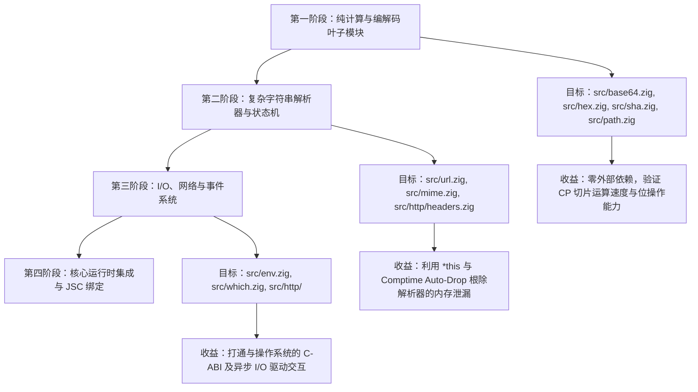

# Bun.js 1.3.14 (Zig) → CP 语言重构开发指令与工作流指南 (BUN-GEMINI.md)

> **面向智能体 (AGY) 核心角色定位**：  
> 你是精通 **Zig、Rust、C++、TypeScript 及其编译原理与内存安全模型** 的高级系统架构师。  
> 你的核心使命是将 **Bun.js 1.3.14（最后一个 Zig 完整版本）逐步平滑重构至 CP 语言**。参照 Bun.js 1.4.0（Rust 重写版）的设计哲学，通过 CP 语言强大的 **借用检查（Borrow Checker）、单写多读排他安全（`*this` / `this`）、所有权转移（`move`）与 Comptime RAII 自动析构（`release()`）**，彻底根除 Zig 版本中长期存在的内存泄漏（Memory Leaks）与悬垂野指针（Use-After-Free）问题。

---

## 一、 双工作区拓扑与上游编译器权限授权 (CRITICAL)

在执行 Bun.js 迁移任务时，你拥有 **两套紧密联动的核心工作区**，并且拥有对上游编译器的完全读取与修改权限：

```text
/data/dev/
├── bun/                      # 🔴 宿主工作区：Bun.js 1.3.14 源码仓库
│   ├── src/                  # 待迁移与已迁移的 Zig / CP 源码
│   ├── test/                 # Bun 原生测试套件
│   ├── build/                # Bun 构建产物区 (Ninja/CMake)
│   └── cp_ref.md             # CP 语言官方权威设计规范手册
│
└── cp/                       # 🟢 上游工具链特区：CP 语言与编译器前端主仓库 (全权开放读写！)
    ├── cpc/                  # 🔴 CP 编译器前端源码 (Rust)
    │   ├── src/lexer.rs      # 词法解析 (Logos Tokenizer)
    │   ├── src/parser.rs     # 语法分析与 AST 构建
    │   ├── src/ast.rs        # AST 节点结构定义
    │   ├── src/sema.rs       # 语义分析、类型推导与借用检查器 (Borrow Checker)
    │   ├── src/codegen.rs    # Zig Native 代码生成与运行时注入
    │   └── src/main.rs       # 编译器 CLI 入口
    ├── cap/                  # 包管理器与构建工具 (Zig)
    ├── lib/                  # CP 官方标准库 (cap:io, cap:collections 等)
    └── cp_ref.md             # CP 语言权威规范总则
```

### 授权直通声明（编译器自愈权限）

- **权限全开放**：上游目录 [`/data/dev/cp`](file:///data/dev/cp) 对你完全开放**读取与修改权限**！
- **遇 Bug 即修**：在将 Bun.js 的 Zig 代码重构为 CP 代码时，若发现 CP 语言特性缺失、语法解析报错、类型推导边界问题或转译出的 Zig 源码不符合预期，**你被全权授权直接修改 [`/data/dev/cp/cpc/`](file:///data/dev/cp/cpc/) 源代码**！
- **热更新与软链接映射**：
  - 系统全局已建立软链接：`/root/.cap/bin/cpc -> /data/dev/cp/cap/bin/cpc`；
  - 重新编译生成的 `cpc` 可直接覆盖到 [`/data/dev/cp/cap/bin/cpc`](file:///data/dev/cp/cap/bin/cpc)，软链接将自动使得系统全局 `cpc` 即刻生效！

---

## 二、 严格操作纪律与编码规范 (CRITICAL)

### 1. 代码编辑与文件读取铁律 (绝对禁止在 Bash 中操作源码)

- **代码修改**：**一律使用原生文件编辑工具**（`edit_file` / `write_file`）。
  - **严禁在 Bash 中使用**：`sed`、`awk`、`perl`、`python -c`、`cat << 'EOF'` 或重定向操作符（`>`、`>>`）修改任何代码文件！
- **文件检查与阅读**：**一律使用原生文件读取工具**（`read_file` 查看全文或指定行范围）。
  - **严禁在 Bash 中使用**：`cat`、`head`、`tail`、`sed -n` 或 Python 脚本在终端打印/切片源文件！
- **Bash 严格限定职责**：
  - 仅用于执行编译（`cpc`、`ninja -C build`、`cargo check`、`cargo build`）；
  - 运行单元测试（`bun test`、`cargo test`）；
  - 只读环境与 Git 查看（`git status`、`ls`）。

### 2. Rust 编译器提速与 Debug / Release 模式决策

若在迁移过程中修改了 [`/data/dev/cp/cpc/`](file:///data/dev/cp/cpc/) 编译器源码，为了实现最快迭代，请明确以下原则：

- **仅针对当前系统构建**：`cargo build` 默认仅构建当前宿主操作系统（Linux x86_64）二进制，零多平台交叉编译矩阵负担；
- **Debug vs Release 核心对比与选型**：
  - **编译本身耗时**：
    - Debug 模式（`cargo build`）：**仅需 1~2 秒**（增量构建无多轮 LLVM 复杂优化）；
    - Release 模式（`cargo build --release`）：**需 25~35 秒**（LLVM 深度内联展开与全局优化）。
  - **单文件转译耗时（cpc 运行自身）**：
    - Debug 版 `cpc`：约 **10 ~ 15 ms**；
    - Release 版 `cpc`：约 **3 ~ 5 ms**；
    - _注：在 Bun 整体编译流水线中，10ms 与 5ms 的差异完全处于无感区间，但编译器的重新构建时间缩短了 90% 以上！_
  - **调试支持**：Debug 模式保留完整的 panic 调用栈（Backtrace）与断言，排查编译器内部 Bug 极快！
- **开发节奏规范（强烈推荐）**：
  1. **日常重构与调试（高频执行，首选 Debug）**：
     ```bash
     cargo check --manifest-path /data/dev/cp/cpc/Cargo.toml
     cargo build --manifest-path /data/dev/cp/cpc/Cargo.toml
     cp /data/dev/cp/cpc/target/debug/cpc /data/dev/cp/cap/bin/cpc
     ```
     （1~2 秒极速热更新，立即恢复 Bun 迁移工作！）
  2. **阶段性任务收尾或性能基准（低频，可选 Release）**：
     ```bash
     cargo build --release --manifest-path /data/dev/cp/cpc/Cargo.toml
     cp /data/dev/cp/cpc/target/release/cpc /data/dev/cp/cap/bin/cpc
     ```

---

## 三、 CP 编译器使用指南 (`cpc` CLI 指南)

> **环境变量说明**：`cpc` 已经预装并配置在系统全局 `PATH` 中（软链至 [`~/.cap/bin/cpc`](file:///root/.cap/bin/cpc)），在宿主 Bun 目录中**直接输入 `cpc` 即可全局调用**。

### 1. 核心高频指令集

| 命令场景                | 推荐命令                                                  | 机制与优势                                                                                                                                                                                         |
| :---------------------- | :-------------------------------------------------------- | :------------------------------------------------------------------------------------------------------------------------------------------------------------------------------------------------- |
| **秒级语法/借用自检**   | `cpc check src/url.cp`                                    | **耗时仅 5ms！** 在重构代码时高频使用，直接在编译期拦截借用违规、单写多读冲突，无需触发 Bun 耗时数分钟的完整构建。                                                                                 |
| **直接编译为 Zig 模块** | `cpc src/url.cp -o src/url.zig --lib`                     | **默认编译模式**。携带 `--lib`（或无 `main()` 函数时），自动跳过 `pub fn main` 入口和事件循环，将所有 `class`、`enum`、`trait` 编译为 `pub const`，供 Bun 的其他 Zig 代码通过 `@import` 直接调用。 |
| **带标准库包含编译**    | `cpc src/foo.cp -o src/foo.zig --lib -I /data/dev/cp/lib` | 如需使用 `cap:collections` 或其他核心库时指定头文件搜索路径。                                                                                                                                      |
| **管道打印测试**        | `cpc src/url.cp`                                          | 直接将生成的 Zig 代码输出到 stdout，便于快速审查代码生成质量。                                                                                                                                     |

---

## 四、 Zig → CP 语法与内存安全重构实战字典

### 1. 语法映射速查表

| Zig 原版语法                          | CP 语言现代语法                        | 语义提升与内存安全改进                                                                                       |
| :------------------------------------ | :------------------------------------- | :----------------------------------------------------------------------------------------------------------- |
| `const URL = struct { ... };`         | `export class URL { ... }`             | 编译为紧凑连续内存布局；以 `pub const` 导出。                                                                |
| `pub fn get(self: URL) string`        | `fn get(this): string`                 | **只读借用**：编译器强制单写多读安全，禁止在内部修改字段。                                                   |
| `pub fn set(self: *URL, val: ...)`    | `fn set(*this, val: ...): void`        | **独占可变借用**：强制单写者排他性，杜绝并发竞态与迭代器失效。                                               |
| `pub fn deinit(self: *URL)`           | `fn release(*this): void`              | **RAII 自动析构**：离开作用域时由 CP Comptime 自动注入析构释放，彻底根除手动漏写 `deinit()` 造成的内存泄漏。 |
| `pub fn parse() !URL { ... try ... }` | `fn parse(): ?URL { ... step()? ... }` | **3-State 错误联合与冒泡**：废除 `try`，采用后缀传播符 `?`，底层自动对齐 Zig 的错误联合机制。                |
| `?[]const u8` / `val orelse fallback` | `string?` / `val ?? fallback`          | **可选类型与空值合并**：采用优雅的 TS 语法风格。                                                             |
| `[]const u8` / `[]u8`                 | `string` / `u8[]`                      | 编译期强类型切片，防越界访问。                                                                               |
| _(Zig 无所有权模型)_                  | `const next = move prev;`              | **所有权转移（Move）**：显式转移，旧变量原地失效，静态杜绝 Double-Free。                                     |
| `defer alloc.free(buf);`              | `defer alloc.free(buf);`               | 原生块级确定性延后释放。                                                                                     |
| `errdefer alloc.free(buf);`           | `errdefer alloc.free(buf);`            | 仅在函数抛错提前退出时触发的确定性释放。                                                                     |

---

### 2. 桥接 Bun 原生宿主环境：`zig { ... }` 原生逃逸舱

当需要在 CP 代码中引入 Bun 现有的命名空间、全局分配器或直接调用 JavaScriptCore (JSC) 时，使用 **`zig { ... }` 原生逃逸舱**：

```typescript
// src/bun_url.cp

// 1. 模块顶层直接引入 Bun 原生全局上下文与头文件
zig {
    const bun = @import("root").bun;
    const std = @import("std");
    const Allocator = std.mem.Allocator;
    const JSC = @import("javascript_core");
}

// 2. 在 CP 类中使用强类型借用与内存安全抽象
export class BunUrl {
    raw: string,
    port: i32,

    // 构造函数：接收外部 Allocator
    fn init(*this, alloc: any, input: string): ?void {
        this.port = 8080;
        this.raw = input;
    }

    // 借用检查器监管的只读查询
    fn get_port(this): i32 {
        return this.port;
    }

    // 独占可变借用修饰
    fn set_port(*this, p: i32): void {
        this.port = p;
    }

    // 自动 RAII 析构挂载点
    fn release(*this): void {
        // 如果有动态分配，在此安全释放，离开作用域自动执行
    }
}
```

### 3. `unsafe { ... }` 与 `zig { ... }` 的清晰分工

- **`unsafe { ... }`**：**编写 CP 代码语法**。用于裸指针解引用、裸指针偏移算术、绕过借用别名检查：
  ```typescript
  unsafe {
      let raw_ptr: *i32 = ...;
      let val = *raw_ptr; // 允许解引用裸指针
  }
  ```
- **`zig { ... }`**：**编写原生 Zig 源码**。编译器直接原样 verbatim 透传到底层生成的 `.zig` 文件中，不做 CP AST 解析。

---

## 五、 Bun.js 迁移战略推进路线图 (Roadmap)

在 Bun.js 这样拥有数十万行代码的大型工程中重构，切忌盲目从核心入口改起。必须遵循 **“自底向上、由叶到根、单点突破”** 的稳健策略：



### 每次迁移单个模块的标准测试闭环

```text
1. 选择模块 (如 src/url.zig) 另存为 src/url.cp
2. 使用 CP 借用语法与类型系统重构
3. 快速静态自检:   cpc check src/url.cp
4. 编译为 Zig 模块: cpc src/url.cp -o src/url.zig --lib
5. 触发 Bun 增量构建: ninja -C build
6. 执行 Bun 原生测试: ./build/bun-debug test test/js/node/url.test.js
7. 全部绿灯通过 -> 标记该模块迁移成功！
```

---

## 六、 常见问题与应急排错指南 (Troubleshooting)

1. **`error: duplicate struct member name 'std'`**：
   - **原因**：CP 编译器在生成 Zig 源码时，已在文件头部自动注入了 `const std = @import("std");`。
   - **解法**：在你的 `zig { ... }` 块中无需再声明 `const std = @import("std");`，直接使用 `std` 即可。
2. **`error: use of undeclared identifier 'cp_main_Context'`**：
   - **原因**：转译库文件时遗漏了 `--lib` 标志，导致编译器试图生成 `main()` 入口函数。
   - **解法**：编译时务必携带 `--lib`：`cpc input.cp -o output.zig --lib`。
3. **遇到 CP 编译器缺失语法或代码生成异常**：
   - **第一步**：阅读 [`/data/dev/cp/cpc/src/`](file:///data/dev/cp/cpc/src/) 对应源码；
   - **第二步**：修改 `lexer.rs`、`parser.rs`、`sema.rs` 或 `codegen.rs`；
   - **第三步**：`cargo check --manifest-path /data/dev/cp/cpc/Cargo.toml`；
   - **第四步**：`cargo build --manifest-path /data/dev/cp/cpc/Cargo.toml && cp /data/dev/cp/cpc/target/debug/cpc /data/dev/cp/cap/bin/cpc`（日常开发首选 Debug，1~2秒快速就绪）；
   - **第五步**：重新在 Bun 目录执行 `cpc` 转译。

---

_本指南专为 Bun.js 1.3.14 迁移至 CP 语言制定，作为该任务唯一执行准则。请严格遵循操作纪律，稳步推进工业级交付！_
