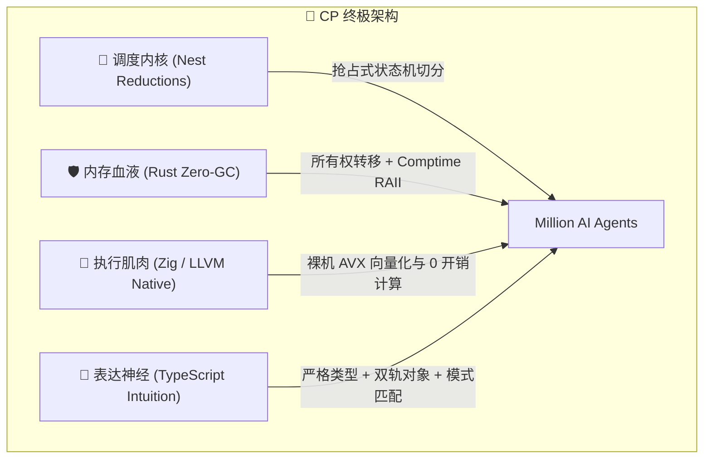

# CP (Concurrent Plus) & CAP (Concurrent Application Plus)

```text
  ██████╗ ██████╗
 ██╔════╝ ██╔══██╗   CP : Concurrent Plus
 ██║      ██████╔╝   The Native Systems Language for the Multi-Agent Era
 ██║      ██╔═══╝    [ TS Syntax • Zero GC • Nest Actor • Native Speed ]
 ╚██████╗ ██║
  ╚═════╝ ╚═╝
```

```text
  ██████╗      ██╗     ██████╗
 ██╔════╝     ████╗    ██╔══██╗   CAP : Concurrent Application Plus
 ██║         ██╔═██╗   ██████╔╝   The All-in-One AI Agent & Native Systems Toolchain
 ██║        ██╔╝ ╚██╗  ██╔═══╝    [ Package Manager • Compiler • Runner • Test • Bench ]
 ╚██████╗  ██╔╝   ╚██╗ ██║        ^ (Upward Arrow) Linking C & P as the Letter 'A' (Application)
  ╚═════╝  ╚═╝     ╚═╝ ╚═╝
```

<p align="center">
  <strong>专为百万级高并发 AI Agent、系统服务与边缘计算而生的下一代原生编程语言与统一工具链</strong>
</p>

<p align="center">
  <a href="#-为什么选择-cp-语言核心痛点与终极解法">哲学与愿景</a> •
  <a href="#-核心优势四位一体极致架构">四位一体架构</a> •
  <a href="#-代码速览一睹为快">代码速览</a> •
  <a href="#-极速安装与环境配置">快速安装</a> •
  <a href="#-cap-统一工具链开发工作流">CAP 工具链</a> •
  <a href="#-主流语言对比全景矩阵">横向对比</a> •
  <a href="cp_ref.md">技术白皮书</a>
</p>

---

## 🌟 起源

已经有Rust、Go、Typescript、JavaScript、Python、C、C++、C#、Java和Zig，还需要新的编程语言吗？

实现大容量、高并发、高稳定的AI智能体开发，必须一个新的语言和编译器，在编译时通过插桩，实现抢占式协程调度，这样在一个智能体死循环时，强行让权，不会影响其他智能体正常运行，从而能实现百万级智能体云端并发运行。

这是创造cp语言的原始起源。

另外，我们在开发系统级后端服务时，基于安全及性能考虑，好像只有Rust可选，其他语言都不安全，容易内存泄露、崩溃。

比如最近软件界发送的大事件：2026年5月14日，Bun官方将写了五年之久的53万行Zig代码，借助AI用Rust重写，并在2026年8月正式发布了全Rust架构的Bun v1.4.0。

迁移的原因是，Zig 缺乏编译期所有权模型和 RAII，当代码库膨胀到 50 多万行时，错误分支中的“忘记释放”和生命周期错乱防不胜防，内存泄漏（Memory Leaks）、段错误（Segfaults）以及大量 UAF（Use-After-Free）问题，让人心力交瘁；特别是作为Claude Code运行底座，Zig版本内存会失控飙升到6.7GB 以上，而Rust 版本稳定平稳在约600MB，彻底解决了常年困扰团队的内存泄漏顽疾。

而Rust并不完美，语法对传统程序员不友好，学习曲线陡峭，特别是生命周期标注，让传统程序员费解。因此很多智能体应用，如 Claude Code、Agy（谷歌）、OpenClaw等，都是基于Typescript研发，Typescript 语法对程序员友好，上手容易。

但Typescript是脚本语言，其应用在V8/JSC中解释执行，效率低、内存消耗大、单线程，所以Claude Code、Agy、OpenClaw等都是单机版，无法在一台服务器上运行一百万个Claude Code、Agy、OpenClaw。

有没有一种语言，语法类似Typescript的易学易用，内存安全类似Rust，不依赖虚拟机，能编译为机器码，高并发、高性能运行在全平台（各种操作系统）上，这样即可以高效开发系统级应用，也能高效开发业务应用，同时还能高效开发智能体应用。

有，这个语言就是CP(Concurrent Plus)。

CP作为一门新语言，稳定吗？

CP并非重新造轮子，类似Babel、SWC将Typescript、ES6编译为ES5，CP将代码编译为Zig代码，通过Zig实现全平台机器码编译。

因此，CP的稳定性完全基于稳定与高性能的Zig。Typescript给JavaScript加了类型，来增强稳定性。CP给Zig加了内存检查，来避免内存泄露，如果使用CP来编写Bun，Bun就不用迁移到Rust。

## 🌟 什么是 CP 与 CAP？

- **CP (Concurrent Plus)**：并发与智能体时代的 C/C++ 家族正统继任者。它融合了 **TypeScript 的直觉表达力**、**Rust 的无 GC 编译期内存安全**、**Nest 的抢占式 Actor 协程海并发**，以及 **Zig 的裸机暴力计算与即时跨平台编译**。
- **CAP (Concurrent Application Plus)**：CP 语言的统一命令行基础设施与全场景应用构建平台（对标 Bun 之于 TS、Cargo 之于 Rust）。以向上跃升之矢 **`^` 代替字母 `A` 连接 `C` 与 `P`**，拼出 `CAP`，象征着从语言规范向百万级 Agent、微服务、CLI 与嵌入式应用程序交付的终极跃迁。

---

## 🎯 为什么选择 CP 语言？核心痛点与终极解法

在当今的大模型与 Multi-Agent（多智能体）时代，现有主流编程语言均面临无法兼顾的**“物理死穴”**：

| 语言          | 开发者面临的痛点与瓶颈                                                                                                              | CP (Concurrent Plus) 的突破解法                                                                                              |
| :------------ | :---------------------------------------------------------------------------------------------------------------------------------- | :--------------------------------------------------------------------------------------------------------------------------- |
| **Python**    | **GIL 线程锁导致并发瘫痪**；动态弱类型与运行时异常频发；单机进程动辄消耗数 GB 显存/内存；Docker 镜像高达数 GB，无法上边缘设备。     | **彻底抛弃 GIL**；原生 Nest 抢占式调度器单机并发百万 Agent；输出仅数 MB 独立静态二进制，零运行时依赖。                       |
| **Node / TS** | **单线程事件循环机制**：处理 Token 解析或大张量时主线程完全卡死；长周期运行的 Agent 极易发生 V8 堆内存泄漏与 GC 卡顿。              | **CPS 状态机切分**：遇到 `await` 或异步计算自动出让 CPU 权；编译期 RAII 自动释放内存，**彻底消除 GC 停顿**。                 |
| **Go**        | 协程为非抢占/协作式，密集循环下调度饥渴；**Stop-The-World 全局垃圾回收**在海量连接时产生不可控的长尾时延；缺少原生 Actor 隔离信箱。 | **基于 Reductions（规约计数）的物理强制抢占**；每个 Agent 拥有完全隔离的独立信箱与生命周期，杜绝跨协程内存争用。             |
| **Rust**      | 借用检查器（Borrow Checker）学习曲线极其陡峭；异步 Future 状态机嵌套复杂；开发周期长，难以适应 AI 业务的高速演进。                  | **TS 般优雅直觉的语法书写**；编译器在后台静默完成借用冲突分析与 Drop Flag 反射注入，享受 Rust 级内存安全，免除复杂心智负担。 |
| **Erlang**    | 语法晦涩古老，缺乏类型系统；**数学与数值计算极其弱鸡**，处理 AI 向量或大矩阵时力不从心。                                            | **Zig/LLVM 原生暴力执行引擎**；内建 AVX-512 / NEON 向量化指令直通，原生支持千万级大张量零拷贝共享堆（`SharedTensor`）。      |

---

## ⚡ 核心优势：四位一体极致架构

CP 采用“**脑、神经、肌肉、血液**”四位一体机制：



1. **🧠 调度内核 (Nest Reductions)**：
   每个 Actor 协程分配固定 Reductions（规约点）。遇到计算死循环或 `await`，物理切断当前函数控制权，保存上下文至 CPS 状态机，安全让权，绝不阻塞工作线程。
2. **🛡️ 内存血液 (Rust-Level Zero GC)**：
   - 彻底废除 Stop-the-world 垃圾回收器。
   - 严格所有权转移（`move` 语法）与排他借用检查（`&` 与 `&mut`）。
   - **编译器黑魔法**：基于 Zig Comptime Reflection 在后台自动注入 `defer`/`errdefer` 释放代码，不写显式释放也不泄漏。
3. **💪 执行肌肉 (Zig / LLVM Native)**：
   直接转译为极致优化的底层原生机器码，零虚表开销，无额外运行时抽象，直达 CPU 寄存器与 SIMD 指令集。
4. **🎨 表达神经 (TypeScript Intuition)**：
   熟悉的 `let`/`const`、箭头函数、模板字符串、解构赋值与模式匹配。彻底废除 `any`、隐式类型转换与混乱的原型链。

---

## 💻 代码速览：一睹为快

### 1. 原生 Actor 并发与消息信箱 (`@spawn`, `@receive`, `@reply`)

轻松在单机并发拉起上万个智能体，拥有独立隔离信箱，告别死锁与数据竞争：

```typescript
// 声明一个 Agent 响应状态机
function agent_worker(): void {
    @receive {
        { type: "ping", sender: pid } => {
            @print("Agent received ping from: {}", pid);
            @reply(pid, { type: "pong", payload: 200 });
        },
        { type: "stop" } => {
            @print("Agent gracefully stopping...");
            return;
        }
    }
}

fn main(): void {
    // 瞬时并发拉起智能体协程
    const agent_pid = @spawn(agent_worker);
    @send(agent_pid, { type: "ping", sender: @self() });
}
```

### 2. 对标 Bun.js 的原生极速 HTTP 微服务 (`serve`)

内建超高吞吐 HTTP 反应堆，支持路径匹配与 JSON 自动序列化：

```typescript
import { serve, Response, json } from "cap:http";

serve({
    port: 3000,
    fetch(req) {
        if (req.path == "/api/status") {
            return json(#{
                status: "online",
                runtime: "Nest",
                agents_alive: 1000000
            });
        }
        return new Response("Hello, Concurrent Plus!", 200);
    }
});

@print("Server running at http://localhost:3000 🚀");
```

### 3. AI 大模型向量与张量零拷贝共享堆 (`SharedTensor`)

跨 Agent 传递百兆大文本或模型权重时，Message 仅传递指针与原子引用计数，零内存复制：

```typescript
import { SharedTensor } from "cap:mem";

fn process_weights(): ?void {
    const tensor = new SharedTensor()?;
    tensor.init(1024 * 1024 * 100); // 100MB 缓冲区
    tensor.retain(); // 原子引用计数 +1

    // 显式所有权安全移交 (单写者保证)
    const moved = move tensor;
    defer moved.release();

    @print("Tensor capacity: {} bytes", moved.get_size());
}
```

---

## 🏗️ Monorepo 模块架构

```text
cp-lang/cp
├── cpc/              # 🔴 编译器前端 (Rust) [Lexer, Parser, AST, Sema, CPS Codegen, LSP]
├── cap/              # 🔵 统一构建工具与包管理器 (Zig) [Runner, Test Runner, Bench, Matrix Build]
├── lib/              # 🟢 系统标准库协议 (cap:io, cap:http, cap:actor, cap:mem, cap:fs)
├── cap/test/         # 🧪 长期系统回归验证用例库
└── cap.json          # ⚙️ 工程核心依赖与构建配置清单
```

---

## 🚀 极速安装与环境配置

二进制产物编译于 `cap/bin/` 目录下，您可通过以下标准方式将其配置为全局命令：

```bash
# 1. 建立用户级工具链沙盒
mkdir -p ~/.cap/bin
ln -sf /data/dev/cp/cap/bin/cap ~/.cap/bin/cap
ln -sf /data/dev/cp/cap/bin/cpc ~/.cap/bin/cpc

# 2. 将 ~/.cap/bin 注入环境变量 PATH
echo 'export PATH="$HOME/.cap/bin:$PATH"' >> ~/.bashrc
source ~/.bashrc

# 3. 验证安装生效
cap help
```

若终端打印出带有向上大箭头 `^` 徽标的 `CAP : Concurrent Application Plus` 控制台，即代表安装成功！

---

## 🛠️ CAP 统一工具链开发工作流

`cap` 提供了比肩 `bun`、超越 `cargo`/`npm` 的丝滑全流程 CLI：

### 1. 日常即时极速调试 (`cap <file>` / `cap run`)

对标 `bun run`，底层使用 Zig 的 `Debug` 模式毫秒级转译并直接启动运行：

```bash
cap cap/test/hello.cp
# 或显式执行：
cap run cap/test/hello.cp
```

### 2. 原生生产级构建 (`cap build`)

编译为带内存安全检查与栈保护的原生独立二进制（产物位于 `bin/`）：

```bash
cap build cap/test/hello.cp
# 执行产物：
./bin/cap/test/hello
```

### 3. 多级增量编译与耗时度量 (0ms 跳过未变动)

`cap` 内建高精度时间度量体系，并自动根据源码与二进制 `mtime` 进行增量跳过：

```text
Building: cap/test/hello.cp (Mode: ReleaseSafe)...
  → [cpc] Transpiled in 2ms
  → Compiling for Native (ReleaseSafe)...
  ✓ Built Native in 16.15s
Build completed in 16.16s! Artifacts in bin/

# 第二次敲击（未修改源码）：
Building: cap/test/hello.cp (Mode: ReleaseSafe)...
  → [Up-to-date] Output binaries are up to date (skipped)
Build completed in 0ms! Artifacts in bin/
```

### 4. 极限速度 (`-f`) 与极限小体积 (`-s`)

- **ReleaseFast 模式**（榨干机器算力，开启全部向量化）：
  ```bash
  cap build -f cap/test/hello.cp
  ```
- **ReleaseSmall 模式**（极限剔除符号与体积优化，专用于边缘嵌入式工控机）：
  ```bash
  cap build -s cap/test/hello.cp
  ```

### 5. 跨平台矩阵发布 (`cap build -r`)

单机一口气编译输出包含 macOS (Apple Silicon/Intel)、Linux (x86_64/ARM64)、Windows 全套二进制矩阵：

```bash
cap build -r
```

### 6. 一键安全清理构建缓存 (`cap clean`)

彻底安全地清除 `.cap/zig/`（转译中间态）、`.cap/zig-cache/`（编译器缓存）以及 `bin/`（构建产物）：

```bash
cap clean
```

清理后再次执行 `cap build` 将执行 100% 全量纯净编译。如需强制全量编译也可随时传入 `-B`：

```bash
cap build -B cap/test/hello.cp
```

### 7. 单元测试与微基准评测 (`cap test` / `cap bench`)

- **运行测试套件**（对标 `bun test`）：
  ```bash
  cap test
  ```
- **运行高精度微秒基准测试**：
  ```bash
  cap bench cap/test/hello.cp
  ```

---

## 📊 主流语言对比全景矩阵

| 评估维度                | Python                    | Node.js (V8)            | Go                    | Rust                   | **CP (Concurrent Plus)**               |
| :---------------------- | :------------------------ | :---------------------- | :-------------------- | :--------------------- | :------------------------------------- |
| **语法风格**            | 缩进语法                  | TypeScript / JS         | 类 C 过程式           | 复杂系统级             | **TypeScript 风格优雅直觉**            |
| **内存管理机制**        | 引用计数 + 周期 GC        | V8 世代标记清除 GC      | 并发三色标记 GC       | 所有权静态检查         | **所有权 + 编译期注入 RAII (Zero GC)** |
| **GC 停顿 (STW)**       | 有 (不可控)               | 有 (堆大时长)           | 毫秒级偶发停顿        | **完全无 GC**          | **完全无 GC (0 停顿)**                 |
| **并发基础模型**        | GIL 单线程 (假并发)       | 异步单线程 EventLoop    | 协作式 CSP Goroutine  | 操作系统线程 / Future  | **抢占式 Nest Actor 协程海**           |
| **单机并发 Agent 上限** | ~ 1,000                   | ~ 10,000                | ~ 100,000             | ~ 500,000              | **1,000,000+ (极轻量隔离)**            |
| **大张量传递成本**      | 序列化跨进程复制          | 跨 Worker 序列化拷贝    | 共享内存需手动加锁    | 指针传递需生命周期约束 | **`SharedTensor` 硬件原子零拷贝**      |
| **独立二进制交付**      | ❌ 需依赖整套 Python 环境 | ❌ 需 Node 运行时或大包 | ✅ 静态二进制 (15MB+) | ✅ 静态二进制 (几MB)   | **✅ 独立静态二进制 (仅数 MB)**        |
| **边缘嵌入式支持**      | 差                        | 极差                    | 一般                  | 极佳                   | **极佳 (继承 Zig 裸机底座)**           |

---

## 📖 官方文档与参考规范

欲深入了解类型系统、模式匹配、借用检查与标准库详细规范，请参阅本代码库官方权威文档：

- 📚 **[CP 语言设计规范与技术白皮书 (cp_ref.md)](file:///data/dev/cp/cp_ref.md)**
- 📝 **[工程更新日志 (CHANGELOG.md)](file:///data/dev/cp/CHANGELOG.md)**
- 🧠 **[架构演化决策记录 (DEVLOG.md)](file:///data/dev/cp/DEVLOG.md)**

---

<p align="center">
  <sub>CP Architecture • Designed with ❤️ for High-Concurrency AI Agents</sub>
</p>
