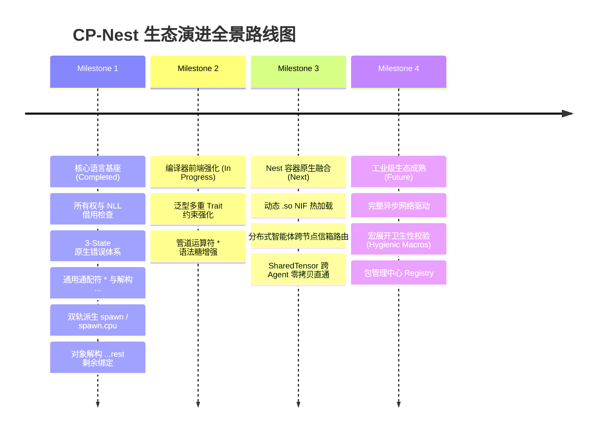

# CP-Nest 语言设计规范与技术白皮书 (The CP-Nest Language Specification)

**版本**：v0.4.0  
**定级**：工业级官方参考规范手册与底层架构指南 (The Definitive Reference Manual)  
**定位**：TypeScript 的直觉表达力 + Rust 的内存安全 + Zig 的极致底层掌控力与无 GC 暴力并发，专为百万级 AI Agent 并发设计的系统级智能体语言。

---

## 目录索引 (Table of Contents)

- [第一篇：CP 语言哲学、架构愿景与工程基座 (Philosophy, Architecture & Cap CLI)](#第一篇cp-语言哲学架构愿景与工程基座)
  - [1.1 核心设计定位](#11-核心设计定位)
  - [1.2 构建与包管理器 cap 全指令矩阵](#12-构建与包管理器-cap-全指令矩阵)
  - [1.3 cap.json 配置规范与语义化依赖声明](#13-capjson-配置规范与语义化依赖声明)
  - [1.4 模块系统与依赖解析引擎](#14-模块系统与依赖解析引擎)
- [第二篇：类型系统、不可变哲学与双轨对象模型 (Types, Immutability & Objects)](#第二篇类型系统不可变哲学与双轨对象模型)
  - [2.1 标量基础类型系统](#21-标量基础类型系统)
  - [2.2 复合容器类型](#22-复合容器类型)
  - [2.3 变量可变性与不可变哲学](#23-变量可变性与不可变哲学)
  - [2.4 双轨对象模型（静态匿名对象 vs 动态字典对象）](#24-双轨对象模型静态匿名对象-vs-动态字典对象)
- [第三篇：解构赋值与 switch 模式匹配体系 (Destructuring & Switch Matching)](#第三篇解构赋值与-switch-模式匹配体系)
  - [3.1 数组与元组解构体系](#31-数组与元组解构体系)
  - [3.2 对象解构体系](#32-对象解构体系)
  - [3.3 switch 原生模式匹配体系](#33-switch-原生模式匹配体系)
  - [3.4 守卫条件表达式与穷尽性检查](#34-守卫条件表达式与穷尽性检查)
- [第四篇：函数系统与参数方法契约 (Function System & Method Contracts)](#第四篇函数系统与参数方法契约)
  - [4.1 函数修饰符与前缀矩阵](#41-函数修饰符与前缀矩阵)
  - [4.2 形参借用与所有权语义规范](#42-形参借用与所有权语义规范)
  - [4.3 方法接收者（Receiver）终极哲学](#43-方法接收者receiver终极哲学)
  - [4.4 返回值类型与省略原则](#44-返回值类型与省略原则)
- [第五篇：所有权、借用检查与内存安全架构 (Ownership, Borrowing & Memory Safety)](#第五篇所有权借用检查与内存安全架构)
  - [5.1 移动语义（Move Semantics）与单写者安全](#51-移动语义move-semantics与单写者安全)
  - [5.2 严格别名排他律（Aliasing XOR Mutability）](#52-严格别名排他律aliasing-xor-mutability)
  - [5.3 容器写保护铁律（Container Mutation Guard）](#53-容器写保护铁律container-mutation-guard)
  - [5.4 结构体生命周期、非词法作用域（NLL）与自动化析构](#54-结构体生命周期非词法作用域nll与自动化析构)
  - [5.5 跨越 await 的资源生命周期安全](#55-跨越-await-的资源生命周期安全)
  - [5.6 闭包逃逸与 Arena 作用域内存生命周期](#56-闭包逃逸与-arena-作用域内存生命周期)
- [第六篇：面向对象与契约解耦体系 (OOP, Structs, Classes & Traits)](#第六篇面向对象与契约解耦体系)
  - [6.1 数据与行为彻底解耦哲学](#61-数据与行为彻底解耦哲学)
  - [6.2 类单继承与完整生命周期钩子](#62-类单继承与完整生命周期钩子)
  - [6.3 Trait 契约体系](#63-trait-契约体系)
  - [6.4 泛型与 Trait 约束](#64-泛型与-trait-约束)
  - [6.5 动态分发胖指针与运行时向下转型](#65-动态分发胖指针与运行时向下转型)
- [第七篇：原生三态错误处理体系 (3-State Error Handling Architecture)](#第七篇原生三态错误处理体系)
  - [7.1 终结传统 Result/Option 胶水装箱](#71-终结传统-resultoption-胶水装箱)
  - [7.2 错误返回值构建与模式匹配](#72-错误返回值构建与模式匹配)
  - [7.3 错误传播链与解包原语](#73-错误传播链与解包原语)
  - [7.4 异常作用域与块级捕获](#74-异常作用域与块级捕获)
  - [7.5 业务层统一 Error 类](#75-业务层统一-error-类)
  - [7.6 胖指针动态错误与错误集自动转换](#76-胖指针动态错误与错误集自动转换)
- [第八篇：现代语法糖与函数式特性 (Modern Syntax Sugar & Functional)](#第八篇现代语法糖与函数式特性)
  - [8.1 管道操作符与通用通配占位符](#81-管道操作符与通用通配占位符)
  - [8.2 多模式现代集合遍历](#82-多模式现代集合遍历)
  - [8.3 范围表达式与切片语法](#83-范围表达式与切片语法)
  - [8.4 字符串模板插值与原生正则表达式](#84-字符串模板插值与原生正则表达式)
- [第九篇：异步编程、双轨并行计算与 Nest 智能体容器 (Async, Dual-Track Parallel & Nest Runtime)](#第九篇异步编程双轨并行计算与-nest-智能体容器)
  - [9.1 CPS 状态机异步内核](#91-cps-状态机异步内核)
  - [9.2 双轨派生模型：协程池与 Worker 物理线程池](#92-双轨派生模型协程池与-worker-物理线程池)
  - [9.3 并发运行时配置体系（注解与 cap.json）](#93-并发运行时配置体系注解与-capjson)
  - [9.4 跨并发边界内存安全防御（Send/Sync 铁律）](#94-跨并发边界内存安全防御sendsync-铁律)
  - [9.5 异步任务流与事件循环](#95-异步任务流与事件循环)
  - [9.6 Nest 智能体容器（Nest Agent Container / Nest Runtime）](#96-nest-智能体容器nest-agent-container--nest-runtime)
- [第十篇：元编程、编译期计算与底层控制 (Metaprogramming, Comptime & Unsafe)](#第十篇元编程编译期计算与底层控制)
  - [10.1 编译期代码执行块（!{ } Comptime）](#101-编译期代码执行块--comptime)
  - [10.2 宏系统（Macro Metaprogramming）](#102-宏系统macro-metaprogramming)
  - [10.3 自定义元注解与类/方法装饰器](#103-自定义元注解与类方法装饰器)
  - [10.4 运行时与编译期反射系统](#104-运行时与编译期反射系统)
  - [10.5 底层控制与 unsafe 安全边界](#105-底层控制与-unsafe-安全边界)
- [第十一篇：标准库索引与生态路线图 (Standard Library & Ecosystem Roadmap)](#第十一篇标准库索引与生态路线图)
  - [11.1 已实装官方核心标准库索引（cap:*）](#111-已实装官方核心标准库索引cap)
  - [11.2 生态演进与路线图（Roadmap）](#112-生态演进与路线图roadmap)

---

# CP 语言规范 · 开篇

> CP(C Plus / Concurrent Plus)：一门基于Zig、拥有Rust级内存安全、语法贴近TypeScript/ES6的全平台编译型系统语言，兼顾易用、安全与底层高性能, 特别适合高并发智能体编程。

> CP 底层基于 Zig 构建，继承 Zig 强大的编译期计算、跨平台交叉编译、C 互操作与无运行时能力；借鉴 Rust 的所有权与借用检查保障默认内存安全；同时采用贴近 TypeScript/ES6 的简洁语法，提供解构、模式匹配、管道、注解与装饰器等现代语法特性。

CP 支持渐进式开发：默认安全，通过 `unsafe` 块与内嵌 `zig{}` 代码块提供底层逃逸出口。它不需要虚拟机、没有垃圾回收，编译产出静态单二进制文件。适合高性能后端、CLI 工具、嵌入式固件、Wasm、智能体程序与系统组件开发。目标是让开发者不用在「好写」、「内存安全」、「底层高性能」三者之间做取舍。

## 第一篇：CP 语言哲学、架构愿景与工程基座

### 1.1 核心设计定位

CP (Cloud Protocol / Concurrent Power) 语言专为海量 AI Agent 并发设计，其架构融汇了当今三大现代语言流派的顶峰设计理念：

- **TypeScript 的高生产力与直觉语法**：摒弃冗余的样板代码，结构清晰，贴合现代工程直觉；
- **Rust 的无畏并发与内存安全**：在编译期通过所有权（Ownership）与非词法生命周期（NLL）借用检查，彻底杜绝悬垂指针、Double-Free 与数据竞态；
- **Zig 的无隐藏控制流与底层控制力**：彻底废除垃圾回收器（No GC），将控制权完全还给硬件，编译产物透明切分并编译为 Zig Native 状态机代码，具备百微秒级的启动与纳秒级出让性能。

---

## CP / Rust / Zig / Go / TypeScript 精简对比表

| 项目         | CP                                            | Rust                           | Zig                              | Go                               | TypeScript                 |
| ------------ | --------------------------------------------- | ------------------------------ | -------------------------------- | -------------------------------- | -------------------------- |
| 编译模型     | 编译到 Zig，原生 AOT                          | AOT 原生编译                   | AOT 原生编译                     | AOT，带轻量 runtime              | 转译到 JS，解释执行        |
| 内存管理     | 所有权+借用检查，无GC；显式unsafe             | 所有权+借用检查，无GC          | 手动管理，无默认借用检查         | GC + 逃逸分析                    | JS GC                      |
| 语法风格     | TS/ES6 风，解构、模式匹配、管道               | 自成体系，生命周期、trait 较重 | 极简底层风格，错误类型`!T`       | 简约，语法克制                   | JS 超集，类型标注          |
| 编译期能力   | 继承 Zig comptime，编译期函数、元编程         | 宏 + const 编译期能力          | 原生 comptime，强项              | 编译期能力弱                     | 只有类型层面编译检查       |
| C 互操作     | 直接复用 Zig C 互操作                         | 支持，需要封装                 | 原生一流支持                     | cgo，有开销                      | 通过 JS FFI                |
| 二进制产物   | 静态单文件，体积小、无依赖                    | 静态单文件，体积偏大           | 静态单文件，体积很小             | 静态单文件，runtime 嵌入         | JS 文本                    |
| 安全边界     | 默认安全；`unsafe` / `zig{}` 作为逃逸口       | 默认安全；`unsafe` 逃逸口      | 默认不安全，靠开发者自律         | 内存安全（GC），数据竞争依然存在 | 内存安全，类型仅编译期检查 |
| 核心优势     | 上手简单 + 内存安全 + 底层全能                | 生态成熟，安全体系完善         | 编译速度快、交叉编译一流、无包袱 | 并发模型简单，工程化成熟         | 前端生态，学习门槛低       |
| 主要短板     | 新生语言，生态尚在建设                        | 学习曲线陡峭，生命周期难       | 缺少内置借用检查，语法现代性弱   | GC抖动，缺少强内存安全           | 不适合高性能系统、裸机     |
| 典型主打场景 | Agent智能体、系统工具、后端服务、嵌入式、Wasm | 操作系统、库、高性能服务       | 底层工具、固件、C 替换           | 云原生后端、微服务               | Web 前端、Node.js 业务     |

---

这块已经可以直接粘贴进规范文档。
接下来我们继续吗？可以开始整理【符号总表】章节，或者开始写「设计哲学」小节。

先把CP的核心定位一句话收住：

> CP = 语法贴近TS/ES6、上手友好；拥有Rust式所有权借用安全；编译后端是Zig，直接复用Zig的编译期能力、跨平台、裸机能力、C互操作；同时自带unsafe块 + 内嵌zig块做逃逸出口。
> 它**不是单纯Zig的语法糖包装**，而是在Zig IR之上套一套更现代、更舒服、类型安全更强、所有权模型更清晰的表层语法。
> 基于这个底座，除了你现在主攻的AI智能体/Agent开发之外，下面这些场景是天然有吸引力、能打动不同开发者群体的，我分大类讲清楚、顺带对比竞品痛点：

## 1. 高性能服务后端（替代一部分 Go / C++ / Rust）

痛点现状：

- Go：GC停顿、缺少严格所有权，高并发下大量堆分配、内存抖动；没有强编译期检查；
- Rust：学习曲线陡峭，语法重、生命周期标注折磨新手，很多人喜欢它安全但是写着累；
- C++：内存坑多、各种未定义行为、编译慢；
- Java/C#：依赖重、GC，很难做低延迟、资源紧的服务。

CP优势：

- 所有权借用安全，**没有GC**，和Rust一样内存安全，但是语法是TS风格，好读好写；
- 编译到Zig，天然跨平台、小体积单二进制，不需要虚拟机、不需要runtime；
- 直接复用Zig的C interop，调用C库零成本；
- 自带管道`|>`、ES6风格解构、清晰的模式匹配，业务代码写起来比Rust清爽很多。

适合：网关、消息中间件、时序数据服务、高频RPC服务、代理服务。
吸引人群：想写无GC低延迟服务，但不想啃Rust生命周期、讨厌C++坑的后端。

## 2. CLI工具、开发工具链（替代 Go / Zig）

现在大量CLI是Go写的（比如各种cli、脚手架、代理工具），Go的优势是单文件打包，缺点GC；Zig本身CLI能力很强，但Zig原生语法比较硬核、模板和类型写法不友好。

CP优势：

- 编译产物和Zig一样：静态单文件、无依赖、体积小；
- comptime编译期函数、元编程能力继承Zig；
- 装饰器、注解、宏体系更现代，TS风格，写命令行参数解析、代码生成器、linter、脚手架比原生Zig舒服；
- 所有权安全，处理流、大文件、管道数据不容易内存泄漏。

适合：代码生成器、静态分析工具、CLI运维工具、文件处理工具、自定义构建工具。
吸引人群：Zig爱好者、工具作者，厌倦Go GC、又觉得Zig原生语法不够顺手的人。

## 3. 嵌入式、裸机、RTOS（Zig原生主场，CP是加分版）

Zig这一块本身就很强：无runtime、无GC、可以写裸机、MCU、RTOS，不需要操作系统依赖。
Rust嵌入式：生态不错，但`#[no_std]`、堆、alloc、生命周期在嵌入式里非常折磨；C：内存灾难。

CP优势：

- 底层直接Zig，天然支持`no_std`、裸机、MCU；
- 上层带Rust级别的借用检查，**在裸机环境下也能拿到内存安全**，这是C、原生Zig都没有的；
- 语法简单，嵌入式工程师很多熟悉JS/TS，上手门槛远低于Rust；
- 可以随时切入`zig{ ... }`内嵌块，碰到必须绕开安全检查的底层寄存器操作直接写Zig。

适合：单片机固件、物联网设备、RTOS任务、硬件驱动。
吸引人群：嵌入式开发者，想要内存安全，但不想承受Rust嵌入式的沉重负担。

## 4. 游戏引擎底层、高性能引擎脚本/绑定层（替代 C++、部分Rust）

游戏领域现状：C++为主，坑极多；Rust尝试很多，但引擎集成成本高、和传统C++引擎互操作麻烦；Lua/TS是脚本，性能不够。

CP优势：

- 无GC，可控内存；所有权模型避免常见野指针、资源释放漏；
- 无缝C互操作，可以接入现有C/C++游戏引擎；
- 语法TS风，策划、客户端前端背景的人更容易读懂；
- comptime适合做引擎层的编译期配置、资源序列化、静态类型反射；
- unsafe + 内嵌zig块给引擎底层留后门，必要时可以直接操作内存。

适合：引擎工具、资源管线、游戏逻辑高性能模块、引擎插件系统。
吸引人群：独立游戏开发者，厌倦C++内存bug，又觉得Rust太重的团队。

## 5. 跨平台系统软件、Daemon、系统组件（替代C / C++）

比如跨平台后台驻留程序、磁盘工具、网络栈组件、监控采集器。
C的问题：全靠人小心，内存错误高危；Rust写没问题，但招人、阅读成本高。

CP卖点：

- 内存安全是默认；
- 编译出来和Zig一样，原生支持Linux/macOS/Windows，交叉编译一键搞定；
- 二进制小，部署简单；
- 可以渐进式：先用CP写业务逻辑，底层必要组件直接内嵌Zig。

## 6. 高性能WebAssembly（Wasm）

Zig编译Wasm成熟，Rust Wasm生态强但包偏大、编译慢；TS转Wasm（AssemblyScript）类型安全弱。

CP优势：

- 编译目标Wasm复用Zig后端；
- 所有权模型，Wasm内部内存安全；
- 语法接近TS，前端开发者迁移成本极低；
- 可以写高性能前端计算模块：图像处理、加密、解析器，比AssemblyScript更严谨。

适合：浏览器内重计算插件、Wasm服务组件。
吸引人群：前端团队，想写高性能Wasm，不想学Rust。

## 7. 教育、入门系统级编程（这个是很特别的差异化赛道）

这是一个很容易被忽略、但是潜力很大的场景：
现在教系统编程两条路：

- C：一上来就是内存错误、野指针，新手很容易劝退；
- Rust：理念很好，但语法门槛太高，学生卡在生命周期。

CP：
✅ 语法长得像TS（绝大多数程序员都懂TS）；
✅ 同时**正经教所有权、借用、内存安全这些核心概念**；
✅ 不是玩具语言，编译到Zig，能跑真实系统代码；
✅ 可以循序渐进：先写简单业务，再接触借用，最后再接触unsafe/zig内嵌块。

> 一句话：它可以作为「系统编程入门语言」—— 既能理解现代内存安全模型，又不像Rust那样一上来就把人挡住。
> 这个场景非常吸引高校、培训、自学人群。

## 8. 现有Zig项目的上层迁移层（Zig生态内部的升级选择）

很多Zig开发者喜欢Zig的编译模型、comptime、C interop、交叉编译，但不满意Zig语法：

- Zig的错误处理`!T`、if err、payload写法比较啰嗦；
- 缺少优雅解构、模式匹配、管道、装饰器注解；
- 没有内置的借用检查（Zig是裸指针，安全靠自己）。

CP对他们来说 = **保留Zig全部能力，叠加Rust安全检查 + TS风格舒服语法**。
他们可以增量迁移：一部分模块用CP写，底层核心zig块不动，混合共存。

---

# 对比竞品，总结CP最独特的差异化标签（用来吸引开发者）

| 语言    | 核心短板                                     | CP对应的差异化                        |
| ------- | -------------------------------------------- | ------------------------------------- |
| Rust    | 陡峭学习曲线、生命周期难写、语法笨重         | TS风格简洁语法，同样所有权安全        |
| Go      | GC，无法极致低延迟，缺少强内存安全           | 无GC，借用安全，单静态二进制          |
| Zig     | 默认没有借用检查，容易内存越界，原生语法简陋 | 上层自带借用安全，保留全部Zig底层能力 |
| C++     | 坑多、未定义行为复杂                         | 安全默认，unsafe显式隔离              |
| C#/Java | 虚拟机、GC、部署笨重                         | 原生编译，轻量无runtime               |

# 边界：哪些场景CP不适合主推（心里要有数）

1. 重型企业业务（Spring、.NET那套CRUD）：生态成熟度暂时打不过Java/C#，不是首发主攻；
2. 纯前端页面开发：没必要，就是TS主场；
3. 重度已有Rust生态绑定（比如很多成熟Rust库）：需要时间积累绑定层。

# 一句话浓缩吸引点（对外宣传可以直接用）

> CP：上手像TypeScript，安全模型对标Rust，底层能力继承Zig。既能写优雅的业务代码，又能下到裸机、系统、高性能服务，不用在“好写”和“安全高性能”之间二选一。

如果你愿意，我们下一步可以：给CP写一段简短的**官方介绍文案**，或者整理一份CP vs Rust / Zig / Go 的精简对比表放进规范文档里。

---

### 1.2 构建与包管理器 `cap` 全指令矩阵

`cap` 是 CP 语言的原生统一命令行工具链（基于 Zig 编写），集包管理、日常调试、发布编译与矩阵交叉构建于一体。

#### 命令矩阵表

| 用户命令                        | 对应 Zig 底层优化模式 | 构建行为说明                                                                                                        |
| :------------------------------ | :-------------------- | :------------------------------------------------------------------------------------------------------------------ |
| `cap run <file/dir>`            | (默认) Debug          | 极速调试模式，零优化，百毫秒级极速编译并在内存/本地直接运行。                                                       |
| `cap build [dir]`               | ReleaseSafe           | 当前系统发布模式，开启安全的运行期保护优化，输出独立 Native 可执行文件至 `bin/`。                                   |
| `cap build -r` (或 `--release`) | ReleaseSafe           | **终极矩阵跨平台模式**，单机一口气编译输出 Windows、macOS-ARM、macOS-Intel、Linux-x64、Linux-ARM 全套生产级二进制！ |
| `cap build -f`                  | ReleaseFast           | 追求极限计算性能优化（可结合 `-r`：`cap build -r -f`）。                                                            |
| `cap build -s`                  | ReleaseSmall          | 追求极小体积二进制（适合嵌入式/轻量边缘容器，可结合 `-r`）。                                                        |
| `cap build --exe`               | -                     | （默认）编译为可执行文件。                                                                                          |
| `cap build --obj`               | -                     | 输出底层的 `.o` 机器码对象文件。                                                                                    |
| `cap build --lib`               | -                     | 输出静态库 `.a` 供系统或其他语言桥接。                                                                              |
| `cap build -b` (或 `--beam`)    | ReleaseFast           | 编译为纯状态机动态库（`.so`/`.dll`），供 Nest 智能体容器原生热加载。                                                |
| `cap add <pkg>`                 | -                     | 声明并拉取依赖库到项目级 `cap_modules/`，同步写入 `cap.json`。                                                      |
| `cap add -g <pkg>`              | -                     | 全局安装依赖库到 `~/.cap/global/cap_modules/`，作为系统公共兜底依赖。                                               |
| `cap test [dir]`                | Debug                 | 递归扫描执行测试套件（输出至 `bin/test/`，与业务代码彻底物理隔离）。                                                |

---

### 1.3 `cap.json` 配置规范与语义化依赖声明

每个 CP 工程通过根目录下的 `cap.json` 指挥塔进行元数据声明：

```json
{
  "name": "agent-core",
  "version": "1.0.0",
  "description": "High-concurrency AI Agent powered by CP-Nest",
  "main": "src/main.cp",
  "mode": "parallel",
  "dependencies": {
    "tensor-math": "^0.2.1",
    "http-router": "~1.0.0"
  },
  "dev_dependencies": {
    "test-kit": "^0.1.0"
  },
  "build": {
    "opt": "fast",
    "out_dir": "bin"
  }
}
```

---

### 1.4 模块系统与依赖解析引擎

CP 全面拥抱 ES6 模块语义，并辅以三层攀升解析引擎：

```typescript
// 1. 本地模块导入
import { WorkerAgent, AgentConfig } from "./agent";
import * as math from "./utils/math";

// 2. 内置核心协议库（cap:xxx 专有协议前缀）
import { print } from "cap:io";
import { SharedTensor } from "cap:mem";
import { spawn, spawn_cpu } from "cap:task";

// 3. 第三方包导入
import { parseJson } from "json-parser";
```

#### 智能目录入口解析优先级

当执行 `import { x } from "./my_dir"` 或 `cap my_dir` 时：

1. 🥇 `my_dir/index.cp`（首选，符合前端工程习惯）
2. 🥈 `my_dir/main.cp`（次选，符合系统级/后端工程习惯）
3. 🥉 解析 `my_dir/cap.json` 中的 `"main"` 字段定位入口

#### 三层向上攀升查找机制（Upward Resolution）

对于第三方非相对路径依赖：

1. 优先在当前目录下的 `cap_modules/` 检索；
2. 逐级向父级目录向上攀升寻找 `cap_modules/`（完美支持 Monorepo 工作区依赖共享）；
3. 终极系统兜底：查找全局缓存目录 `~/.cap/global/cap_modules/`。

---

## 第二篇：类型系统、不可变哲学与双轨对象模型

### 2.1 标量基础类型系统

CP 是一门严格无 GC 的静态类型编译型语言，禁止任何隐式类型提升：

| 标量类型 | 内存宽度                | 说明                          |
| :------- | :---------------------- | :---------------------------- |
| `i32`    | 32-bit 有符号整型       | 默认整数字面量类型            |
| `u32`    | 32-bit 无符号整型       | 无符号索引、尺寸              |
| `u64`    | 64-bit 无符号整型       | 高精度时间戳、大计数器        |
| `usize`  | 架构字长 (32/64-bit)    | 内存偏移量、容器长度          |
| `f32`    | 32-bit 单精度浮点       | 图形计算、Tensor 运算基准     |
| `f64`    | 64-bit 双精度浮点       | 默认浮点字面量类型            |
| `bool`   | 1-bit / 1-byte          | 布尔真假值 (`true` / `false`) |
| `string` | 连续只读 UTF-8 内存视图 | 附带长度信息的不可变切片视图  |
| `void`   | 0-bit                   | 空单元类型，表示无返回值      |

---

### 2.2 复合容器类型

```typescript
// 1. 动态连续数组与切片：[T]
let nums: [i32] = [10, 20, 30];
let slice: [i32] = nums[1..3];

// 2. 静态定长元组：[T1, T2, ...]
let pair: [string, i32] = ["alpha", 100];

// 3. 字典哈希表：Dict<K, V> 或 Map<K, V>
let scoreTable: Dict<string, i32> = Dict();
scoreTable.set("Alice", 98);

// 4. 哈希集合：Set<T>
let visited: Set<i32> = Set();
visited.add(42);
```

---

### 2.3 变量可变性与不可变哲学

CP 彻底废除 `let mut`，全面拥抱 TypeScript 直觉：

- **`let`**：局部变量声明，**默认可变**。
- **`const`**：常量与深度不可变声明。编译期阻止一切重分配与内部修改。

```typescript
let count = 1;
count = count + 1; // 合法

const MAX_LIMIT = 1024;
// MAX_LIMIT = 2048; // 编译报错：Cannot assign to constant 'MAX_LIMIT'
```

---

### 2.4 双轨对象模型（静态匿名对象 vs 动态字典对象）

CP 创新性地提供“双轨对象模型”，完美兼顾零成本强类型计算与灵活动态配置：

```typescript
// 1. 静态匿名对象 (Anonymous Struct)
// 语法：{ key: value }
// 特性：编译期推导确切结构，零堆开销栈分配，直接对齐 Zig 匿名结构体
let point = { x: 10, y: 20 };
let sum = point.x + point.y;

// 2. 动态匿名对象 / 字典对象 (Dynamic Dict)
// 语法：#{ key: value }
// 特性：堆分配动态哈希字典，支持运行时自由插入、修改键值对，原生对齐 JSON 动态交互
let config = #{ host: "127.0.0.1", port: 8080 };
config.set("timeout", 5000);
```

---

## 第三篇：解构赋值与 `switch` 模式匹配体系

### 3.1 数组与元组解构体系

CP 拥有现代语言中最精炼的通配符与解构语法：

- **`*`（单元素跳过通配符）**：跳过并丢弃单个元素；
- **`...`（切片提取与区间忽略通配符）**：丢弃或提取 0 到任意多个元素（彻底摒弃 `..`，`..` 符号专属作为范围运算符）。

```typescript
let arr = [10, 20, 30, 40, 50];

// 1. 单元素通配跳过 (*)
let [first, *, third, ...] = arr;
// first = 10, third = 30

// 2. 剩余切片捕获 (...rest)
let [head, ...rest] = arr;
// head = 10, rest = [20, 30, 40, 50]

// 3. 首尾两头提取，忽略中间任意长度 ([head, ..., tail])
let [startVal, ..., endVal] = arr;
// startVal = 10, endVal = 50
```

---

### 3.2 对象解构体系

```typescript
let user = { id: 1001, name: "Antigravity", role: "Admin", score: 99 };

// 1. 基础解构与别名映射
let { id, name: userName } = user;

// 2. 字段忽略通配符 (...)
// 仅提取指定属性，明确忽略对象中声明的其他属性
let { id, ... } = user;

// 3. 剩余属性提取绑定 (...rest)
// 提取未显式指定的剩余属性并自动按强类型打包为包含剩余字段的对象结构体
let { id, ...extraProps } = user;
// extraProps 为包含 { name: "Antigravity", role: "Admin", score: 99 } 的强类型对象，零堆分配开销
```

---

### 3.3 `switch` 原生模式匹配体系

CP 官方正式定稿采用 **`switch`** 作为唯一标准匹配关键字（`match` 仅保留作为编译器的透明向下兼容别名）。匹配分支的缺省通配统一使用 `*`。

```typescript
let status_code = 404;

let msg = switch (status_code) {
    200 => "OK",
    // 联合模式匹配
    400 | 401 | 403 => "Client Error",
    // 闭区间匹配
    500..=599 => "Server Error",
    // 缺省通配分支（统一使用 * 号，不占用 _）
    * => "Unknown Status"
};
```

#### 原生三态解包匹配

```typescript
let result = load_data();

switch (result) {
    // 1. 成功正常值解包
    data => print("Loaded payload:", data),
    // 2. 显式错误匹配与提取
    Err(e) => print("Load failed with error:", e),
    // 3. 空值匹配
    null => print("No data present")
}
```

---

### 3.4 守卫条件表达式与穷尽性检查

分支支持 `if` 守卫条件；编译器会对匹配项进行全域穷尽性检查：

```typescript
let info = switch (person) {
    { age, role } if age >= 18 && role == "Admin" => "Adult Superuser",
    { age, ... } if age < 18 => "Minor",
    * => "Standard User"
};
```

---

## 第四篇：函数系统与参数方法契约

### 4.1 函数修饰符与前缀矩阵

函数修饰符保持正交、严格正序：

- `pub`：公开导出符号；
- `static`：类中静态方法，不绑定实例；
- `async`：异步函数，切分为 CPS 状态机；
- `unsafe`：不安全函数，调用方必须位于 `unsafe { }` 作用域内。

```typescript
pub async fn fetch_remote_metrics(url: string): string ! NetError {
    // ...
}
```

---

### 4.2 形参借用与所有权语义规范

为了达成无 GC 与零成本抽象，函数形参具备极其严谨的所有权语义：

1. **缺省形参（只读借用）**：
   ```typescript
   fn inspect(data: [i32]) {
       // data 默认为只读借用，传参零拷贝，禁止内部任何原地修改
   }
   ```
2. **可变借用形参（`*param` 或 `mut param`）**：
   ```typescript
   fn append_seed(*data: [i32], seed: i32) {
       data.push(seed); // 允许对调用方传入的实参进行原地修改
   }
   ```
3. **所有权转移形参（`move param`）**：
   ```typescript
   fn take_ownership(move data: Tensor) {
       // data 所有权完全移交进函数体，调用方原变量变为未初始化失效态
   }
   ```

---

### 4.3 方法接收者（Receiver）终极哲学

在 CP 语言中，**`_` 被确立为方法接收者（Receiver）的唯一专属符号**（等同于 TS 中的 `this`）：

```typescript
class Account {
    balance: f64;

    // 1. 只读调用：_（不可变只读借用）
    pub fn get_balance(_): f64 {
        return _.balance;
    }

    // 2. 状态变更调用：*_ 或 mut _（可变借用）
    pub fn deposit(*_, amount: f64) {
        _.balance = _.balance + amount;
    }

    // 3. 消费自身调用：move _（转移所有权，调用后原实例被销毁）
    pub fn close(move _): f64 {
        let final_cash = _.balance;
        _.balance = 0.0;
        return final_cash;
    }
}
```

---

### 4.4 返回值类型与省略原则

- **`void` 省略哲学**：当函数无返回值时，省略 `: void` 声明；
- **原生 3-State 返回签名**：
  - 返回确切值或错误：`fn save(): void ! IOError`
  - 返回可选值或错误：`fn find(): ?User ! DBError`

---

## 第五篇：所有权、借用检查与内存安全架构

### 5.1 移动语义（Move Semantics）与单写者安全

对于拥有堆上资源、文件句柄或物理显存的大对象，赋值与跨界传参默认使用 `move` 移动语义：

```typescript
let t1 = Tensor.allocate([1024, 1024]);
let t2 = move t1; // 所有权转移给 t2

// print(t1.size()); // 编译报错：Use of moved value 't1'
```

---

### 5.2 严格别名排他律（Aliasing XOR Mutability）

CP 编译器在编译期执行铁律检查：

> **任意时刻，一块数据要么只能拥有任意数量的只读借用（`&T`），要么只能拥有唯一的排他性可变借用（`*T` / `&mut T`），二者绝不可共存！**

---

### 5.3 容器写保护铁律（Container Mutation Guard）

针对 `Array`、`Map`、`Set`、`Dict` 等容器类型，CP 施加了极其严苛的写保护安全铁律：

> **当一个容器存在存活的只读借用（如 `let p = &v;`）时：**
>
> 1. **严禁对容器进行任何结构调整（禁止扩容、缩容、`push`、`pop`）；**
> 2. **严禁对容器内部的任何现有元素执行原位修改（禁止 `v[0] = 6`）。**

```typescript
let v = [1, 2, 3];
let p = &v; // 建立只读借用

// v[0] = 6;
// 编译拦截并抛出硬错误：
// CP Compile Error: Borrow conflict on 'v': cannot borrow as mutable while 'p' is still active
print(p[0]); // p 在此为最后一次使用
v[0] = 6;    // 合法：p 生命周期已由 NLL 释放
```

---

### 5.4 结构体生命周期、非词法作用域（NLL）与自动化析构

- 编译期基于 AST 进行精准的 **最后使用位置（Last-Use Map）分析**，变量一旦离开生命周期窗口，其持有的借用即刻失效解禁。
- 变量离开自身词法作用域时，编译器**自动在其后织入 Zig 级别的 `defer` 与 `errdefer` 资源清理指令**，开发者无需手写脆弱的析构胶水。

---

### 5.5 跨越 `await` 的资源生命周期安全

跨越协程挂起点（`await`）的底层句柄、套接字与显存张量，底层全数封装为 **NIF Resource Objects**。当 Agent 或协程由于崩溃意外中断退出时，Nest 宿主容器的析构追踪器会兜底激活 Zig 终结器，确保显存和物理资源绝对零泄露。

---

### 5.6 闭包逃逸与 Arena 作用域内存生命周期

当闭包发生逃逸时，捕获的局部上下文由编译器自动克隆并提升至作用域堆或当前任务所属的专属 `Arena` 分配器中，杜绝栈帧销毁后的野指针访问。

---

## 第六篇：面向对象与契约解耦体系

### 6.1 数据与行为彻底解耦哲学

CP 彻底废除传统的 `interface` 混合模型，实现彻底解耦：

- **`struct` / `class`**：仅用于定义纯内存布局容器（Memory Layout Container），无任何虚表指针额外开销；
- **`trait`**：声明纯行为契约与默认实现；
- **`impl Trait for Target`**：独立实现契约，支持零侵入地为已有第三方结构体实现新行为。

```typescript
class Point {
    x: f64;
    y: f64;
}

trait Measurable {
    fn distance_to_origin(_): f64;
}

impl Measurable for Point {
    fn distance_to_origin(_): f64 {
        return Math.sqrt(_.x * _.x + _.y * _.y);
    }
}
```

---

### 6.2 类单继承与完整生命周期钩子

```typescript
class Device {
    id: u32;

    pub fn init(*_, id: u32) {
        _.id = id;
    }

    // 显式析构钩子：离开作用域或被 release 时自动执行
    pub fn release(*_) {
        print("Releasing hardware device context:", _.id);
    }
}

class GpuDevice extends Device {
    cuda_stream: usize;

    pub fn init(*_, id: u32, stream: usize) {
        super.init(id);
        _.cuda_stream = stream;
    }
}
```

---

### 6.3 Trait 契约体系

Trait 支持方法签名契约及默认实现：

```typescript
trait Logger {
    fn log_raw(_, msg: string);

    // 默认方法实现
    fn log_info(_, msg: string) {
        _.log_raw("[INFO] " + msg);
    }
}
```

---

### 6.4 泛型与 Trait 约束

```typescript
fn print_distance<T: Measurable>(item: T) {
    print("Distance:", item.distance_to_origin());
}

// 多 Trait 约束组合
fn sync_data<T: Reader + Writer>(stream: *T) {
    // ...
}
```

---

### 6.5 动态分发胖指针与运行时向下转型

当需要异构多态容器时，使用 `Box<dyn Trait>` 胖指针（包含数据真实指针与 vtable 虚表指针）：

```typescript
let handlers: [Box<dyn EventHandler>] = [];
handlers.push(Box.new(NetworkHandler.init()));

// 运行时安全向下转型 (Downcast)
for handler of handlers {
    if let Some(net) = handler.downcast<NetworkHandler>() {
        net.flush_socket();
    }
}
```

---

## 第七篇：原生三态错误处理体系

### 7.1 终结传统 Result/Option 胶水装箱

CP 原生引入**三态原生值类型（3-State Value Type）**，彻底终结了 Rust/TS 中沉重的 `Result<T, E>` / `Option<T>` / `Some` / `None` / `Ok` 胶水包装：

- **正常值**：直接返回值 `val`（零额外栈开销）；
- **错误值**：`! E`（由联合错误集限定）；
- **空值**：`?T`（允许赋值为 `null`）。

---

### 7.2 错误返回值构建与模式匹配

```typescript
error NetworkError {
    Timeout,
    ConnectionReset,
    HostUnreachable
}

fn ping(host: string): string ! NetworkError {
    if host == "" {
        return Err(.HostUnreachable);
    }
    return "PONG";
}
```

---

### 7.3 错误传播链与解包原语

```typescript
// 1. 错误传播操作符 (?)
// 遇到 Err 立即向上冒泡返回，遇到正常值解包出原始值
let response = ping("api.cp.org")?;

// 2. 默认降级容错 (? default)
// 发生任何 Err 时，优雅降级为缺省值
let safe_res = ping("bad.host") ? "FALLBACK_HOST";

// 3. 空值合并操作符 (?? default)
// 遇到 null 时回退
let opt_val: string? = null;
let text = opt_val ?? "default_text";
```

---

### 7.4 异常作用域与块级捕获

```typescript
// 1. 表达式后缀 catch
let cfg = load_config() catch e => #{ port: 8080 };

// 2. 块级 try ... catch 作用域
// 核心魔法：在 try 块内，所有产生 Err 的调用均自动具备隐式 ? 向上冒泡机制，无需逐行书写 ?
try {
    let raw = read_file("agent.json"); // 遇错直接跳转 catch
    let obj = parse_json(raw);
    save_to_db(obj);
} catch err => {
    print("Failed transaction:", err);
}
```

---

### 7.5 业务层统一 Error 类

内置标准业务级 `Error` 结构，附带代码与堆栈上下文追踪：

```typescript
let e = Error.init(500, "Internal Server Failure");
print(e.code, e.message);
```

---

### 7.6 胖指针动态错误与错误集自动转换

当不同模块的子错误集向上传播时，编译器自动织入 `cp_convert_err` 进行错误集合并与自动升级，亦支持通用动态错误胖指针 `Box<dyn Error>`。

---

## 第八篇：现代语法糖与函数式特性

### 8.1 管道操作符与通用通配占位符

CP 的管道操作符 `|>` 与全能通配符 `*` 深度解耦，彻底避免与方法接收者 `_` 混淆：

```typescript
fn add(a: i32, b: i32): i32 { return a + b; }
fn mul(a: i32, b: i32): i32 { return a * b; }

let x = 10;

// 1. 默认作为唯一/首参传入
let r1 = x |> mul(2); // 20

// 2. 使用通配占位符 (*) 精确指定插入位置
let r2 = r1 |> add(5, *); // add(5, 20) -> 25

// 3. 点号无参方法链式调用简写
let trimmed = "  cp-lang  " |> .trim(); // "cp-lang"
```

---

### 8.2 多模式现代集合遍历

```typescript
let numbers = [1, 2, 3, 4];

// 1. 只读借用遍历 (只读零拷贝)
for item of numbers {
    print(item);
}

// 2. 可变借用遍历 (原地修改元素)
for *item of numbers {
    item.* = item.* * 10;
}

// 3. 所有权转移遍历 (消费源集合)
for move item of numbers {
    sink(item);
}
```

---

### 8.3 范围表达式与切片语法

```typescript
// 范围循环迭代
for i of 0..10 {    // 半开区间：0 到 9
    print(i);
}

for i of 0..=10 {   // 闭区间：0 到 10
    print(i);
}

// 数组高速切片视图
let head_part = numbers[0..2];
```

---

### 8.4 字符串模板插值与原生正则表达式

```typescript
let agentName = "Nexus-9";
let taskCount = 42;

// 模板插值
let summary = "Agent ${agentName} executed ${taskCount} reductions.";

// 原生正则字面量
let emailRegex = /^[a-zA-Z0-9._%+-]+@[a-zA-Z0-9.-]+\.[a-zA-Z]{2,}$/;
if emailRegex.test("admin@cp-nest.org") {
    print("Valid email format");
}
```

---

## 第九篇：异步编程、双轨并行计算与 Nest 智能体容器

### 9.1 CPS 状态机异步内核

每个标记为 `async` 的函数在编译期被解构切片为一个紧凑的 Zig 结构体状态机。当遇到 `await` 时，函数保存程序计数器（`pc`）与局部上下文，执行物理 `return` 出让线程，彻底消灭运行时调用栈膨胀。

---

### 9.2 双轨派生模型：协程池与 Worker 物理线程池

CP 在语言级首创了**“双轨派生模型（Dual-Track Spawn）”**，以满足高吞吐信箱与重度科学计算的不同极端诉求：

```typescript
// 1. spawn(fn) —— 轻量级协程池 (Coroutine Pool)
// 纳秒级派发，依托 CPS 状态机与 Reductions 时间片切分，适合数百万高并发 Agent、网络 I/O、事件传递
let t1: Task = spawn(async () => {
  return fetch_agent_state();
});

// 2. spawn.cpu(fn) —— Worker 物理线程池 (CPU Thread Pool)
// 派生真实 OS 物理线程，脱离协程调度器，专门压榨多核算力，用于重度矩阵运算、Tensor 变换、图像渲染
let t2: Task = spawn.cpu(() => {
  return matrix_multiply(big_tensor_a, big_tensor_b);
});

// 同步协调与等待
let res = join(t2);
```

---

### 9.3 并发运行时配置体系（注解与 `cap.json`）

#### 项目级全局配置（`cap.json`）

```json
{
  "mode": "parallel"
}
```

#### 代码级入口注解声明

```typescript
// 显式声明开启多核并行引擎，并指定 8 个 Worker 物理线程
@parallel(8)
fn main() {
    print("Parallel runtime initialized with 8 OS workers.");
}

// 亦可声明强制单线程模式，便于精准隔离调试与竞态分析
@single_thread
fn debug_main() {
    // ...
}
```

---

### 9.4 跨并发边界内存安全防御（Send/Sync 铁律）

当向 `spawn` 或 `spawn.cpu` 派发闭包时，编译器启动静态逃逸守卫检查：

- **严禁捕获栈上引用结构体（`ref struct`）**；
- **严禁捕获局部临时借用（`&T`）**；
- 跨任务必须使用 `move` 显式转移所有权，或使用 `Shared<T>` / `SharedTensor` 走原子引用计数（`std.atomic`）。

---

### 9.5 异步任务流与事件循环

```typescript
// 并发聚合协调器
let [user, metrics] = await Task.all([fetch_user(), fetch_metrics()]);

// 事件循环体系
let bus = EventEmitter();
bus.on("agent_death", (pid) => {
  print("Agent crashed:", pid);
});
bus.emit("agent_death", 1002);
```

---

### 9.6 Nest 智能体容器（Nest Agent Container / Nest Runtime）

CP 语言是 **Nest 智能体容器** 的原生执行体：

- **Actor 一等公民模型**：`actor`, `@spawn`, `@receive`, `@reply`；
- **抢占式调度器（Reductions 内核）**：以指令计数为依据实行强制抢占，长任务不可饿死其他智能体；
- **零拷贝通信**：小数据物理值拷贝；超大数据 / 显存 Tensor 采用全局共享堆 `SharedTensor` / `Refc Binaries`，仅跨信箱传递指针与原子引用计数；
- **动态链接与打包**：使用 `cap build --beam`（`-b`）编译导出为标准 C-ABI 动态库（`.so`/`.dll`），由 Nest 智能体容器极速加载接管。

---

## 第十篇：元编程、编译期计算与底层控制

### 10.1 编译期代码执行块（`!{ }` Comptime）

在 `!{ }` 内的代码完全在编译期由内置编译器求值展开：

```typescript
const HASH_TABLE = !{
    let table: [i32] = [];
    for i of 0..256 {
        table.push(i * 31 % 255);
    }
    table
};
```

---

### 10.2 宏系统（Macro Metaprogramming）

```typescript
macro define_getter(name) {
    pub fn get_${name}(_): string {
        return _.${name};
    }
}

class User {
    nickname: string;
    !define_getter(nickname);
}
```

---

### 10.3 自定义元注解与类/方法装饰器

```typescript
// 1. 元注解声明
@meta(author: "Antigravity", timeout: 3000)
class PaymentAgent {}

// 2. 方法装饰器（编译期 AOP 拦截）
@dec(trace_execution)
fn process_order(id: u64) {
    // 自动织入耗时统计与日志
}
```

---

### 10.4 运行时与编译期反射系统

```typescript
import { reflect } from "cap:reflect";

let type_info = reflect.type_of<Point>();
print("Type Name:", type_info.name);

let fields = reflect.fields_of<Point>();
for f of fields {
    print("Field:", f.name, "Type:", f.type);
}
```

---

### 10.5 底层控制与 `unsafe` 安全边界

CP 拥有直通硬件底层的裸指针与内存控制能力，所有非安全操作严格受限于 `unsafe` 隔离块：

```typescript
unsafe {
    // 裸指针声明与算术
    let raw_addr: *i32 = cp_cast_ptr(0x7FFF0000);
    let second_item: *i32 = raw_addr + 1;

    // 裸指针解引用写入
    second_item.* = 42;
}

pub unsafe fn direct_io_write(port: u16, val: u8) {
    // 裸硬件端口操作
}
```

---

## 第十一篇：标准库索引与生态路线图

### 11.1 已实装官方核心标准库索引（`cap:*`）

| 标准库协议通道 | 核心导出功能                                          | 状态           |
| :------------- | :---------------------------------------------------- | :------------- |
| `cap:io`       | `print`, `print_err`, `readLine`, 格式化输出流        | **已全面实装** |
| `cap:mem`      | `Arena`, `SharedTensor`, 全局共享堆, 原子引用计数     | **已全面实装** |
| `cap:task`     | `spawn`, `spawn_cpu`, `join`, `Task.all`, `Task.race` | **已全面实装** |
| `cap:actor`    | `@spawn`, `@receive`, `@reply`, `PID`, 信箱通信       | **已全面实装** |
| `cap:fs`       | 异步/同步文件读取、写入、目录创建、流式 I/O           | **已全面实装** |
| `cap:net`      | TCP 套接字、UDP 广播、轻量 HTTP 协议栈                | **已全面实装** |
| `cap:reflect`  | 编译期与运行时 `type_of`, `fields_of`, 结构体自省     | **已全面实装** |

---

### 11.2 生态演进与路线图（Roadmap）



---

_本规范由 CP-Nest 架构设计委员会制定，作为全体编译器研发、运行时对接与开发者生态的唯一最高准则。_
