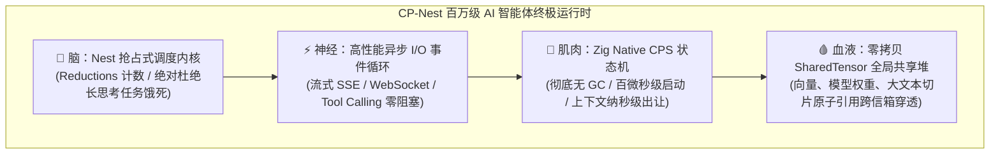
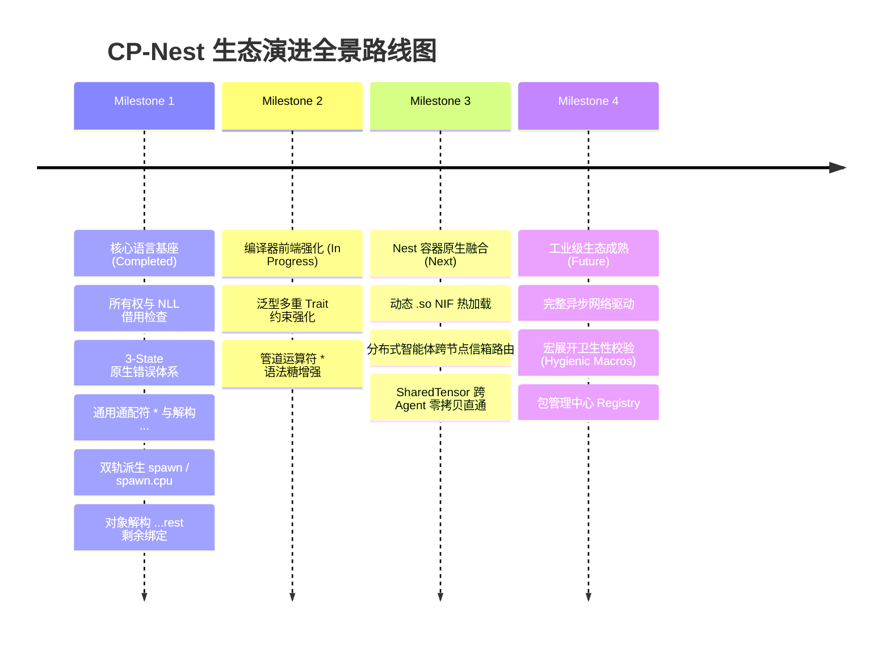

# CP-Nest 语言设计规范与技术白皮书 (The CP-Nest Language Specification)

**版本**：v0.5.0  
**定级**：工业级官方参考规范手册与底层架构指南 (The Definitive Reference Manual)  
**定位**：TypeScript 的直觉表达力 + Rust 的内存安全 + Zig 的极致底层掌控力与无 GC 暴力并发，专为高安全、高并发、高性能、小体积、低内存与AI、百万级AI Agent并发而设计的系统级编程语言。
**特点**：上手像TypeScript，安全模型对标Rust，底层能力继承Zig。既能写优雅的业务代码，又能下到裸机、系统、高性能服务，不用在“好写”和“安全高性能”之间二选一。同时在AI与AI智能体编程方面有独特优势。

---

## 目录索引 (Table of Contents)

- [第一篇：CP 语言哲学、核心愿景与全景场景矩阵 (Philosophy, Vision & Scenarios)](#第一篇cp-语言哲学核心愿景与全景场景矩阵)
  - [1.1 核心设计定位](#11-核心设计定位)
  - [1.2 CP/Rust/Zig/Go/TypeScript 精简对比表](#12-cprustziggotypescript-精简对比表)
    - [1.2.1 对比竞品，CP最独特的差异化标签](#121-对比竞品cp最独特的差异化标签)
    - [1.2.2 对比竞品，CP优势](#122-对比竞品cp优势)
  - [1.3 为AI而生：CP在 AI/AI智能体 领域的独到优势与设计哲学](#13-为ai而生cp在aiai智能体领域的独到优势与设计哲学)
    - [1.3.1 五大主流语言在 AI 智能体领域的“物理死穴”对比](#131-五大主流语言在-ai-智能体领域的物理死穴对比)
    - [1.3.2 CP 语言在 AI 与智能体领域的六大独到优势与核心架构解析](#132-cp-语言在-ai-与智能体领域的六大独到优势与核心架构解析)
    - [1.3.3 典型场景落地优势实测直观对比](#133-典型场景落地优势实测直观对比)
  - [1.4 高性能服务后端（替代部分 Go/C++/C/Rust/Zig）](#14-高性能服务后端替代部分-goccrustzig)
  - [1.5 CLI工具、开发工具链（替代 Go / Zig）](#15-cli工具开发工具链替代-go--zig)
  - [1.6 嵌入式、裸机、RTOS（Zig原生主场，CP是加分版）](#16-嵌入式裸机rtoszig原生主场cp是加分版)
  - [1.7 游戏引擎底层、高性能引擎脚本/绑定层（替代 C++、部分Rust）](#17-游戏引擎底层高性能引擎脚本绑定层替代-c部分rust)
  - [1.8 跨平台系统软件、Daemon、系统组件（替代C / C++）](#18-跨平台系统软件daemon系统组件替代c--c)
  - [1.9 高性能WebAssembly（Wasm）](#19-高性能webassemblywasm)
  - [2.0 教育、入门系统级编程（这个是很特别的差异化赛道）](#20-教育入门系统级编程这个是很特别的差异化赛道)
  - [2.1 现有Zig项目的上层迁移层（Zig生态内部的升级选择）](#21-现有zig项目的上层迁移层zig生态内部的升级选择)
  - [2.2 边界：哪些场景CP不适合主推](#22-边界哪些场景cp不适合主推)
- [第二篇：cap 统一工具链与模块生态体系 (The cap Toolchain & Ecosystem)](#第二篇cap-统一工具链与模块生态体系-the-cap-all-in-one-toolchain--ecosystem)
  - [2.1 架构愿景：CAP (Concurrent Application Plus) 核心定位与品牌标识](#21-架构愿景cap-concurrent-application-plus-核心定位与品牌标识)
  - [2.2 cap CLI 全指令全景矩阵](#22-cap-cli-全指令全景矩阵)
  - [2.3 全局缓存与软链接零拷贝注入机制 (Symlink & Global Cache)](#23-全局缓存与软链接零拷贝注入机制-symlink--global-cache)
  - [2.4 cap.json 工程清单权威规范](#24-capjson-工程清单权威规范)
  - [2.5 ES6 风格模块系统与依赖解析引擎](#25-es6-风格模块系统与依赖解析引擎)
  - [2.6 CAP 特性演进与对标路线图 (Implementation Status & Roadmap)](#26-cap-特性演进与对标路线图-implementation-status--roadmap)
- [第三篇：类型系统、不可变哲学与双轨对象模型 (Types, Immutability & Objects)](#第三篇类型系统不可变哲学与双轨对象模型)
  - [3.1 标量基础类型系统](#31-标量基础类型系统)
  - [3.2 复合容器类型](#32-复合容器类型)
  - [3.3 变量可变性与不可变哲学](#33-变量可变性与不可变哲学)
  - [3.4 双轨对象模型（静态匿名对象 vs 动态字典对象）](#34-双轨对象模型静态匿名对象-vs-动态字典对象)
- [第四篇：解构赋值与 switch 模式匹配体系 (Destructuring & Switch Matching)](#第四篇解构赋值与-switch-模式匹配体系)
  - [4.1 数组与元组解构体系](#41-数组与元组解构体系)
  - [4.2 对象解构体系](#42-对象解构体系)
  - [4.3 switch 原生模式匹配体系](#43-switch-原生模式匹配体系)
  - [4.4 守卫条件表达式与穷尽性检查](#44-守卫条件表达式与穷尽性检查)
- [第五篇：函数系统与参数方法契约 (Function System & Method Contracts)](#第五篇函数系统与参数方法契约)
  - [5.1 函数修饰符与前缀矩阵](#51-函数修饰符与前缀矩阵)
  - [5.2 形参借用与所有权语义规范](#52-形参借用与所有权语义规范)
  - [5.3 方法接收者（Receiver）终极哲学](#53-方法接收者receiver终极哲学)
  - [5.4 返回值类型与省略原则](#54-返回值类型与省略原则)
- [第六篇：所有权、借用检查与内存安全架构 (Ownership, Borrowing & Memory Safety)](#第六篇所有权借用检查与内存安全架构)
  - [6.1 移动语义（Move Semantics）与单写者安全](#61-移动语义move-semantics与单写者安全)
  - [6.2 严格别名排他律（Aliasing XOR Mutability）](#62-严格别名排他律aliasing-xor-mutability)
  - [6.3 容器写保护铁律（Container Mutation Guard）](#63-容器写保护铁律container-mutation-guard)
  - [6.4 结构体生命周期、非词法作用域（NLL）与自动化析构](#64-结构体生命周期非词法作用域nll与自动化析构)
  - [6.5 跨越 await 的资源生命周期安全](#65-跨越-await-的资源生命周期安全)
  - [6.6 闭包逃逸与 Arena 作用域内存生命周期](#66-闭包逃逸与-arena-作用域内存生命周期)
- [第七篇：面向对象与契约解耦体系 (OOP, Structs, Classes & Traits)](#第七篇面向对象与契约解耦体系)
  - [7.1 数据与行为彻底解耦哲学](#71-数据与行为彻底解耦哲学)
  - [7.2 类单继承与完整生命周期钩子](#72-类单继承与完整生命周期钩子)
  - [7.3 Trait 契约体系](#73-trait-契约体系)
  - [7.4 泛型与 Trait 约束](#74-泛型与-trait-约束)
  - [7.5 动态分发胖指针与运行时向下转型](#75-动态分发胖指针与运行时向下转型)
- [第八篇：原生三态错误处理体系 (3-State Error Handling Architecture)](#第八篇原生三态错误处理体系)
  - [8.1 终结传统 Result/Option 胶水装箱](#81-终结传统-resultoption-胶水装箱)
  - [8.2 错误返回值构建与模式匹配](#82-错误返回值构建与模式匹配)
  - [8.3 错误传播链与解包原语](#83-错误传播链与解包原语)
  - [8.4 异常作用域与块级捕获](#84-异常作用域与块级捕获)
  - [8.5 业务层统一 Error 类](#85-业务层统一-error-类)
  - [8.6 胖指针动态错误与错误集自动转换](#86-胖指针动态错误与错误集自动转换)
- [第九篇：现代语法糖与函数式特性 (Modern Syntax Sugar & Functional)](#第九篇现代语法糖与函数式特性)
  - [9.1 管道操作符与通用通配占位符](#91-管道操作符与通用通配占位符)
  - [9.2 多模式现代集合遍历](#92-多模式现代集合遍历)
  - [9.3 范围表达式与切片语法](#93-范围表达式与切片语法)
  - [9.4 字符串模板插值与原生正则表达式](#94-字符串模板插值与原生正则表达式)
- [第十篇：异步编程、双轨并行计算与 Nest 智能体容器 (Async, Dual-Track Parallel & Nest Runtime)](#第十篇异步编程双轨并行计算与-nest-智能体容器)
  - [10.1 CPS 状态机异步内核](#101-cps-状态机异步内核)
  - [10.2 双轨派生模型：协程池与 Worker 物理线程池](#102-双轨派生模型协程池与-worker-物理线程池)
  - [10.3 并发运行时配置体系（注解与 cap.json）](#103-并发运行时配置体系注解与-capjson)
  - [10.4 跨并发边界内存安全防御（Send/Sync 铁律）](#104-跨并发边界内存安全防御sendsync-铁律)
  - [10.5 异步任务流与事件循环](#105-异步任务流与事件循环)
  - [10.6 Nest 智能体容器（Nest Agent Container / Nest Runtime）](#106-nest-智能体容器nest-agent-container--nest-runtime)
- [第十一篇：元编程、编译期计算与底层控制 (Metaprogramming, Comptime & Unsafe)](#第十一篇元编程编译期计算与底层控制)
  - [11.1 编译期代码执行块（!{ } Comptime）](#111-编译期代码执行块--comptime)
  - [11.2 宏系统（Macro Metaprogramming）](#112-宏系统macro-metaprogramming)
  - [11.3 自定义元注解与类/方法装饰器](#113-自定义元注解与类方法装饰器)
  - [11.4 运行时与编译期反射系统](#114-运行时与编译期反射系统)
  - [11.5 底层控制与 unsafe 安全边界](#115-底层控制与-unsafe-安全边界)
- [第十二篇：标准库索引与生态路线图 (Standard Library & Ecosystem Roadmap)](#第十二篇标准库索引与生态路线图)
  - [12.1 已实装官方核心标准库索引（cap:*）](#121-已实装官方核心标准库索引cap)
  - [12.2 生态演进与路线图（Roadmap）](#122-生态演进与路线图roadmap)

---

# CP 语言规范 · 开篇

```text
  ██████╗ ██████╗
 ██╔════╝ ██╔══██╗   CP : Concurrent Plus
 ██║      ██████╔╝   The AI Agent & Native Systems Language
 ██║      ██╔═══╝    [ TS-Syntax • Rust-Safety • Zig-Performance • Nest-Actor ]
 ╚██████╗ ██║
  ╚═════╝ ╚═╝
```

> CP (Concurrent Plus)：一门基于Zig、拥有Rust级内存安全、语法贴近TypeScript/ES6的全平台编译型系统语言，兼顾易用、安全与底层高性能, 在AI、AI Agent、高安全、高并发、高性能、小体积、低内存场景独具优势。

CP 为AI以及海量（百万级以上）AI Agent 并发运行提供了专门支持，提供编译选项（-nest）编译为智能体容器动态加载运行，抢占式协程调度，避免单智能体死循环影响其他智能体运行。

CP 是 C/C++ 在并发与智能体时代的终极演进：TS 直觉 + Rust 安全 + Zig 底层 + Nest 并发。

## 第一篇：CP 语言哲学、核心愿景与全景场景矩阵

### 1.1 核心设计定位

CP = AI（智能体） + C/C++（资源） + Zig（性能） + Rust（安全） + Typescript/ES6（易用） + Java（功能）。

CP 融汇了当今三大现代语言流派的顶峰设计理念：

- **TypeScript 的高生产力与直觉语法**：摒弃冗余的样板代码，结构清晰，贴合现代工程直觉；
- **Rust 的无畏并发与内存安全**：在编译期通过所有权（Ownership）与非词法生命周期（NLL）借用检查，彻底杜绝悬垂指针、Double-Free 与数据竞态，避免内存泄露与程序崩溃；
- **Zig 的无隐藏控制流与底层控制力**：无障碍C/C++互操作，彻底废除垃圾回收器（No GC），裸机能力，将控制权完全还给硬件，全平台编译机器码直接运行于各大操作系统，无虚拟机，具备百微秒级的启动与纳秒级出让性能。

CP 底层基于 Zig 构建，继承 Zig 强大的编译期计算、全平台交叉编译、无障碍C 互操作与无运行时能力；借鉴 Rust 的所有权与借用检查保障默认内存安全；同时采用贴近 TypeScript/ES6 的简洁语法，容易上手，对JavaScript程序员友好，并提供解构、模式匹配、管道、注解与装饰器等现代语法特性。

CP 支持渐进式开发：默认类似Rust编译器安全检查，通过 `unsafe` 块与内嵌 `zig{}` 代码块提供底层逃逸出口。没有虚拟机、没有垃圾回收，编译产出静态单二进制文件直接运行于操作系统。适合高安全、高性能、高并发后端，CLI 工具、嵌入式固件、Wasm、智能体程序与系统组件开发。目标是让开发者不用在「好写」、「内存安全」、「底层高性能」三者之间做取舍。

---

### 1.2 CP/Rust/Zig/Go/TypeScript 精简对比表

#### 1.2.1 对比竞品，CP最独特的差异化标签

| 语言    | 核心短板                                     | CP对应的差异化                        |
| ------- | -------------------------------------------- | ------------------------------------- |
| Rust    | 陡峭学习曲线、生命周期难写、语法笨重         | TS风格简洁语法，同样所有权安全        |
| Go      | GC，无法极致低延迟，缺少强内存安全           | 无GC，借用安全，单静态二进制          |
| Zig     | 默认没有借用检查，容易内存越界，原生语法简陋 | 上层自带借用安全，保留全部Zig底层能力 |
| C++     | 坑多、未定义行为复杂                         | 安全默认，unsafe显式隔离              |
| C#/Java | 虚拟机、GC、部署笨重                         | 原生编译，轻量无runtime               |

#### 1.2.2 对比竞品，CP优势

| 项目         | CP                                            | Rust                           | Zig                              | Go                               | TypeScript                 |
| ------------ | --------------------------------------------- | ------------------------------ | -------------------------------- | -------------------------------- | -------------------------- |
| 编译模型     | 编译到 Zig，原生 AOT                          | AOT 原生编译                   | AOT 原生编译                     | AOT，带轻量 runtime              | 转译到 JS，解释执行        |
| 内存管理     | 所有权+借用检查，无GC；显式unsafe             | 所有权+借用检查，无GC          | 手动管理，无默认借用检查         | GC + 逃逸分析                    | JS GC                      |
| 语法风格     | TS/ES6 风，解构、模式匹配、管道               | 自成体系，生命周期、trait 较重 | 极简底层风格，错误类型`!T`       | 简约，语法克制                   | JS 超集，类型标注          |
| 编译期能力   | 继承 Zig comptime，编译期函数、元编程         | 宏 + const 编译期能力          | 原生 comptime，强项              | 编译期能力弱                     | 只有类型层面编译检查       |
| C 互操作     | 直接复用 Zig C 互操作                         | 支持，需要封装                 | 原生一流支持                     | cgo，有开销                      | 通过 JS FFI                |
| 二进制产物   | 静态单文件，体积小、无依赖                    | 静态单文件，体积偏大           | 静态单文件，体积很小             | 静态单文件，runtime 嵌入         | JS 文本                    |
| 安全边界     | 默认安全；`unsafe` / `zig{}` 作为逃逸口       | 默认安全；`unsafe` 逃逸口      | 默认不安全，靠开发者自律         | 内存安全（GC），数据竞争依然存在 | 内存安全，类型仅编译期检查 |
| 核心优势     | 上手简单 + 内存安全 + 底层全能                | 生态成熟，安全体系完善         | 编译速度快、交叉编译一流、无包袱 | 并发模型简单，工程化成熟         | 前端生态，学习门槛低       |
| 主要短板     | 新生语言，生态尚在建设                        | 学习曲线陡峭，生命周期难       | 缺少内置借用检查，语法现代性弱   | GC抖动，缺少强内存安全           | 不适合高性能系统、裸机     |
| 典型主打场景 | Agent智能体、系统工具、后端服务、嵌入式、Wasm | 操作系统、库、高性能服务       | 底层工具、固件、C 替换           | 云原生后端、微服务               | Web 前端、Node.js 业务     |

---

### 1.3 为AI而生：CP在`AI/AI智能体`领域的独到优势与设计哲学

#### 1.3.1 五大主流语言在 AI 智能体领域的“物理死穴”对比

当今主流的 AI 智能体开发几乎被 **Python**（LangChain/AutoGen/CrewAI/PyTorch）和 **TypeScript**（ElizaOS/LangChain.js）统治，底层系统与基础设施由 **Rust/C++** 扛鼎，网络高并发常用 **Go**，而 **Zig** 提供了极致的底层掌控。

然而，**当 AI 智能体从“单体玩具（Single Agent / ChatBot）”演进到“群体智能（Multi-Agent Swarm / 百万级并发智能体仿真）”时，现有全部编程语言都会撞上一堵厚重的物理高墙**：

| 语言           | 当前优势                                   | 在海量 AI Agent 并发场景下的致命痛点                                                                                                                                                                                                     |
| :------------- | :----------------------------------------- | :--------------------------------------------------------------------------------------------------------------------------------------------------------------------------------------------------------------------------------------- |
| **Python**     | AI 生态第一，库极其丰富，胶水能力极强      | **单机并发极低，内存极度膨胀**。GIL 锁死多核；每个线程消耗 ~8MB 栈；`asyncio` 是单线程协作，任何 Agent 稍微执行一点向量距离计算或复杂 JSON 解析就会**卡死整个事件循环**；一个 Agent 动辄消耗数十 MB 内存，单机根本无法支撑上万个 Agent。 |
| **TypeScript** | 事件驱动，异步 I/O 直觉，JSON 零阻抗       | **单线程事件循环阻塞，无原生多核并行**。海量 Agent 在进行 Prompt 模板拼接、Tool Schema 校验、正则清洗时会持续占用主线程，导致高并发网络 I/O 延迟剧增；对象内存占用高且受限于 V8 堆内存上限。                                             |
| **Go**         | Goroutine 极轻（~2KB 栈），网络高并发极强  | **Stop-The-World (STW) 垃圾回收噩梦**。当 100 万个 Agent 各自持有庞大的对话上下文、历史记忆切片时，堆内存中散落着数亿个对象指针。Go 的三色标记 GC 每隔数秒必须遍历扫描全堆，产生严重的 **GC 停顿与 CPU 算力白白空转**。                  |
| **Rust**       | 内存极其安全，零成本抽象，无 GC，性能霸权  | **编写业务级 Agent 极其痛苦，生命周期与并发心智地狱**。跨越异步 `await` 的状态管理需要满屏的 `Arc<Mutex<T>>`、`Box<dyn Future>` 与 `Pin`；Actor 框架并非一等公民；且异步任务默认**无法被抢占**，长思考任务仍会饿死并发队列。             |
| **Zig**        | 无隐藏控制流，极致纯粹，直接掌控内存与硬件 | **缺乏高级抽象与并发信箱原语**。纯手工内存管理（Allocator 手动申请与释放）在编写极其多变、动态交互的 Agent 工具链（Tool Calling）和反思链路时，极易诱发 UAF 内存泄漏，开发心智负担过重。                                                 |

---

#### 1.3.2 CP 语言在 AI 与智能体领域的六大独到优势与核心架构解析

CP-Nest 确立了**“脑（调度）、神经（感知）、肌肉（执行）、血液（数据）”**四位一体的智能体专有架构：



##### 1. 独创“双轨派生模型”：`spawn`（协程池）vs `spawn.cpu`（Worker 物理线程池）

- **传统困境**：Python/TS 遇到本地 Embedding 余弦计算或重度正则匹配就会卡死 I/O；Go/Rust 则需要开发者手动设计复杂的 Worker Pool 和 Channel 路由。
- **CP 独到设计**：在语言级提供双轨调度：
  - **`spawn(async () => ...)`**：派生到**抢占式协程池**，仅消耗百字节级内存，支撑数百万 Agent 的 I/O 监听、工具流式调用、网络信箱收发；
  - **`spawn.cpu(() => ...)`**：一键将繁重的小模型本地推理、向量检索、矩阵转置直接派发到底层的 **OS 物理线程池**，榨干 CPU 多核多线程算力，**完全不占用、不阻塞协程调度器**！

##### 2. 彻底无 GC（No GC）+ CPS 状态机切分：终结百万 Agent 内存爆炸

- **传统困境**：Go/TS/Python 的垃圾回收器是百万级 Agent 的天敌。100 万个 Agent 挂起等待 LLM 回复时，堆内存扫描开销就会击垮系统。
- **CP 独到设计**：
  - CP 语言在编译器前端彻底抛弃传统运行时调用栈，每个带 `async` 的函数在编译期被切分为精简的 **CPS 状态机结构体**；
  - 当 Agent 执行 `await llm.chat()` 挂起时，它直接执行物理 `return` 归还操作系统线程，其挂起状态仅占用一个极小的 Context 结构体（百字节级）；
  - **全生命周期无 GC 扫描开销**，通过作用域边界自动织入 `defer` / `errdefer` 保证零内存泄漏，单台服务器轻松驻留数百万个活跃 Agent！

##### 3. 血液流淌：`SharedTensor` 全局共享堆与零拷贝跨 Agent 通信

- **传统困境**：在 Python/Node 多进程架构中，Agent A 把一段 100k Token 的长上下文或一个 4096 维的向量 Embedding 发送给 Agent B，必须经过低效的 IPC 序列化与内存深拷贝，系统总线迅速被撑爆。
- **CP 独到设计**：
  - **小数据（指令、状态标记）**：走轻量信箱物理值拷贝；
  - **大数据（Prompt 上下文、Embedding 向量、模型权重）**：分配于全局共享堆 `SharedTensor` / `Refc Binaries`；
  - 智能体间通过信箱传递消息时，**仅传递指针与 `std.atomic` 原子引用计数**，数据零拷贝、零延迟瞬间到达目标 Agent！配合 CP 的 `move` 移动语义，直接保证了单写者所有权安全。

##### 4. 抢占式调度（Reductions 时间片）：杜绝复杂 Prompt / CoT 思考饿死集群

- **传统困境**：在 Node.js 或 Python 中，如果某个 Agent 正在进行长达几秒的重度思维链（Chain of Thought）文本处理或死循环，同一个事件循环线程上的其余所有 Agent 全部陷入僵死。
- **CP 独到设计**：
  - CP 继承了 BEAM/Nest 虚拟机的抢占哲学，以虚拟机指令减少计数（Reductions）作为时间片基准；
  - 任何 Agent 的计算任务一旦达到设定阈值（如 2000 个 Reductions），无论其逻辑是否结束，调度器强制将其暂停并压入队列尾部，将执行权出让给等待流式响应的其他 Agent，**杜绝单点饥饿**。

##### 5. 双轨对象模型 + 原生 3-State 错误体系：天生为 LLM Tool Calling 而生

- **传统困境**：AI 智能体有 70% 的代码都在跟 LLM 吐出的动态 JSON、Function Call 参数、网络断连容错打交道。强类型语言（Rust/C++）写反序列化极其繁琐，动态语言（Python/JS）又缺乏类型检查极易运行时崩溃。
- **CP 独到设计**：
  - **双轨对象模型**：内部计算走**静态匿名结构体 `{ x, y }`**，零额外开销对齐硬件；对接 LLM 动态返回走**动态字典对象 `#{ key: val }`**，零摩擦任意增删改查；
  - **对象解构 `...rest` 强类型提取**：如 `let { tool_name, ...args } = llm_response;`，直接解耦核心参数与动态扩展参数；
  - **原生 3-State 错误体系（`! E`, `?T`, `?`, `? default`）**：彻底消灭嵌套的 `try/catch` 和繁重的 `Result` 胶水装箱。Tool 超时、LLM 幻觉产生格式错误时，通过 `?` 自动冒泡或 `? default` 优雅降级，让 Agent 工具链代码极致优雅且绝对坚固。

##### 6. Crash-Proof 故障隔离（“任其崩溃”哲学）：工业级多 Agent 容灾

- **传统困境**：在一个由 100 个 Agent 协作的任务中，某一个 Agent 因为网络波动、未预期输入或显存越界崩溃抛出未捕获异常，很容易引发整个服务进程崩溃。
- **CP 独到设计**：
  - 每个 Agent 拥有独立的隔离边界。某个 Agent 崩溃死亡时，仅其自身的 Actor 实例被销毁，其持有的所有底层句柄与显存张量由底层的 **NIF Resource Objects** + `release()` 自动释放；
  - 其余并发 Agent 完全不受干扰，宿主监控树（Supervisor Tree）会自动感知死亡事件并按策略执行毫秒级热拉起重启。

---

#### 1.3.3 典型场景落地优势实测直观对比

| 真实业务场景                                           | 传统语言方案 (Python / Node / Go / Rust)                                                                    | CP-Nest 解决方案优势                                                                                                 |
| :----------------------------------------------------- | :---------------------------------------------------------------------------------------------------------- | :------------------------------------------------------------------------------------------------------------------- |
| **场景一：万人同域/NPC 智能体小镇仿真 (Virtual Town)** | **Python/Node 彻底趴窝**（内存数天崩溃，单机难撑 500 个）；**Go 频遭 GC 卡顿**；**Rust 开发周期长达数月**。 | **单机并发支撑 100 万 Agent**。每个 Agent 挂起态仅百字节，零 GC 运行，抢占调度杜绝卡顿，单机即可模拟庞大的数字社会。 |
| **场景二：多智能体实时金融高频量化决策群**             | **Python 延迟在几十毫秒级**，受限于 GIL 和 IPC 拷贝，无法应对毫秒级盘口。                                   | **微秒级信箱吞吐**。CPS 状态机配合 `SharedTensor` 零拷贝穿透，Agent 决策与风控判定在纳秒级完成。                     |
| **场景三：边缘端嵌入式 / 本地小型化 Agent 设备**       | **Python 无法运行在无环境边缘设备**；Node 运行时体积高达 80MB+。                                            | **`cap build -s` 吐出独立静态二进制**（仅数 MB），零外部依赖，极速在边缘工控机/手机上跑满 Agent 群。                 |

> **Python 赋予了 AI 思考的模型，TypeScript 带来了连接前端的敏捷，Rust 构筑了底层算力的基石。**  
> **而 CP 语言，则是专为让这百万级智能体在同一台物理机器上“群智涌现、永不休眠、安全共生”而诞生的原生智能体母语。**

### 1.4 高性能服务后端（替代部分 Go/C++/C/Rust/Zig）

痛点现状：

- Go：GC停顿、缺少严格所有权，高并发下大量堆分配、内存抖动；没有强编译期检查；
- Rust：学习曲线陡峭，语法重、生命周期标注折磨新手，很多人喜欢它安全但是写着累；
- C++：内存坑多、各种未定义行为、编译慢；
- Java/C#：JVM虚拟机运行，依赖重、GC，很难做低延迟、资源紧的服务。
- Typescript/ES6：V8虚拟机解释执行，运行效率低，GC 内存占用大，容易内存泄露，没有安全检查，程序容易崩溃。
- Zig：没有内存安全检查，容易内存泄露，著名的Bun.js（Claude Cli底层） 就是因为内存泄露问题，百万级源代码从Zig迁移到Rust。

CP优势：

- 所有权借用安全，**没有GC**，和Rust一样内存安全，但是语法是TS风格，好读好写；
- 编译到Zig，天然跨平台、小体积单二进制，不需要虚拟机、不需要runtime，相当于Zig的升级版，可完全替代Zig；
- 直接复用Zig的C interop，调用C/C++库零成本，可替代C/C++做嵌入式、系统级编程；
- 自带管道`|>`、ES6风格解构、清晰的模式匹配，业务代码写起来比Rust清爽很多。熟悉JavaScript、Typescript程序员直接上手。

适合：网关、消息中间件、时序数据服务、高频RPC服务、代理服务。
吸引人群：想写无GC低延迟服务，但不想啃Rust生命周期、讨厌C++坑的后端。

### 1.5 CLI工具、开发工具链（替代 Go / Zig）

现在大量CLI是Go写的（比如各种cli、脚手架、代理工具），Go的优势是单文件打包，缺点GC；Zig本身CLI能力很强，但Zig原生语法比较硬核、模板和类型写法不友好。

CP优势：

- 编译产物和Zig一样：静态单文件、无依赖、体积小；
- comptime编译期函数、元编程能力继承Zig；
- 装饰器、注解、宏体系更现代，TS风格，写命令行参数解析、代码生成器、linter、脚手架比原生Zig舒服；
- 所有权安全，处理流、大文件、管道数据不容易内存泄漏。

适合：代码生成器、静态分析工具、CLI运维工具、文件处理工具、自定义构建工具。
吸引人群：Zig爱好者、工具作者，厌倦Go GC、又觉得Zig原生语法不够顺手的人。

### 1.6 嵌入式、裸机、RTOS（Zig原生主场，CP是加分版）

Zig这一块本身就很强：无runtime、无GC、可以写裸机、MCU、RTOS，不需要操作系统依赖。
Rust嵌入式：生态不错，但`#[no_std]`、堆、alloc、生命周期在嵌入式里非常折磨；C：内存灾难。

CP优势：

- 底层直接Zig，天然支持`no_std`、裸机、MCU；
- 上层带Rust级别的借用检查，**在裸机环境下也能拿到内存安全**，这是C、原生Zig都没有的；
- 语法简单，嵌入式工程师很多熟悉JS/TS，上手门槛远低于Rust；
- 可以随时切入`zig{ ... }`内嵌块，碰到必须绕开安全检查的底层寄存器操作直接写Zig。

适合：单片机固件、物联网设备、RTOS任务、硬件驱动。
吸引人群：嵌入式开发者，想要内存安全，但不想承受Rust嵌入式的沉重负担。

### 1.7 游戏引擎底层、高性能引擎脚本/绑定层（替代 C++、部分Rust）

游戏领域现状：C++为主，坑极多；Rust尝试很多，但引擎集成成本高、和传统C++引擎互操作麻烦；Lua/TS是脚本，性能不够。

CP优势：

- 无GC，可控内存；所有权模型避免常见野指针、资源释放漏；
- 无缝C互操作，可以接入现有C/C++游戏引擎；
- 语法TS风，策划、客户端前端背景的人更容易读懂；
- comptime适合做引擎层的编译期配置、资源序列化、静态类型反射；
- unsafe + 内嵌zig块给引擎底层留后门，必要时可以直接操作内存。

适合：引擎工具、资源管线、游戏逻辑高性能模块、引擎插件系统。
吸引人群：独立游戏开发者，厌倦C++内存bug，又觉得Rust太重的团队。

### 1.8 跨平台系统软件、Daemon、系统组件（替代C / C++）

比如跨平台后台驻留程序、磁盘工具、网络栈组件、监控采集器。
C的问题：全靠人小心，内存错误高危；Rust写没问题，但招人、阅读成本高。

CP卖点：

- 内存安全是默认；
- 编译出来和Zig一样，原生支持Linux/macOS/Windows，交叉编译一键搞定；
- 二进制小，部署简单；
- 可以渐进式：先用CP写业务逻辑，底层必要组件直接内嵌Zig。

### 1.9 高性能WebAssembly（Wasm）

Zig编译Wasm成熟，Rust Wasm生态强但包偏大、编译慢；TS转Wasm（AssemblyScript）类型安全弱。

CP优势：

- 编译目标Wasm复用Zig后端；
- 所有权模型，Wasm内部内存安全；
- 语法接近TS，前端开发者迁移成本极低；
- 可以写高性能前端计算模块：图像处理、加密、解析器，比AssemblyScript更严谨。

适合：浏览器内重计算插件、Wasm服务组件。
吸引人群：前端团队，想写高性能Wasm，不想学Rust。

### 2.0 教育、入门系统级编程（这个是很特别的差异化赛道）

这是一个很容易被忽略、但是潜力很大的场景：
现在教系统编程两条路：

- C/C++：一上来就是内存错误、野指针，新手很容易劝退；
- Rust：理念很好，但语法门槛太高，不友好、不优雅，学生卡在生命周期。
- JavaScript/Typescript：解释执行脚本，语言能力弱，浏览器页面或V8虚拟机运行，无法做系统级编程。
- Python：解释执行脚本，语言能力弱，与标准编程语言差异大，不适合教学。

CP：
✅ 专为AI而生，AI时代必须掌握AI及AI智能体编程。
✅ 语法像TS（绝大多数程序员都懂TS），易学易用；
✅ 同时**正经教所有权、借用、内存安全这些核心概念**；
✅ 不是玩具语言，编译到Zig，通过Zig编译为全平台二进制机器码，能做系统级编程；
✅ 与操作系统底层以及庞大的C/C++库无障碍交互，继承人类宝贵资源；
✅ 可以循序渐进：先写简单业务，再接触所有权借用，最后再接触unsafe/zig裸指针内嵌块。

> 一句话：它可以作为「系统编程入门语言」—— 既能理解现代内存安全模型，又不像Rust那样一上来就把人挡住。
> 学会了CP，等于学会了 Typescript、Rust、Zig、C、C++。
> 这个场景非常吸引高校、培训、自学人群。

### 2.1 现有Zig项目的上层迁移层（Zig生态内部的升级选择）

很多Zig开发者喜欢Zig的编译模型、comptime、C interop、交叉编译，但不满意Zig语法：

- Zig的错误处理`!T`、if err、payload写法比较啰嗦；
- 缺少优雅解构、模式匹配、管道、装饰器注解等现代语言能力；
- 没有内置的所有权借用检查（Zig是裸指针，安全靠自己），容易内存泄露、程序崩溃。

CP对他们来说 = **保留Zig全部能力，叠加Rust安全检查 + TS风格舒服语法**。
他们可以增量迁移：CP本身就是编译为Zig代码的，因此可以一部分模块用CP写，CP中也能通过zig{}编写zig代码，底层核心zig块不动，混合共存。

---

### 2.2 边界：哪些场景CP不适合主推

1. 重型企业业务（Spring、.NET那套CRUD）：生态成熟度暂时打不过Java/C#，不是首发主攻；
2. 纯前端页面开发：没必要，就是TS主场；
3. 重度已有Rust生态绑定（比如很多成熟Rust库）：需要时间积累绑定层。

---

## 第二篇：`cap` 统一工具链与模块生态体系 (The `cap` All-in-One Toolchain & Ecosystem)

### 2.1 架构愿景：CAP (Concurrent Application Plus) 核心定位与品牌标识

```text
  ██████╗      ██╗     ██████╗
 ██╔════╝     ████╗    ██╔══██╗   CAP : Concurrent Application Plus
 ██║         ██╔═██╗   ██████╔╝   The All-in-One AI Agent & Native Systems Toolchain
 ██║        ██╔╝ ╚██╗  ██╔═══╝    [ Package Manager • Compiler • Runner • Test • Bench ]
 ╚██████╗  ██╔╝   ╚██╗ ██║        ^ (Upward Arrow) Linking C & P as the Letter 'A' (Application)
  ╚═════╝  ╚═╝     ╚═╝ ╚═╝
```

#### 1. 深度对标 Bun.js 的全合一哲学 (All-in-One Philosophy)

**Bun.js 之于 TypeScript/JavaScript，犹如 CAP 之于 CP。**

在传统系统编程与 AI 框架中，开发者饱受工具链碎片化之苦：

- 在 **JavaScript/TypeScript** 生态中，开发者必须痛苦组合 `npm`/`pnpm` + `vite`/`esbuild` + `jest`/`vitest` + `tsc` + `tsx`，并在数以万计的小文件与深度嵌套依赖中挣扎；
- 在 **Rust** 生态中，开发者需要在 `cargo`, `rustc`, `rustup`, `clippy`, `cargo-watch` 之间频繁切换，每次重新编译耗时漫长；
- 在 **Python** 生态中，`pip`, `poetry`, `conda`, `venv` 互不兼容，环境污染与依赖版本冲突屡见不鲜。

**CAP 彻底终结了这一工程痛点**：

- `cap` 是一个采用 Zig 原生编写的高性能单独立二进制程序（Single Static Executable），体积小、零系统外部依赖、冷启动仅数毫秒；
- **全生态归一**：开发者使用 CP 语言的主要入口就是 `cap` 命令，无论是新建项目、安装依赖、日常秒级调试运行、单元测试、矩阵交叉编译发布，均由 `cap` 一站式全盘接管；
- **生态生命线**：CP 智能体与原生库的繁荣分发完全依托 `cap`，它是开发者与底层硬件、网络、智能体集群交互的核心指挥塔。

#### 2. 品牌寓意：CP 与 CAP 的血脉同构 (Concurrent Plus & Concurrent Application Plus)

- **语言本体：CP (Concurrent Plus)**：
  - **C (Concurrent)**：专为百万级 AI Agent 与高并发系统设计的无 GC、抢占式调度并发内核；
  - **P (Plus)**：对 C++ 历史演进的正统继承与全维度增益（TypeScript 直觉语法 + Rust 借用所有权内存安全 + Zig 零成本裸机控制力）。
- **工具链体系：CAP (Concurrent Application Plus)**：
  - **在 `C` 与 `P` 之间注入字母 `A` (`Application`)**：视觉上由向上腾飞的箭头符号 **`^`** 精准呈现，直观牢固地链接语言内核（C）与生态增益（P），完整拼写出 **`CAP`**；
  - **代表 CAP 绝非“C 的 P 次方”**：它象征着从“语言规范（CP）”通过“应用工程赋能（Application / `^` 腾飞之矢）”迈向全场景生产级交付（CAP）；
  - **C (Concurrent)**：并发调度底座与多核算力引擎；
  - **A / ^ (Application & Ascend)**：全场景应用支撑（涵盖 AI Agent 集群、高性能服务器、系统 CLI、嵌入式固件等全部应用形态），寓意算力与开发效率的向上跃升；
  - **P (Plus)**：跨平台构建交付矩阵、统一模块依赖拓扑与自动化测试评测生态。

---

### 2.2 `cap` CLI 全指令全景矩阵

`cap` 提供了比肩 `bun`、超越传统 `cargo`/`npm` 的极速统一指令行体系：

| 用户命令                        | 底层优化模式 | 功能定位与行为说明                                                                                                  | 实装状态       |
| :------------------------------ | :----------- | :------------------------------------------------------------------------------------------------------------------ | :------------- |
| `cap <file/dir>`                | Debug        | **日常极速运行**：直接运行 `.cp` 脚本或目录，百毫秒级 JIT 式极速构建并在内存/本地直接运行。                         | **已全面实装** |
| `cap run <file/dir>`            | Debug        | **显式运行模式**：与 `cap <file>` 等价，支持透传参数给用户程序。                                                    | **已全面实装** |
| `cap build [dir]`               | ReleaseSafe  | **当前平台安全发布**：开启运行期安全检查与优化，输出独立 Native 可执行文件至 `bin/`。                               | **已全面实装** |
| `cap build -r` (或 `--release`) | ReleaseSafe  | **终极矩阵跨平台构建**：单机一口气编译输出 Windows、macOS-ARM、macOS-Intel、Linux-x64、Linux-ARM 全套生产级二进制！ | **已全面实装** |
| `cap build -f`                  | ReleaseFast  | **极限计算性能优化**：榨干硬件算力，消除一切额外运行时检查（可结合 `-r`：`cap build -r -f`）。                      | **已全面实装** |
| `cap build -s`                  | ReleaseSmall | **极小体积构建**：极限剔除调试信息与体积优化，专用于边缘计算、嵌入式设备与轻量容器（可结合 `-r`）。                 | **已全面实装** |
| `cap build --exe`               | -            | （默认行为）输出独立的系统原生可执行程序。                                                                          | **已全面实装** |
| `cap build --obj`               | -            | 输出底层的 `.o` 机器码对象文件，供外部链接。                                                                        | **已全面实装** |
| `cap build --lib`               | -            | 输出系统级静态库 `.a`，供 C/C++ 或宿主语言无缝桥接。                                                                | **已全面实装** |
| `cap build -b` (或 `--beam`)    | ReleaseFast  | **Nest 智能体容器动态库**：编译为导出标准 C-ABI 的纯状态机动态库（`.so`/`.dll`），供 Nest 容器原生动态热加载。      | **已全面实装** |
| `cap add <pkg>`                 | -            | **项目级依赖安装**：极速拉取并软链接到 `cap_modules/`，自动将依赖与 Semver 写入 `cap.json`。                        | **已全面实装** |
| `cap add -g <pkg>`              | -            | **全局依赖注入**：将公共高频依赖安装到 `~/.cap/global/cap_modules/`，作为当前系统所有项目的公共兜底池。             | **已全面实装** |
| `cap test [dir]`                | Debug        | **单元与集成测试**：递归扫描并执行测试用例，结果输出至 `bin/test/`，与业务产物物理隔离。                            | **已全面实装** |
| `cap init [template]`           | -            | **开箱即用工程脚手架**：快速初始化模板工程（支持 `app` 独立应用、`agent` 智能体服务、`lib` 库模块）。               | **已全面实装** |
| `cap remove <pkg>`              | -            | **依赖卸载**：清理指定依赖项及其孤立软链接，同步更新 `cap.json` 清单。                                              | **已全面实装** |
| `cap update [pkg]`              | -            | **语义化版本升级**：按照 `^`/`~` 规则安全升级依赖包至符合 Semver 规范的最新版本。                                   | **已全面实装** |
| `cap bench <file.cp>`           | ReleaseFast  | **微秒级基准测试**：纳秒级高精度计时度量状态机、闭包与数据吞吐耗时。                                                | **已全面实装** |
| `cap fmt`                       | -            | **代码格式化**：原生百毫秒级格式化全部 `.cp` 源代码，保持工业级统一风格。                                           | **规划实现**   |
| `cap lint`                      | -            | **静态分析与安全审计**：扫描生命周期逃逸、借用冲突与性能反模式。                                                    | **规划实现**   |
| `cap publish`                   | -            | **去中心化生态发布**：将编译好的原生包或源码包签名并发布至 CP 官方 Registry。                                       | **规划实现**   |
| `cap cache clean`               | -            | **全局缓存治理**：检查并清理 `~/.cap/cache/` 下的历史过期缓存。                                                     | **规划实现**   |

---

### 2.3 全局缓存与软链接零拷贝注入机制 (Symlink & Global Cache)

为了彻底终结 Node.js `node_modules` 深度嵌套与硬盘吞噬（磁盘黑洞），`cap` 借鉴了 `bun` 与 `pnpm` 的先进哲学，自研了**全局单实例物理存储 + 局部原子软链接注入机制**：

```mermaid
flowchart TD
    Registry["📦 CP Registry / Git 远程仓库"] -->|极速并发拉取 / 构建| GlobalCache["🗄️ 全局中心物理存储<br/>(~/.cap/cache/<pkg>@<ver>/)"]
    GlobalCache -->|原子符号软链接 (Symlink) 零拷贝注入| ProjectA["📁 项目 A: ./cap_modules/<pkg>"]
    GlobalCache -->|原子符号软链接 (Symlink) 零拷贝注入| ProjectB["📁 项目 B: ./cap_modules/<pkg>"]
    GlobalCache -->|cap add -g 全局注入| GlobalModules["🌐 全局公共依赖池<br/>(~/.cap/global/cap_modules/<pkg>)"]
```

#### 核心优势：

1. **零重复磁盘占用**：同版本依赖在整台操作系统中物理磁盘上永远只保留一份，无论开启 100 个项目，都不会产生冗余存储；
2. **毫秒级依赖还原**：`cap install` 在解析依赖树后，仅需在 `cap_modules/` 中创建轻量级符号链接，即使面对数百个依赖，整个安装过程通常在 200 毫秒内瞬间完成；
3. **全局依赖与无感知免装运行**：使用 `cap add -g <pkg>` 安装的高频库，任意目录下的独立 `.cp` 脚本均可直接 `import` 引用（由编译器自动攀升向上寻找兜底），打造类似 Python 脚本随写随跑、却享有 Rust 级别性能与安全的开发体验。

---

### 2.4 `cap.json` 工程清单权威规范

每个 CP 工程均以根目录下的 `cap.json` 作为唯一工程元数据清单与构建指挥塔：

```json
{
  "name": "nexus-agent",
  "version": "1.0.0",
  "description": "High-concurrency distributed AI Agent built with CP & Nest",
  "author": "Antigravity Team",
  "license": "Apache-2.0",
  "main": "src/main.cp",
  "mode": "parallel",
  "scripts": {
    "start": "cap src/main.cp",
    "build:prod": "cap build -r -f",
    "test": "cap test",
    "bench": "cap bench"
  },
  "dependencies": {
    "tensor-math": "^0.2.1",
    "http-router": "~1.0.0",
    "agent-actor": "1.2.0"
  },
  "dev_dependencies": {
    "test-kit": "^0.1.0"
  },
  "workspaces": ["packages/*"],
  "build": {
    "opt": "fast",
    "out_dir": "bin",
    "c_flags": ["-O3"],
    "link_libs": ["c", "m"]
  },
  "nest": {
    "mailbox_capacity": 65536,
    "reduction_slice": 2000
  }
}
```

#### 关键字段说明：

- **`main`**：工程默认入口源文件；
- **`mode`**：并发引擎模式，支持 `"parallel"`（开启底层 Worker 多物理线程池）或 `"single"`（严格单线程确定性隔离运行）；
- **`dependencies`**：生产环境依赖，严格遵循 Semver 语义化版本规则（`^` 次版本兼容、`~` 修订版本兼容、精确固定版本）；
- **`dev_dependencies`**：开发与测试依赖，使用 `cap add -d <pkg>` 自动注入；
- **`workspaces`**：Monorepo 多包工作区支持，各子包之间自动创建内部软链接引用；
- **`build`**：构建控制块，定义输出目录、优化等级与目标平台矩阵：
  - **`opt`**：编译优化模式，直接对接底层 Zig 4 级优化：
    - `"debug"`：**Debug 模式**，编译速度最快（毫秒级），保留全部调试符号与运行期安全检查。日常 `cap <file>` 与 `cap test` 默认模式；
    - `"safe"`：**ReleaseSafe 模式**（`cap build` 默认模式），平衡编译速度与执行性能，保留溢出、数组越界安全检查与崩溃调用栈；
    - `"fast"`：**ReleaseFast 模式**（`cap build -f`），追求极限单核/多核算力，消除一切额外运行时断言，榨干硬件性能；
    - `"small"`：**ReleaseSmall 模式**（`cap build -s`），极限剔除调试表并压制机器码体积，专用于边缘计算、嵌入式 MCU 与轻量微容器；
  - **`out_dir`**：产物输出目录，默认 `"bin"`（亦可通过 CLI `-o <dir>` 临时覆盖）；
  - **`target`**：单目标交叉编译平台（例如 `"x86_64-linux"`）；
  - **`targets`**：多平台矩阵发布列表（例如 `["x86_64-linux", "aarch64-macos", "x86_64-windows"]`），执行 `cap build -r` 时自动读取；
  - **`c_flags`**：透传给底层 C 编译器的专属参数（如 `["-O3", "-Wall"]`）；
  - **`link_libs`**：外部系统链接库数组（如 `["c", "m", "pthread"]`，自动转化为 `-lc -lm -lpthread` 链接）。
- **`nest`**：Nest 智能体容器专有参数，定义智能体默认信箱容量上限与抢占式 Reductions 时间片阈值。

#### 构建参数覆盖优先级裁定 (Precedence Hierarchy)

构建参数严格遵循以下三层优先级决策链：

1. **最高优先级**：命令行显式参数（如 `-f`、`-s`、`--debug`、`--safe`、`--opt=fast`、`-o <dir>`、`-t <triple>`、`-r`）；
2. **次高优先级**：当前项目 `cap.json` 中的 `"build"` 配置块；
3. **内置默认值**：`cap build` 默认 `ReleaseSafe`，`cap run`/`test` 默认 `Debug`，默认产物目录为 `bin/`。

---

### 2.5 ES6 风格模块系统与依赖解析引擎

CP 彻底摒弃了老旧沉重的 C/C++ `#include` 头文件包含与 CommonJS 的 `require` 动态阻塞机制，全面原生采纳现代 ES6 模块语义标准。

#### 1. 标准导入与导出语法

```typescript
// 1. 命名导出与默认导出
export const PI = 3.1415926;
export fn add(a: i32, b: i32): i32 { return a + b; }
export default class AgentCore {}

// 2. 命名导入与命名空间导入
import { AgentCore, add } from "./core";
import * as math from "./utils/math";

// 3. 别名更名导入与导出 (使用 as 关键字)
import { query_user as getUser } from "./db";
export { add as sum, PI as TAU };

// 4. 内置标准库协议（使用专有的 cap:* 统一协议通道）
import { print, print_err } from "cap:io";
import { SharedTensor } from "cap:mem";
import { spawn, spawn_cpu } from "cap:task";
import { @spawn, @receive, @reply } from "cap:actor";

// 5. 第三方包导入 (自动触发向上攀升解析引擎)
import { Matrix } from "tensor-math";
```

#### 3. 智能目录入口解析优先级

当开发者书写 `import { something } from "./my_dir"` 或在命令行执行 `cap ./my_dir` 时，`cpc` 编译器与 `cap` 运行时将按照以下优先级自动侦测缺省入口：

1. 🥇 `my_dir/index.cp`（首选：沿用现代前端/模块化规范习惯）
2. 🥈 `my_dir/main.cp`（次选：沿用系统级后端/Rust/Go 主入口习惯）
3. 🥉 解析 `my_dir/cap.json`，读取其中的 `"main"` 字段定位入口文件

#### 4. 三层智能向上攀升依赖查找机制（Upward Resolution）

对于所有的第三方库引用（例如 `import { Matrix } from "tensor-math"`，而非以 `./`、`../` 或 `cap:` 开头），CP 编译器具备强大的向上攀升查找能力：

1. **第一层（项目私有）**：首先在当前源码文件所在目录的父级中检索 `cap_modules/tensor-math/`；
2. **第二层（工作区/Monorepo 共享）**：若未找到，逐层向父级目录递归向上攀升寻找 `cap_modules/`，直至硬盘盘符根目录。这使得在 Monorepo 架构下，所有子工程可以零拷贝共享根目录的统一依赖池；
3. **第三层（系统全局兜底）**：若整个目录树均未命中，系统自动启动终极兜底策略，直通操作系统的全局缓存区（`~/.cap/global/cap_modules/tensor-math/`）。

---

### 2.6 CAP 特性演进与对标路线图 (Implementation Status & Roadmap)

| 核心特性领域              | 对标 Bun / Cargo 对应机制     | CAP 现行架构设计与能力                                                                           | 演进状态       |
| :------------------------ | :---------------------------- | :----------------------------------------------------------------------------------------------- | :------------- |
| **单二进制极速工具链**    | `bun` (C++ & Zig 编写)        | `cap` 采用 Zig 纯原生编写，零系统动态依赖，单静态可执行文件直通系统底层。                        | **已全面实装** |
| **极速依赖管理**          | `bun install` / `pnpm`        | 全局中心物理存储（`~/.cap/cache/`）+ 毫秒级符号软链接注入（`cap_modules/`），无磁盘冗余。        | **已全面实装** |
| **全局依赖无感运行**      | `bun install -g`              | `cap add -g` 全局安装，结合编译器三层向上攀升查找引擎，免配置随写随跑。                          | **已全面实装** |
| **跨平台矩阵构建**        | Zig `b.standardTargetOptions` | `cap build -r` 单机一键并发交叉编译 macOS (ARM/Intel)、Linux (x64/ARM)、Windows 全矩阵二进制。   | **已全面实装** |
| **智能体容器桥接**        | NIF / Node-API                | `cap build -b` 打包为纯 CPS 状态机动态库（`.so`/`.dll`），无死循环主线程，供 Nest 容器原生接管。 | **已全面实装** |
| **单元与集成测试**        | `bun test` / `cargo test`     | `cap test` 自动递归扫描测试文件，自动编译执行，测试产物隔离至 `bin/test/`。                      | **已全面实装** |
| **开箱脚手架初始化**      | `bun create` / `cargo init`   | `cap init` 提供 `agent`、`app`、`lib`、`wasm` 官方标准项目模板脚手架。                           | **正在演进**   |
| **高精度基准测评**        | `bun:bench` / `cargo bench`   | `cap bench` 原生集成纳秒级计时器与 CPS 状态机调度吞吐压测分析器。                                | **正在演进**   |
| **语义依赖增删与更新**    | `bun add/remove/update`       | `cap remove` 与 `cap update` 针对 `cap.json` 的安全 Semver 版本自动修补与孤立软链接清理。        | **正在演进**   |
| **代码格式化与 Linter**   | `bun fmt` / `cargo fmt`       | `cap fmt` 与 `cap lint` 针对 CP 语法规范与借用安全生命周期约束进行静态格式化与合规审计。         | **规划实现**   |
| **去中心化生态 Registry** | `npm publish` / `crates.io`   | `cap publish` 与官方包注册中心联动，支持语义化包分发与数字签名验证。                             | **规划实现**   |
| **单文件静态全打包**      | `bun build --compile`         | `cap bundle` 将源码、静态资源与 Nest 状态机完全打包进单一微型 Native 可执行程序。                | **规划实现**   |

---

## 第三篇：类型系统、不可变哲学与双轨对象模型

### 3.1 标量基础类型系统

CP 是一门严格无 GC 的静态类型编译型语言，禁止任何隐式类型提升：

| 标量类型 | 内存宽度                | 说明                          |
| :------- | :---------------------- | :---------------------------- |
| `i32`    | 32-bit 有符号整型       | 默认整数字面量类型            |
| `u32`    | 32-bit 无符号整型       | 无符号索引、尺寸              |
| `u64`    | 64-bit 无符号整型       | 高精度时间戳、大计数器        |
| `usize`  | 架构字长 (32/64-bit)    | 内存偏移量、容器长度          |
| `f32`    | 32-bit 单精度浮点       | 图形计算、Tensor 运算基准     |
| `f64`    | 64-bit 双精度浮点       | 默认浮点字面量类型            |
| `bool`   | 1-bit / 1-byte          | 布尔真假值 (`true` / `false`) |
| `string` | 连续只读 UTF-8 内存视图 | 附带长度信息的不可变切片视图  |
| `void`   | 0-bit                   | 空单元类型，表示无返回值      |

---

### 3.2 复合容器类型

```typescript
// 1. 动态连续数组与切片：[T]
let nums: [i32] = [10, 20, 30];
let slice: [i32] = nums[1..3];

// 2. 静态定长元组：[T1, T2, ...]
let pair: [string, i32] = ["alpha", 100];

// 3. 字典哈希表：Dict<K, V> 或 Map<K, V>
let scoreTable: Dict<string, i32> = Dict();
scoreTable.set("Alice", 98);

// 4. 哈希集合：Set<T>
let visited: Set<i32> = Set();
visited.add(42);
```

---

### 3.3 变量可变性与不可变哲学

CP 彻底废除 `let mut`，全面拥抱 TypeScript 直觉：

- **`let`**：局部变量声明，**默认可变**。
- **`const`**：常量与深度不可变声明。编译期阻止一切重分配与内部修改。

```typescript
let count = 1;
count = count + 1; // 合法

const MAX_LIMIT = 1024;
// MAX_LIMIT = 2048; // 编译报错：Cannot assign to constant 'MAX_LIMIT'
```

---

### 3.4 双轨对象模型（静态匿名对象 vs 动态字典对象）

CP 创新性地提供“双轨对象模型”，完美兼顾零成本强类型计算与灵活动态配置：

```typescript
// 1. 静态匿名对象 (Anonymous Struct)
// 语法：{ key: value }
// 特性：编译期推导确切结构，零堆开销栈分配，直接对齐 Zig 匿名结构体
let point = { x: 10, y: 20 };
let sum = point.x + point.y;

// 2. 动态匿名对象 / 字典对象 (Dynamic Dict)
// 语法：#{ key: value }
// 特性：堆分配动态哈希字典，支持运行时自由插入、修改键值对，原生对齐 JSON 动态交互
let config = #{ host: "127.0.0.1", port: 8080 };
config.set("timeout", 5000);
```

---

## 第四篇：解构赋值与 `switch` 模式匹配体系

### 4.1 数组与元组解构体系

CP 拥有现代语言中最精炼的通配符与解构语法：

- **`*`（单元素跳过通配符）**：跳过并丢弃单个元素；
- **`...`（切片提取与区间忽略通配符）**：丢弃或提取 0 到任意多个元素（彻底摒弃 `..`，`..` 符号专属作为范围运算符）。

```typescript
let arr = [10, 20, 30, 40, 50];

// 1. 单元素通配跳过 (*)
let [first, *, third, ...] = arr;
// first = 10, third = 30

// 2. 剩余切片捕获 (...rest)
let [head, ...rest] = arr;
// head = 10, rest = [20, 30, 40, 50]

// 3. 首尾两头提取，忽略中间任意长度 ([head, ..., tail])
let [startVal, ..., endVal] = arr;
// startVal = 10, endVal = 50
```

---

### 4.2 对象解构体系

```typescript
let user = { id: 1001, name: "Antigravity", role: "Admin", score: 99 };

// 1. 基础解构与别名映射
let { id, name: userName } = user;

// 2. 字段忽略通配符 (...)
// 仅提取指定属性，明确忽略对象中声明的其他属性
let { id, ... } = user;

// 3. 剩余属性提取绑定 (...rest)
// 提取未显式指定的剩余属性并自动按强类型打包为包含剩余字段的对象结构体
let { id, ...extraProps } = user;
// extraProps 为包含 { name: "Antigravity", role: "Admin", score: 99 } 的强类型对象，零堆分配开销
```

---

### 4.3 `switch` 原生模式匹配体系

CP 官方正式定稿采用 **`switch`** 作为唯一标准匹配关键字（`match` 仅保留作为编译器的透明向下兼容别名）。匹配分支的缺省通配统一使用 `*`。

```typescript
let status_code = 404;

let msg = switch (status_code) {
    200 => "OK",
    // 联合模式匹配
    400 | 401 | 403 => "Client Error",
    // 闭区间匹配
    500..=599 => "Server Error",
    // 缺省通配分支（统一使用 * 号，不占用 _）
    * => "Unknown Status"
};
```

#### 原生三态解包匹配

```typescript
let result = load_data();

switch (result) {
    // 1. 成功正常值解包
    data => print("Loaded payload:", data),
    // 2. 显式错误匹配与提取
    Err(e) => print("Load failed with error:", e),
    // 3. 空值匹配
    null => print("No data present")
}
```

---

### 4.4 守卫条件表达式与穷尽性检查

分支支持 `if` 守卫条件；编译器会对匹配项进行全域穷尽性检查：

```typescript
let info = switch (person) {
    { age, role } if age >= 18 && role == "Admin" => "Adult Superuser",
    { age, ... } if age < 18 => "Minor",
    * => "Standard User"
};
```

---

## 第五篇：函数系统与参数方法契约

### 5.1 函数修饰符与前缀矩阵

函数修饰符保持正交、严格正序：

- `pub`：公开导出符号；
- `static`：类中静态方法，不绑定实例；
- `async`：异步函数，切分为 CPS 状态机；
- `unsafe`：不安全函数，调用方必须位于 `unsafe { }` 作用域内。

```typescript
pub async fn fetch_remote_metrics(url: string): string ! NetError {
    // ...
}
```

---

### 5.2 形参借用与所有权语义规范

为了达成无 GC 与零成本抽象，函数形参具备极其严谨的所有权语义：

1. **缺省形参（只读借用）**：
   ```typescript
   fn inspect(data: [i32]) {
       // data 默认为只读借用，传参零拷贝，禁止内部任何原地修改
   }
   ```
2. **可变借用形参（`*param` 或 `mut param`）**：
   ```typescript
   fn append_seed(*data: [i32], seed: i32) {
       data.push(seed); // 允许对调用方传入的实参进行原地修改
   }
   ```
3. **所有权转移形参（`move param`）**：
   ```typescript
   fn take_ownership(move data: Tensor) {
       // data 所有权完全移交进函数体，调用方原变量变为未初始化失效态
   }
   ```

---

### 5.3 方法接收者（Receiver）终极哲学

在 CP 语言中，**`_` 被确立为方法接收者（Receiver）的唯一专属符号**（等同于 TS 中的 `this`）：

```typescript
class Account {
    balance: f64;

    // 1. 只读调用：_（不可变只读借用）
    pub fn get_balance(_): f64 {
        return _.balance;
    }

    // 2. 状态变更调用：*_ 或 mut _（可变借用）
    pub fn deposit(*_, amount: f64) {
        _.balance = _.balance + amount;
    }

    // 3. 消费自身调用：move _（转移所有权，调用后原实例被销毁）
    pub fn close(move _): f64 {
        let final_cash = _.balance;
        _.balance = 0.0;
        return final_cash;
    }
}
```

---

### 5.4 返回值类型与省略原则

- **`void` 省略哲学**：当函数无返回值时，省略 `: void` 声明；
- **原生 3-State 返回签名**：
  - 返回确切值或错误：`fn save(): void ! IOError`
  - 返回可选值或错误：`fn find(): ?User ! DBError`

---

## 第六篇：所有权、借用检查与内存安全架构

### 6.1 移动语义（Move Semantics）与单写者安全

对于拥有堆上资源、文件句柄或物理显存的大对象，赋值与跨界传参默认使用 `move` 移动语义：

```typescript
let t1 = Tensor.allocate([1024, 1024]);
let t2 = move t1; // 所有权转移给 t2

// print(t1.size()); // 编译报错：Use of moved value 't1'
```

---

### 6.2 严格别名排他律（Aliasing XOR Mutability）

CP 编译器在编译期执行铁律检查：

> **任意时刻，一块数据要么只能拥有任意数量的只读借用（`&T`），要么只能拥有唯一的排他性可变借用（`*T` / `&mut T`），二者绝不可共存！**

---

### 6.3 容器写保护铁律（Container Mutation Guard）

针对 `Array`、`Map`、`Set`、`Dict` 等容器类型，CP 施加了极其严苛的写保护安全铁律：

> **当一个容器存在存活的只读借用（如 `let p = &v;`）时：**
>
> 1. **严禁对容器进行任何结构调整（禁止扩容、缩容、`push`、`pop`）；**
> 2. **严禁对容器内部的任何现有元素执行原位修改（禁止 `v[0] = 6`）。**

```typescript
let v = [1, 2, 3];
let p = &v; // 建立只读借用

// v[0] = 6;
// 编译拦截并抛出硬错误：
// CP Compile Error: Borrow conflict on 'v': cannot borrow as mutable while 'p' is still active
print(p[0]); // p 在此为最后一次使用
v[0] = 6;    // 合法：p 生命周期已由 NLL 释放
```

---

### 6.4 结构体生命周期、非词法作用域（NLL）与自动化析构

- 编译期基于 AST 进行精准的 **最后使用位置（Last-Use Map）分析**，变量一旦离开生命周期窗口，其持有的借用即刻失效解禁。
- 变量离开自身词法作用域时，编译器**自动在其后织入 Zig 级别的 `defer` 与 `errdefer` 资源清理指令**，开发者无需手写脆弱的析构胶水。

---

### 6.5 跨越 `await` 的资源生命周期安全

跨越协程挂起点（`await`）的底层句柄、套接字与显存张量，底层全数封装为 **NIF Resource Objects**。当 Agent 或协程由于崩溃意外中断退出时，Nest 宿主容器的析构追踪器会兜底激活 Zig 终结器，确保显存和物理资源绝对零泄露。

---

### 6.6 闭包逃逸与 Arena 作用域内存生命周期

当闭包发生逃逸时，捕获的局部上下文由编译器自动克隆并提升至作用域堆或当前任务所属的专属 `Arena` 分配器中，杜绝栈帧销毁后的野指针访问。

---

## 第七篇：面向对象与契约解耦体系

### 7.1 数据与行为彻底解耦哲学

CP 彻底废除传统的 `interface` 混合模型，实现彻底解耦：

- **`struct` / `class`**：仅用于定义纯内存布局容器（Memory Layout Container），无任何虚表指针额外开销；
- **`trait`**：声明纯行为契约与默认实现；
- **`impl Trait for Target`**：独立实现契约，支持零侵入地为已有第三方结构体实现新行为。

```typescript
class Point {
    x: f64;
    y: f64;
}

trait Measurable {
    fn distance_to_origin(_): f64;
}

impl Measurable for Point {
    fn distance_to_origin(_): f64 {
        return Math.sqrt(_.x * _.x + _.y * _.y);
    }
}
```

---

### 7.2 类单继承与完整生命周期钩子

```typescript
class Device {
    id: u32;

    pub fn init(*_, id: u32) {
        _.id = id;
    }

    // 显式析构钩子：离开作用域或被 release 时自动执行
    pub fn release(*_) {
        print("Releasing hardware device context:", _.id);
    }
}

class GpuDevice extends Device {
    cuda_stream: usize;

    pub fn init(*_, id: u32, stream: usize) {
        super.init(id);
        _.cuda_stream = stream;
    }
}
```

---

### 7.3 Trait 契约体系

Trait 支持方法签名契约及默认实现：

```typescript
trait Logger {
    fn log_raw(_, msg: string);

    // 默认方法实现
    fn log_info(_, msg: string) {
        _.log_raw("[INFO] " + msg);
    }
}
```

---

### 7.4 泛型与 Trait 约束

```typescript
fn print_distance<T: Measurable>(item: T) {
    print("Distance:", item.distance_to_origin());
}

// 多 Trait 约束组合
fn sync_data<T: Reader + Writer>(stream: *T) {
    // ...
}
```

---

### 7.5 动态分发胖指针与运行时向下转型

当需要异构多态容器时，使用 `Box<dyn Trait>` 胖指针（包含数据真实指针与 vtable 虚表指针）：

```typescript
let handlers: [Box<dyn EventHandler>] = [];
handlers.push(Box.new(NetworkHandler.init()));

// 运行时安全向下转型 (Downcast)
for handler of handlers {
    if let Some(net) = handler.downcast<NetworkHandler>() {
        net.flush_socket();
    }
}
```

---

## 第八篇：原生三态错误处理体系

### 8.1 终结传统 Result/Option 胶水装箱

CP 原生引入**三态原生值类型（3-State Value Type）**，彻底终结了 Rust/TS 中沉重的 `Result<T, E>` / `Option<T>` / `Some` / `None` / `Ok` 胶水包装：

- **正常值**：直接返回值 `val`（零额外栈开销）；
- **错误值**：`! E`（由联合错误集限定）；
- **空值**：`?T`（允许赋值为 `null`）。

---

### 8.2 错误返回值构建与模式匹配

```typescript
error NetworkError {
    Timeout,
    ConnectionReset,
    HostUnreachable
}

fn ping(host: string): string ! NetworkError {
    if host == "" {
        return Err(.HostUnreachable);
    }
    return "PONG";
}
```

---

### 8.3 错误传播链与解包原语

```typescript
// 1. 错误传播操作符 (?)
// 遇到 Err 立即向上冒泡返回，遇到正常值解包出原始值
let response = ping("api.cp.org")?;

// 2. 默认降级容错 (? default)
// 发生任何 Err 时，优雅降级为缺省值
let safe_res = ping("bad.host") ? "FALLBACK_HOST";

// 3. 空值合并操作符 (?? default)
// 遇到 null 时回退
let opt_val: string? = null;
let text = opt_val ?? "default_text";
```

---

### 8.4 异常作用域与块级捕获

```typescript
// 1. 表达式后缀 catch
let cfg = load_config() catch e => #{ port: 8080 };

// 2. 块级 try ... catch 作用域
// 核心魔法：在 try 块内，所有产生 Err 的调用均自动具备隐式 ? 向上冒泡机制，无需逐行书写 ?
try {
    let raw = read_file("agent.json"); // 遇错直接跳转 catch
    let obj = parse_json(raw);
    save_to_db(obj);
} catch err => {
    print("Failed transaction:", err);
}
```

---

### 8.5 业务层统一 Error 类

内置标准业务级 `Error` 结构，附带代码与堆栈上下文追踪：

```typescript
let e = Error.init(500, "Internal Server Failure");
print(e.code, e.message);
```

---

### 8.6 胖指针动态错误与错误集自动转换

当不同模块的子错误集向上传播时，编译器自动织入 `cp_convert_err` 进行错误集合并与自动升级，亦支持通用动态错误胖指针 `Box<dyn Error>`。

---

## 第九篇：现代语法糖与函数式特性

### 9.1 管道操作符与通用通配占位符

CP 的管道操作符 `|>` 与全能通配符 `*` 深度解耦，彻底避免与方法接收者 `_` 混淆：

```typescript
fn add(a: i32, b: i32): i32 { return a + b; }
fn mul(a: i32, b: i32): i32 { return a * b; }

let x = 10;

// 1. 默认作为唯一/首参传入
let r1 = x |> mul(2); // 20

// 2. 使用通配占位符 (*) 精确指定插入位置
let r2 = r1 |> add(5, *); // add(5, 20) -> 25

// 3. 点号无参方法链式调用简写
let trimmed = "  cp-lang  " |> .trim(); // "cp-lang"
```

---

### 9.2 多模式现代集合遍历

```typescript
let numbers = [1, 2, 3, 4];

// 1. 只读借用遍历 (只读零拷贝)
for item of numbers {
    print(item);
}

// 2. 可变借用遍历 (原地修改元素)
for *item of numbers {
    item.* = item.* * 10;
}

// 3. 所有权转移遍历 (消费源集合)
for move item of numbers {
    sink(item);
}
```

---

### 9.3 范围表达式与切片语法

```typescript
// 范围循环迭代
for i of 0..10 {    // 半开区间：0 到 9
    print(i);
}

for i of 0..=10 {   // 闭区间：0 到 10
    print(i);
}

// 数组高速切片视图
let head_part = numbers[0..2];
```

---

### 9.4 字符串模板插值与原生正则表达式

```typescript
let agentName = "Nexus-9";
let taskCount = 42;

// 模板插值
let summary = "Agent ${agentName} executed ${taskCount} reductions.";

// 原生正则字面量
let emailRegex = /^[a-zA-Z0-9._%+-]+@[a-zA-Z0-9.-]+\.[a-zA-Z]{2,}$/;
if emailRegex.test("admin@cp-nest.org") {
    print("Valid email format");
}
```

---

## 第十篇：异步编程、双轨并行计算与 Nest 智能体容器

### 10.1 CPS 状态机异步内核

每个标记为 `async` 的函数在编译期被解构切片为一个紧凑的 Zig 结构体状态机。当遇到 `await` 时，函数保存程序计数器（`pc`）与局部上下文，执行物理 `return` 出让线程，彻底消灭运行时调用栈膨胀。

---

### 10.2 双轨派生模型：协程池与 Worker 物理线程池

CP 在语言级首创了**“双轨派生模型（Dual-Track Spawn）”**，以满足高吞吐信箱与重度科学计算的不同极端诉求：

```typescript
// 1. spawn(fn) —— 轻量级协程池 (Coroutine Pool)
// 纳秒级派发，依托 CPS 状态机与 Reductions 时间片切分，适合数百万高并发 Agent、网络 I/O、事件传递
let t1: Task = spawn(async () => {
  return fetch_agent_state();
});

// 2. spawn.cpu(fn) —— Worker 物理线程池 (CPU Thread Pool)
// 派生真实 OS 物理线程，脱离协程调度器，专门压榨多核算力，用于重度矩阵运算、Tensor 变换、图像渲染
let t2: Task = spawn.cpu(() => {
  return matrix_multiply(big_tensor_a, big_tensor_b);
});

// 同步协调与等待
let res = join(t2);
```

---

### 10.3 并发运行时配置体系（注解与 `cap.json`）

#### 项目级全局配置（`cap.json`）

```json
{
  "mode": "parallel"
}
```

#### 代码级入口注解声明

```typescript
// 显式声明开启多核并行引擎，并指定 8 个 Worker 物理线程
@parallel(8)
fn main() {
    print("Parallel runtime initialized with 8 OS workers.");
}

// 亦可声明强制单线程模式，便于精准隔离调试与竞态分析
@single_thread
fn debug_main() {
    // ...
}
```

---

### 10.4 跨并发边界内存安全防御（Send/Sync 铁律）

当向 `spawn` 或 `spawn.cpu` 派发闭包时，编译器启动静态逃逸守卫检查：

- **严禁捕获栈上引用结构体（`ref struct`）**；
- **严禁捕获局部临时借用（`&T`）**；
- 跨任务必须使用 `move` 显式转移所有权，或使用 `Shared<T>` / `SharedTensor` 走原子引用计数（`std.atomic`）。

---

### 10.5 异步任务流与事件循环

```typescript
// 并发聚合协调器
let [user, metrics] = await Task.all([fetch_user(), fetch_metrics()]);

// 事件循环体系
let bus = EventEmitter();
bus.on("agent_death", (pid) => {
  print("Agent crashed:", pid);
});
bus.emit("agent_death", 1002);
```

---

### 10.6 Nest 智能体容器（Nest Agent Container / Nest Runtime）

CP 语言是 **Nest 智能体容器** 的原生执行体：

- **Actor 一等公民模型**：`actor`, `@spawn`, `@receive`, `@reply`；
- **抢占式调度器（Reductions 内核）**：以指令计数为依据实行强制抢占，长任务不可饿死其他智能体；
- **零拷贝通信**：小数据物理值拷贝；超大数据 / 显存 Tensor 采用全局共享堆 `SharedTensor` / `Refc Binaries`，仅跨信箱传递指针与原子引用计数；
- **动态链接与打包**：使用 `cap build --beam`（`-b`）编译导出为标准 C-ABI 动态库（`.so`/`.dll`），由 Nest 智能体容器极速加载接管。

---

## 第十一篇：元编程、编译期计算与底层控制

### 11.1 编译期代码执行块（`!{ }` Comptime）

在 `!{ }` 内的代码完全在编译期由内置编译器求值展开：

```typescript
const HASH_TABLE = !{
    let table: [i32] = [];
    for i of 0..256 {
        table.push(i * 31 % 255);
    }
    table
};
```

---

### 11.2 宏系统（Macro Metaprogramming）

```typescript
macro define_getter(name) {
    pub fn get_${name}(_): string {
        return _.${name};
    }
}

class User {
    nickname: string;
    !define_getter(nickname);
}
```

---

### 11.3 自定义元注解与类/方法装饰器

```typescript
// 1. 元注解声明
@meta(author: "Antigravity", timeout: 3000)
class PaymentAgent {}

// 2. 方法装饰器（编译期 AOP 拦截）
@dec(trace_execution)
fn process_order(id: u64) {
    // 自动织入耗时统计与日志
}
```

---

### 11.4 运行时与编译期反射系统

```typescript
import { reflect } from "cap:reflect";

let type_info = reflect.type_of<Point>();
print("Type Name:", type_info.name);

let fields = reflect.fields_of<Point>();
for f of fields {
    print("Field:", f.name, "Type:", f.type);
}
```

---

### 11.5 底层控制与 `unsafe` 安全边界

CP 拥有直通硬件底层的裸指针与内存控制能力，所有非安全操作严格受限于 `unsafe` 隔离块：

```typescript
unsafe {
    // 裸指针声明与算术
    let raw_addr: *i32 = cp_cast_ptr(0x7FFF0000);
    let second_item: *i32 = raw_addr + 1;

    // 裸指针解引用写入
    second_item.* = 42;
}

pub unsafe fn direct_io_write(port: u16, val: u8) {
    // 裸硬件端口操作
}
```

---

## 第十二篇：标准库索引与生态路线图

### 12.1 已实装官方核心标准库索引（`cap:*`）

| 标准库协议通道 | 核心导出功能                                          | 状态           |
| :------------- | :---------------------------------------------------- | :------------- |
| `cap:io`       | `print`, `print_err`, `readLine`, 格式化输出流        | **已全面实装** |
| `cap:mem`      | `Arena`, `SharedTensor`, 全局共享堆, 原子引用计数     | **已全面实装** |
| `cap:task`     | `spawn`, `spawn_cpu`, `join`, `Task.all`, `Task.race` | **已全面实装** |
| `cap:actor`    | `@spawn`, `@receive`, `@reply`, `PID`, 信箱通信       | **已全面实装** |
| `cap:fs`       | 异步/同步文件读取、写入、目录创建、流式 I/O           | **已全面实装** |
| `cap:net`      | TCP 套接字、UDP 广播、轻量 HTTP 协议栈                | **已全面实装** |
| `cap:reflect`  | 编译期与运行时 `type_of`, `fields_of`, 结构体自省     | **已全面实装** |

---

### 12.2 生态演进与路线图（Roadmap）



---

_本规范由 CP 架构设计委员会制定，作为全体编译器研发、运行时对接与开发者生态的唯一最高准则。_
