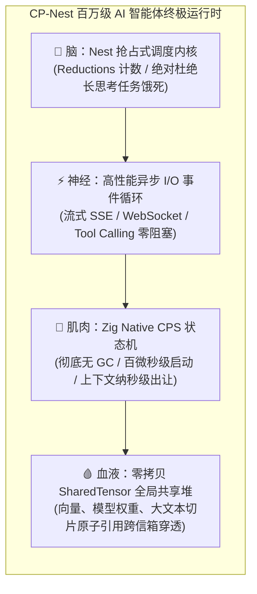
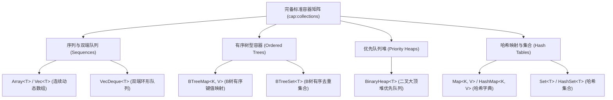
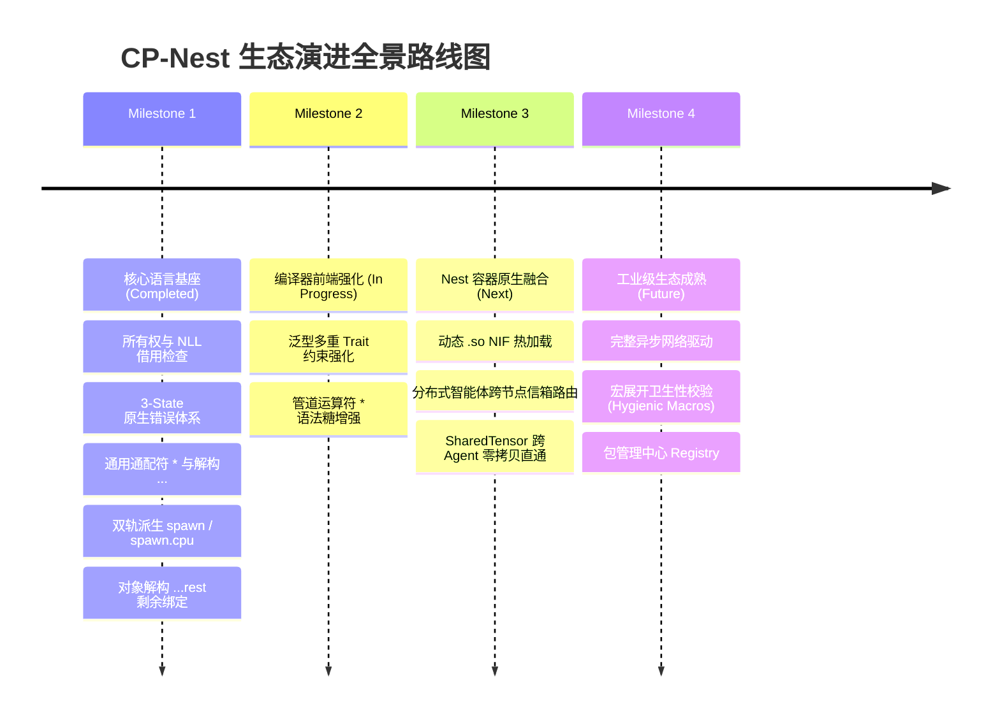

# CP 语言设计规范与技术白皮书 (The CP Language Specification)

**版本**：v0.6.0  
**定级**：工业级官方参考规范手册与底层架构指南 (The Definitive Reference Manual)  
**定位**：TypeScript 的直觉表达力 + Rust 的内存安全 + Zig 的极致底层掌控力与无 GC 暴力并发，专为高安全、高并发、高性能、小体积、低内存与AI、百万级AI Agent并发而设计的系统级编程语言。
**特点**：上手像TypeScript，安全模型对标Rust，底层能力继承Zig。既能写优雅的业务代码，又能下到裸机、系统、高性能服务，不用在“好写”和“安全高性能”之间二选一。同时在AI与AI智能体编程方面有独特优势。

---

## 目录索引 (Table of Contents)

- [一、CP 语言哲学、核心愿景与全景场景矩阵 (Philosophy, Vision & Scenarios)](#第一篇cp-语言哲学核心愿景与全景场景矩阵)
  - [1.1 核心设计定位](#11-核心设计定位)
  - [1.2 CP/Rust/Zig/Go/TypeScript 精简对比表](#12-cprustziggotypescript-精简对比表)
    - [1.2.1 对比竞品，CP最独特的差异化标签](#121-对比竞品cp最独特的差异化标签)
    - [1.2.2 对比竞品，CP优势](#122-对比竞品cp优势)
  - [1.3 为AI而生：CP在 AI/AI智能体 领域的独到优势与设计哲学](#13-为ai而生cp在aiai智能体领域的独到优势与设计哲学)
    - [1.3.1 五大主流语言在 AI 智能体领域的“物理死穴”对比](#131-五大主流语言在-ai-智能体领域的物理死穴对比)
    - [1.3.2 CP 语言在 AI 与智能体领域的六大独到优势与核心架构解析](#132-cp-语言在-ai-与智能体领域的六大独到优势与核心架构解析)
    - [1.3.3 典型场景落地优势实测直观对比](#133-典型场景落地优势实测直观对比)
  - [1.4 高性能服务后端（替代部分 Go/C++/C/Rust/Zig）](#14-高性能服务后端替代部分-goccrustzig)
  - [1.5 CLI工具、开发工具链（替代 Go / Zig）](#15-cli工具开发工具链替代-go--zig)
  - [1.6 嵌入式、裸机、RTOS（Zig原生主场，CP是加分版）](#16-嵌入式裸机rtoszig原生主场cp是加分版)
  - [1.7 游戏引擎底层、高性能引擎脚本/绑定层（替代 C++、部分Rust）](#17-游戏引擎底层高性能引擎脚本绑定层替代-c部分rust)
  - [1.8 跨平台系统软件、Daemon、系统组件（替代C / C++）](#18-跨平台系统软件daemon系统组件替代c--c)
  - [1.9 高性能WebAssembly（Wasm）](#19-高性能webassemblywasm)
  - [2.0 教育、入门系统级编程（这个是很特别的差异化赛道）](#20-教育入门系统级编程这个是很特别的差异化赛道)
  - [2.1 现有Zig项目的上层迁移层（Zig生态内部的升级选择）](#21-现有zig项目的上层迁移层zig生态内部的升级选择)
  - [2.2 边界：哪些场景CP不适合主推](#22-边界哪些场景cp不适合主推)
- [二、cap 统一工具链与模块生态体系 (The cap Toolchain & Ecosystem)](#第二篇cap-统一工具链与模块生态体系-the-cap-all-in-one-toolchain--ecosystem)
  - [2.1 架构愿景：CAP (Concurrent Application Plus) 核心定位与品牌标识](#21-架构愿景cap-concurrent-application-plus-核心定位与品牌标识)
  - [2.2 cap CLI 全指令全景矩阵](#22-cap-cli-全指令全景矩阵)
  - [2.3 全局缓存与软链接零拷贝注入机制 (Symlink & Global Cache)](#23-全局缓存与软链接零拷贝注入机制-symlink--global-cache)
  - [2.4 cap.json 工程清单权威规范](#24-capjson-工程清单权威规范)
  - [2.5 ES6 风格模块系统与依赖解析引擎](#25-es6-风格模块系统与依赖解析引擎)
  - [2.6 CAP 特性演进与对标路线图 (Implementation Status & Roadmap)](#26-cap-特性演进与对标路线图-implementation-status--roadmap)
- [三、类型系统、不可变哲学与双轨对象模型 (Types, Immutability & Objects)](#第三篇类型系统不可变哲学与双轨对象模型)
  - [3.1 标量基础类型系统](#31-标量基础类型系统)
  - [3.2 复合容器类型](#32-复合容器类型)
  - [3.3 变量可变性与不可变哲学](#33-变量可变性与不可变哲学)
  - [3.4 双轨对象模型（静态匿名对象 vs 动态字典对象）](#34-双轨对象模型静态匿名对象-vs-动态字典对象)
  - [3.5 枚举与代数数据类型（Enum & Tagged Union）](#35-枚举与代数数据类型enum--tagged-union)
- [四、解构赋值与 switch 模式匹配体系 (Destructuring & Switch Matching)](#第四篇解构赋值与-switch-模式匹配体系)
  - [4.1 数组与元组解构体系](#41-数组与元组解构体系)
  - [4.2 对象解构体系](#42-对象解构体系)
  - [4.3 switch 原生模式匹配体系](#43-switch-原生模式匹配体系)
  - [4.4 守卫条件表达式与穷尽性检查](#44-守卫条件表达式与穷尽性检查)
  - [4.5 枚举载荷解构、Walrus 绑定与动态类型匹配](#45-枚举载荷解构walrus-绑定与动态类型匹配)
- [五、函数系统与参数方法契约 (Function System & Method Contracts)](#第五篇函数系统与参数方法契约)
  - [5.1 函数修饰符与前缀矩阵](#51-函数修饰符与前缀矩阵)
  - [5.2 形参借用与所有权语义规范](#52-形参借用与所有权语义规范)
  - [5.3 方法接收者（Receiver）终极哲学](#53-方法接收者receiver终极哲学)
  - [5.4 返回值类型与省略原则](#54-返回值类型与省略原则)
- [六、所有权、借用检查与内存安全架构 (Ownership, Borrowing & Memory Safety)](#第六篇所有权借用检查与内存安全架构)
  - [6.1 移动语义（Move Semantics）与单写者安全](#61-移动语义move-semantics与单写者安全)
  - [6.2 严格别名排他律（Aliasing XOR Mutability）](#62-严格别名排他律aliasing-xor-mutability)
  - [6.3 容器写保护铁律（Container Mutation Guard）](#63-容器写保护铁律container-mutation-guard)
  - [6.4 结构体生命周期、非词法作用域（NLL）与自动化析构](#64-结构体生命周期非词法作用域nll与自动化析构)
  - [6.5 跨越 await 的资源生命周期安全](#65-跨越-await-的资源生命周期安全)
  - [6.6 闭包逃逸与 Arena 作用域内存生命周期](#66-闭包逃逸与-arena-作用域内存生命周期)
- [七、面向对象与契约解耦体系 (OOP, Structs, Classes & Traits)](#第七篇面向对象与契约解耦体系)
  - [7.1 数据与行为彻底解耦哲学](#71-数据与行为彻底解耦哲学)
  - [7.2 类单继承与完整生命周期钩子](#72-类单继承与完整生命周期钩子)
  - [7.3 Trait 契约体系](#73-trait-契约体系)
  - [7.4 泛型与 Trait 约束](#74-泛型与-trait-约束)
  - [7.5 动态分发胖指针与运行时向下转型](#75-动态分发胖指针与运行时向下转型)
- [八、原生三态错误处理体系 (3-State Error Handling Architecture)](#第八篇原生三态错误处理体系)
  - [8.1 终结传统 Result/Option 胶水装箱](#81-终结传统-resultoption-胶水装箱)
  - [8.2 错误返回值构建与模式匹配](#82-错误返回值构建与模式匹配)
  - [8.3 错误传播链与解包原语](#83-错误传播链与解包原语)
  - [8.4 异常作用域与块级捕获](#84-异常作用域与块级捕获)
  - [8.5 业务层统一 Error 类](#85-业务层统一-error-类)
  - [8.6 胖指针动态错误与错误集自动转换](#86-胖指针动态错误与错误集自动转换)
- [九、现代语法糖与函数式特性 (Modern Syntax Sugar & Functional)](#第九篇现代语法糖与函数式特性)
  - [9.1 管道操作符与通用通配占位符](#91-管道操作符与通用通配占位符)
  - [9.2 多模式现代集合遍历](#92-多模式现代集合遍历)
  - [9.3 范围表达式与切片语法](#93-范围表达式与切片语法)
  - [9.4 字符串模板插值与原生正则表达式](#94-字符串模板插值与原生正则表达式)
- [十、异步编程、双轨并行计算与 Nest 智能体容器 (Async, Dual-Track Parallel & Nest Runtime)](#第十篇异步编程双轨并行计算与-nest-智能体容器)
  - [10.1 CPS 状态机异步内核](#101-cps-状态机异步内核)
  - [10.2 双轨派生模型：协程池与 Worker 物理线程池](#102-双轨派生模型协程池与-worker-物理线程池)
  - [10.3 并发运行时配置体系（注解与 cap.json）](#103-并发运行时配置体系注解与-capjson)
  - [10.4 跨并发边界内存安全防御（Send/Sync 铁律）](#104-跨并发边界内存安全防御sendsync-铁律)
  - [10.5 异步任务流与事件循环](#105-异步任务流与事件循环)
  - [10.6 Nest 智能体容器（Nest Agent Container / Nest Runtime）](#106-nest-智能体容器nest-agent-container--nest-runtime)
- [十一、元编程、编译期计算与底层控制 (Metaprogramming, Comptime & Unsafe)](#十一元编程编译期计算与底层控制)
  - [11.1 编译期元编程系统（Comptime Metaprogramming）](#111-编译期元编程系统comptime-metaprogramming)
  - [11.2 宏系统（Macro Metaprogramming）](#112-宏系统macro-metaprogramming)
  - [11.3 自定义元注解与类/方法装饰器](#113-自定义元注解与类方法装饰器)
  - [11.4 运行时与编译期反射系统](#114-运行时与编译期反射系统)
  - [11.5 底层控制与 unsafe 安全边界](#115-底层控制与-unsafe-安全边界)
  - [11.6 Native Zig 逃逸舱（zig { ... }）](#116-native-zig-逃逸舱zig----)
  - [11.7 零成本转译抽象：按需摇树注入与原生发射](#117-零成本转译抽象按需摇树注入与原生发射)
- [十二、标准库索引与生态路线图 (Standard Library & Ecosystem Roadmap)](#第十二篇标准库索引与生态路线图)
  - [12.1 已实装官方核心标准库索引（cap:*）](#121-已实装官方核心标准库索引cap)
  - [12.2 生态演进与路线图（Roadmap）](#122-生态演进与路线图roadmap)

---

# CP 语言规范 · 开篇

```text
  ██████╗ ██████╗
 ██╔════╝ ██╔══██╗   CP : Concurrent Plus
 ██║      ██████╔╝   The AI Agent & Native Systems Language
 ██║      ██╔═══╝    [ TS-Syntax • Rust-Safety • Zig-Performance • Nest-Actor ]
 ╚██████╗ ██║
  ╚═════╝ ╚═╝
```

> CP (Concurrent Plus)：一门基于Zig、拥有Rust级内存安全、语法贴近TypeScript/ES6的全平台编译型系统语言，兼顾易用、安全与底层高性能, 在AI、AI Agent、高安全、高并发、高性能、小体积、低内存场景独具优势。

CP 为AI以及海量（百万级以上）AI Agent 并发运行提供了专门支持，提供编译选项（-nest）编译为智能体容器动态加载运行，抢占式协程调度，避免单智能体死循环影响其他智能体运行。

CP 是 C/C++ 在并发与智能体时代的终极演进：TS 直觉 + Rust 安全 + Zig 底层 + Nest 并发。

## 一、CP 语言哲学、核心愿景与全景场景矩阵

### 1. 核心设计定位

CP = AI（智能体） + C/C++（资源） + Zig（性能） + Rust（安全） + Typescript/ES6（易用） + Java（功能）。

CP 融汇了当今三大现代语言流派的顶峰设计理念：

- **TypeScript 的高生产力与直觉语法**：摒弃冗余的样板代码，结构清晰，贴合现代工程直觉；
- **Rust 的无畏并发与内存安全**：在编译期通过所有权（Ownership）与非词法生命周期（NLL）借用检查，彻底杜绝悬垂指针、Double-Free 与数据竞态，避免内存泄露与程序崩溃；
- **Zig 的无隐藏控制流与底层控制力**：无障碍C/C++互操作，彻底废除垃圾回收器（No GC），裸机能力，将控制权完全还给硬件，全平台编译机器码直接运行于各大操作系统，无虚拟机，具备百微秒级的启动与纳秒级出让性能。

CP 底层基于 Zig 构建，继承 Zig 强大的编译期计算、全平台交叉编译、无障碍C 互操作与无运行时能力；借鉴 Rust 的所有权与借用检查保障默认内存安全；同时采用贴近 TypeScript/ES6 的简洁语法，容易上手，对JavaScript程序员友好，并提供解构、模式匹配、管道、注解与装饰器等现代语法特性。

CP 支持渐进式开发：默认类似Rust编译器安全检查，通过 `unsafe` 块与内嵌 `zig{}` 代码块提供底层逃逸出口。没有虚拟机、没有垃圾回收，编译产出静态单二进制文件直接运行于操作系统。适合高安全、高性能、高并发后端，CLI 工具、嵌入式固件、Wasm、智能体程序与系统组件开发。目标是让开发者不用在「好写」、「内存安全」、「底层高性能」三者之间做取舍。

---

### 2. CP/Rust/Zig/Go/TypeScript 精简对比表

#### 2.1 对比竞品，CP最独特的差异化标签

| 语言    | 核心短板                                     | CP对应的差异化                        |
| ------- | -------------------------------------------- | ------------------------------------- |
| Rust    | 陡峭学习曲线、生命周期难写、语法笨重         | TS风格简洁语法，同样所有权安全        |
| Go      | GC，无法极致低延迟，缺少强内存安全           | 无GC，借用安全，单静态二进制          |
| Zig     | 默认没有借用检查，容易内存越界，原生语法简陋 | 上层自带借用安全，保留全部Zig底层能力 |
| C++     | 坑多、未定义行为复杂                         | 安全默认，unsafe显式隔离              |
| C#/Java | 虚拟机、GC、部署笨重                         | 原生编译，轻量无runtime               |

#### 2.2 对比竞品，CP优势

| 项目         | CP                                            | Rust                           | Zig                              | Go                               | TypeScript                 |
| ------------ | --------------------------------------------- | ------------------------------ | -------------------------------- | -------------------------------- | -------------------------- |
| 编译模型     | 编译到 Zig，原生 AOT                          | AOT 原生编译                   | AOT 原生编译                     | AOT，带轻量 runtime              | 转译到 JS，解释执行        |
| 内存管理     | 所有权+借用检查，无GC；显式unsafe             | 所有权+借用检查，无GC          | 手动管理，无默认借用检查         | GC + 逃逸分析                    | JS GC                      |
| 语法风格     | TS/ES6 风，解构、模式匹配、管道               | 自成体系，生命周期、trait 较重 | 极简底层风格，错误类型`!T`       | 简约，语法克制                   | JS 超集，类型标注          |
| 编译期能力   | 继承 Zig comptime，编译期函数、元编程         | 宏 + const 编译期能力          | 原生 comptime，强项              | 编译期能力弱                     | 只有类型层面编译检查       |
| C 互操作     | 直接复用 Zig C 互操作                         | 支持，需要封装                 | 原生一流支持                     | cgo，有开销                      | 通过 JS FFI                |
| 二进制产物   | 静态单文件，体积小、无依赖                    | 静态单文件，体积偏大           | 静态单文件，体积很小             | 静态单文件，runtime 嵌入         | JS 文本                    |
| 安全边界     | 默认安全；`unsafe` / `zig{}` 作为逃逸口       | 默认安全；`unsafe` 逃逸口      | 默认不安全，靠开发者自律         | 内存安全（GC），数据竞争依然存在 | 内存安全，类型仅编译期检查 |
| 核心优势     | 上手简单 + 内存安全 + 底层全能                | 生态成熟，安全体系完善         | 编译速度快、交叉编译一流、无包袱 | 并发模型简单，工程化成熟         | 前端生态，学习门槛低       |
| 主要短板     | 新生语言，生态尚在建设                        | 学习曲线陡峭，生命周期难       | 缺少内置借用检查，语法现代性弱   | GC抖动，缺少强内存安全           | 不适合高性能系统、裸机     |
| 典型主打场景 | Agent智能体、系统工具、后端服务、嵌入式、Wasm | 操作系统、库、高性能服务       | 底层工具、固件、C 替换           | 云原生后端、微服务               | Web 前端、Node.js 业务     |

---

### 3. 为AI而生：CP在`AI/AI智能体`领域的独到优势与设计哲学

#### 3.1 五大主流语言在 AI 智能体领域的“物理死穴”对比

当今主流的 AI 智能体开发几乎被 **Python**（LangChain/AutoGen/CrewAI/PyTorch）和 **TypeScript**（ElizaOS/LangChain.js）统治，底层系统与基础设施由 **Rust/C++** 扛鼎，网络高并发常用 **Go**，而 **Zig** 提供了极致的底层掌控。

然而，**当 AI 智能体从“单体玩具（Single Agent / ChatBot）”演进到“群体智能（Multi-Agent Swarm / 百万级并发智能体仿真）”时，现有全部编程语言都会撞上一堵厚重的物理高墙**：

| 语言           | 当前优势                                   | 在海量 AI Agent 并发场景下的致命痛点                                                                                                                                                                                                     |
| :------------- | :----------------------------------------- | :--------------------------------------------------------------------------------------------------------------------------------------------------------------------------------------------------------------------------------------- |
| **Python**     | AI 生态第一，库极其丰富，胶水能力极强      | **单机并发极低，内存极度膨胀**。GIL 锁死多核；每个线程消耗 ~8MB 栈；`asyncio` 是单线程协作，任何 Agent 稍微执行一点向量距离计算或复杂 JSON 解析就会**卡死整个事件循环**；一个 Agent 动辄消耗数十 MB 内存，单机根本无法支撑上万个 Agent。 |
| **TypeScript** | 事件驱动，异步 I/O 直觉，JSON 零阻抗       | **单线程事件循环阻塞，无原生多核并行**。海量 Agent 在进行 Prompt 模板拼接、Tool Schema 校验、正则清洗时会持续占用主线程，导致高并发网络 I/O 延迟剧增；对象内存占用高且受限于 V8 堆内存上限。                                             |
| **Go**         | Goroutine 极轻（~2KB 栈），网络高并发极强  | **Stop-The-World (STW) 垃圾回收噩梦**。当 100 万个 Agent 各自持有庞大的对话上下文、历史记忆切片时，堆内存中散落着数亿个对象指针。Go 的三色标记 GC 每隔数秒必须遍历扫描全堆，产生严重的 **GC 停顿与 CPU 算力白白空转**。                  |
| **Rust**       | 内存极其安全，零成本抽象，无 GC，性能霸权  | **编写业务级 Agent 极其痛苦，生命周期与并发心智地狱**。跨越异步 `await` 的状态管理需要满屏的 `Arc<Mutex<T>>`、`Box<dyn Future>` 与 `Pin`；Actor 框架并非一等公民；且异步任务默认**无法被抢占**，长思考任务仍会饿死并发队列。             |
| **Zig**        | 无隐藏控制流，极致纯粹，直接掌控内存与硬件 | **缺乏高级抽象与并发信箱原语**。纯手工内存管理（Allocator 手动申请与释放）在编写极其多变、动态交互的 Agent 工具链（Tool Calling）和反思链路时，极易诱发 UAF 内存泄漏，开发心智负担过重。                                                 |

---

#### 3.2 CP 语言在 AI 与智能体领域的六大独到优势与核心架构解析

CP-Nest 确立了**“脑（调度）、神经（感知）、肌肉（执行）、血液（数据）”**四位一体的智能体专有架构：



##### 1. 独创“双轨派生模型”：`spawn`（协程池）vs `spawn.cpu`（Worker 物理线程池）

- **传统困境**：Python/TS 遇到本地 Embedding 余弦计算或重度正则匹配就会卡死 I/O；Go/Rust 则需要开发者手动设计复杂的 Worker Pool 和 Channel 路由。
- **CP 独到设计**：在语言级提供双轨调度：
  - **`spawn(async () => ...)`**：派生到**抢占式协程池**，仅消耗百字节级内存，支撑数百万 Agent 的 I/O 监听、工具流式调用、网络信箱收发；
  - **`spawn.cpu(() => ...)`**：一键将繁重的小模型本地推理、向量检索、矩阵转置直接派发到底层的 **OS 物理线程池**，榨干 CPU 多核多线程算力，**完全不占用、不阻塞协程调度器**！

##### 2. 彻底无 GC（No GC）+ CPS 状态机切分：终结百万 Agent 内存爆炸

- **传统困境**：Go/TS/Python 的垃圾回收器是百万级 Agent 的天敌。100 万个 Agent 挂起等待 LLM 回复时，堆内存扫描开销就会击垮系统。
- **CP 独到设计**：
  - CP 语言在编译器前端彻底抛弃传统运行时调用栈，每个带 `async` 的函数在编译期被切分为精简的 **CPS 状态机结构体**；
  - 当 Agent 执行 `await llm.chat()` 挂起时，它直接执行物理 `return` 归还操作系统线程，其挂起状态仅占用一个极小的 Context 结构体（百字节级）；
  - **全生命周期无 GC 扫描开销**，通过作用域边界自动织入 `defer` / `errdefer` 保证零内存泄漏，单台服务器轻松驻留数百万个活跃 Agent！

##### 3. 血液流淌：`SharedTensor` 全局共享堆与零拷贝跨 Agent 通信

- **传统困境**：在 Python/Node 多进程架构中，Agent A 把一段 100k Token 的长上下文或一个 4096 维的向量 Embedding 发送给 Agent B，必须经过低效的 IPC 序列化与内存深拷贝，系统总线迅速被撑爆。
- **CP 独到设计**：
  - **小数据（指令、状态标记）**：走轻量信箱物理值拷贝；
  - **大数据（Prompt 上下文、Embedding 向量、模型权重）**：分配于全局共享堆 `SharedTensor` / `Refc Binaries`；
  - 智能体间通过信箱传递消息时，**仅传递指针与 `std.atomic` 原子引用计数**，数据零拷贝、零延迟瞬间到达目标 Agent！配合 CP 的 `move` 移动语义，直接保证了单写者所有权安全。

##### 4. 抢占式调度（Reductions 时间片）：杜绝复杂 Prompt / CoT 思考饿死集群

- **传统困境**：在 Node.js 或 Python 中，如果某个 Agent 正在进行长达几秒的重度思维链（Chain of Thought）文本处理或死循环，同一个事件循环线程上的其余所有 Agent 全部陷入僵死。
- **CP 独到设计**：
  - CP 继承了 BEAM/Nest 虚拟机的抢占哲学，以虚拟机指令减少计数（Reductions）作为时间片基准；
  - 任何 Agent 的计算任务一旦达到设定阈值（如 2000 个 Reductions），无论其逻辑是否结束，调度器强制将其暂停并压入队列尾部，将执行权出让给等待流式响应的其他 Agent，**杜绝单点饥饿**。

##### 5. 双轨对象模型 + 原生 3-State 错误体系：天生为 LLM Tool Calling 而生

- **传统困境**：AI 智能体有 70% 的代码都在跟 LLM 吐出的动态 JSON、Function Call 参数、网络断连容错打交道。强类型语言（Rust/C++）写反序列化极其繁琐，动态语言（Python/JS）又缺乏类型检查极易运行时崩溃。
- **CP 独到设计**：
  - **双轨对象模型**：内部计算走**静态匿名结构体 `{ x, y }`**，零额外开销对齐硬件；对接 LLM 动态返回走**动态字典对象 `#{ key: val }`**，零摩擦任意增删改查；
  - **对象解构 `...rest` 强类型提取**：如 `let { tool_name, ...args } = llm_response;`，直接解耦核心参数与动态扩展参数；
  - **原生 3-State 错误体系（`! E`, `?T`, `?`, `? default`）**：彻底消灭嵌套的 `try/catch` 和繁重的 `Result` 胶水装箱。Tool 超时、LLM 幻觉产生格式错误时，通过 `?` 自动冒泡或 `? default` 优雅降级，让 Agent 工具链代码极致优雅且绝对坚固。

##### 6. Crash-Proof 故障隔离（“任其崩溃”哲学）：工业级多 Agent 容灾

- **传统困境**：在一个由 100 个 Agent 协作的任务中，某一个 Agent 因为网络波动、未预期输入或显存越界崩溃抛出未捕获异常，很容易引发整个服务进程崩溃。
- **CP 独到设计**：
  - 每个 Agent 拥有独立的隔离边界。某个 Agent 崩溃死亡时，仅其自身的 Actor 实例被销毁，其持有的所有底层句柄与显存张量由底层的 **NIF Resource Objects** + `release()` 自动释放；
  - 其余并发 Agent 完全不受干扰，宿主监控树（Supervisor Tree）会自动感知死亡事件并按策略执行毫秒级热拉起重启。

---

#### 3.3 典型场景落地优势实测直观对比

| 真实业务场景                                           | 传统语言方案 (Python / Node / Go / Rust)                                                                    | CP-Nest 解决方案优势                                                                                                 |
| :----------------------------------------------------- | :---------------------------------------------------------------------------------------------------------- | :------------------------------------------------------------------------------------------------------------------- |
| **场景一：万人同域/NPC 智能体小镇仿真 (Virtual Town)** | **Python/Node 彻底趴窝**（内存数天崩溃，单机难撑 500 个）；**Go 频遭 GC 卡顿**；**Rust 开发周期长达数月**。 | **单机并发支撑 100 万 Agent**。每个 Agent 挂起态仅百字节，零 GC 运行，抢占调度杜绝卡顿，单机即可模拟庞大的数字社会。 |
| **场景二：多智能体实时金融高频量化决策群**             | **Python 延迟在几十毫秒级**，受限于 GIL 和 IPC 拷贝，无法应对毫秒级盘口。                                   | **微秒级信箱吞吐**。CPS 状态机配合 `SharedTensor` 零拷贝穿透，Agent 决策与风控判定在纳秒级完成。                     |
| **场景三：边缘端嵌入式 / 本地小型化 Agent 设备**       | **Python 无法运行在无环境边缘设备**；Node 运行时体积高达 80MB+。                                            | **`cap build -s` 吐出独立静态二进制**（仅数 MB），零外部依赖，极速在边缘工控机/手机上跑满 Agent 群。                 |

> **Python 赋予了 AI 思考的模型，TypeScript 带来了连接前端的敏捷，Rust 构筑了底层算力的基石。**  
> **而 CP 语言，则是专为让这百万级智能体在同一台物理机器上“群智涌现、永不休眠、安全共生”而诞生的原生智能体母语。**

### 4. 高性能服务后端（替代部分 Go/C++/C/Rust/Zig）

痛点现状：

- Go：GC停顿、缺少严格所有权，高并发下大量堆分配、内存抖动；没有强编译期检查；
- Rust：学习曲线陡峭，语法重、生命周期标注折磨新手，很多人喜欢它安全但是写着累；
- C++：内存坑多、各种未定义行为、编译慢；
- Java/C#：JVM虚拟机运行，依赖重、GC，很难做低延迟、资源紧的服务。
- Typescript/ES6：V8虚拟机解释执行，运行效率低，GC 内存占用大，容易内存泄露，没有安全检查，程序容易崩溃。
- Zig：没有内存安全检查，容易内存泄露，著名的Bun.js（Claude Cli底层） 就是因为内存泄露问题，百万级源代码从Zig迁移到Rust。

CP优势：

- 所有权借用安全，**没有GC**，和Rust一样内存安全，但是语法是TS风格，好读好写；
- 编译到Zig，天然跨平台、小体积单二进制，不需要虚拟机、不需要runtime，相当于Zig的升级版，可完全替代Zig；
- 直接复用Zig的C interop，调用C/C++库零成本，可替代C/C++做嵌入式、系统级编程；
- 自带管道`|>`、ES6风格解构、清晰的模式匹配，业务代码写起来比Rust清爽很多。熟悉JavaScript、Typescript程序员直接上手。

适合：网关、消息中间件、时序数据服务、高频RPC服务、代理服务。
吸引人群：想写无GC低延迟服务，但不想啃Rust生命周期、讨厌C++坑的后端。

### 5. CLI工具、开发工具链（替代 Go / Zig）

现在大量CLI是Go写的（比如各种cli、脚手架、代理工具），Go的优势是单文件打包，缺点GC；Zig本身CLI能力很强，但Zig原生语法比较硬核、模板和类型写法不友好。

CP优势：

- 编译产物和Zig一样：静态单文件、无依赖、体积小；
- comptime编译期函数、元编程能力继承Zig；
- 装饰器、注解、宏体系更现代，TS风格，写命令行参数解析、代码生成器、linter、脚手架比原生Zig舒服；
- 所有权安全，处理流、大文件、管道数据不容易内存泄漏。

适合：代码生成器、静态分析工具、CLI运维工具、文件处理工具、自定义构建工具。
吸引人群：Zig爱好者、工具作者，厌倦Go GC、又觉得Zig原生语法不够顺手的人。

### 6. 嵌入式、裸机、RTOS（Zig原生主场，CP是加分版）

Zig这一块本身就很强：无runtime、无GC、可以写裸机、MCU、RTOS，不需要操作系统依赖。
Rust嵌入式：生态不错，但`#[no_std]`、堆、alloc、生命周期在嵌入式里非常折磨；C：内存灾难。

CP优势：

- 底层直接Zig，天然支持`no_std`、裸机、MCU；
- 上层带Rust级别的借用检查，**在裸机环境下也能拿到内存安全**，这是C、原生Zig都没有的；
- 语法简单，嵌入式工程师很多熟悉JS/TS，上手门槛远低于Rust；
- 可以随时切入`zig{ ... }`内嵌块，碰到必须绕开安全检查的底层寄存器操作直接写Zig。

适合：单片机固件、物联网设备、RTOS任务、硬件驱动。
吸引人群：嵌入式开发者，想要内存安全，但不想承受Rust嵌入式的沉重负担。

### 7. 游戏引擎底层、高性能引擎脚本/绑定层（替代 C++、部分Rust）

游戏领域现状：C++为主，坑极多；Rust尝试很多，但引擎集成成本高、和传统C++引擎互操作麻烦；Lua/TS是脚本，性能不够。

CP优势：

- 无GC，可控内存；所有权模型避免常见野指针、资源释放漏；
- 无缝C互操作，可以接入现有C/C++游戏引擎；
- 语法TS风，策划、客户端前端背景的人更容易读懂；
- comptime适合做引擎层的编译期配置、资源序列化、静态类型反射；
- unsafe + 内嵌zig块给引擎底层留后门，必要时可以直接操作内存。

适合：引擎工具、资源管线、游戏逻辑高性能模块、引擎插件系统。
吸引人群：独立游戏开发者，厌倦C++内存bug，又觉得Rust太重的团队。

### 8. 跨平台系统软件、Daemon、系统组件（替代C / C++）

比如跨平台后台驻留程序、磁盘工具、网络栈组件、监控采集器。
C的问题：全靠人小心，内存错误高危；Rust写没问题，但招人、阅读成本高。

CP卖点：

- 内存安全是默认；
- 编译出来和Zig一样，原生支持Linux/macOS/Windows，交叉编译一键搞定；
- 二进制小，部署简单；
- 可以渐进式：先用CP写业务逻辑，底层必要组件直接内嵌Zig。

### 9. 高性能WebAssembly（Wasm）

Zig编译Wasm成熟，Rust Wasm生态强但包偏大、编译慢；TS转Wasm（AssemblyScript）类型安全弱。

CP优势：

- 编译目标Wasm复用Zig后端；
- 所有权模型，Wasm内部内存安全；
- 语法接近TS，前端开发者迁移成本极低；
- 可以写高性能前端计算模块：图像处理、加密、解析器，比AssemblyScript更严谨。

适合：浏览器内重计算插件、Wasm服务组件。
吸引人群：前端团队，想写高性能Wasm，不想学Rust。

### 10. 教育、入门系统级编程（这个是很特别的差异化赛道）

这是一个很容易被忽略、但是潜力很大的场景：
现在教系统编程两条路：

- C/C++：一上来就是内存错误、野指针，新手很容易劝退；
- Rust：理念很好，但语法门槛太高，不友好、不优雅，学生卡在生命周期。
- JavaScript/Typescript：解释执行脚本，语言能力弱，浏览器页面或V8虚拟机运行，无法做系统级编程。
- Python：解释执行脚本，语言能力弱，与标准编程语言差异大，不适合教学。

CP：
✅ 专为AI而生，AI时代必须掌握AI及AI智能体编程。
✅ 语法像TS（绝大多数程序员都懂TS），易学易用；
✅ 同时**正经教所有权、借用、内存安全这些核心概念**；
✅ 不是玩具语言，编译到Zig，通过Zig编译为全平台二进制机器码，能做系统级编程；
✅ 与操作系统底层以及庞大的C/C++库无障碍交互，继承人类宝贵资源；
✅ 可以循序渐进：先写简单业务，再接触所有权借用，最后再接触unsafe/zig裸指针内嵌块。

> 一句话：它可以作为「系统编程入门语言」—— 既能理解现代内存安全模型，又不像Rust那样一上来就把人挡住。
> 学会了CP，等于学会了 Typescript、Rust、Zig、C、C++。
> 这个场景非常吸引高校、培训、自学人群。

### 11. 现有Zig项目的上层迁移层（Zig生态内部的升级选择）

很多Zig开发者喜欢Zig的编译模型、comptime、C interop、交叉编译，但不满意Zig语法：

- Zig的错误处理`!T`、if err、payload写法比较啰嗦；
- 缺少优雅解构、模式匹配、管道、装饰器注解等现代语言能力；
- 没有内置的所有权借用检查（Zig是裸指针，安全靠自己），容易内存泄露、程序崩溃。

CP对他们来说 = **保留Zig全部能力，叠加Rust安全检查 + TS风格舒服语法**。
他们可以增量迁移：CP本身就是编译为Zig代码的，因此可以一部分模块用CP写，CP中也能通过zig{}编写zig代码，底层核心zig块不动，混合共存。

---

### 12. 边界：哪些场景CP不适合主推

- 重型企业业务（Spring、.NET那套CRUD）：生态成熟度暂时打不过Java/C#，不是首发主攻；
- 纯前端页面开发：没必要，就是TS主场；
- 重度已有Rust生态绑定（比如很多成熟Rust库）：需要时间积累绑定层。

---

## 二、`cap` 统一工具链与模块生态体系 (The `cap` All-in-One Toolchain & Ecosystem)

### 2.1 架构愿景：CAP (Concurrent Application Plus) 核心定位与品牌标识

```text
  ██████╗      ██╗     ██████╗
 ██╔════╝     ████╗    ██╔══██╗   CAP : Concurrent Application Plus
 ██║         ██╔═██╗   ██████╔╝   The All-in-One AI Agent & Native Systems Toolchain
 ██║        ██╔╝ ╚██╗  ██╔═══╝    [ Package Manager • Compiler • Runner • Test • Bench ]
 ╚██████╗  ██╔╝   ╚██╗ ██║        ^ (Upward Arrow) Linking C & P as the Letter 'A' (Application)
  ╚═════╝  ╚═╝     ╚═╝ ╚═╝
```

#### 1. 深度对标 Bun.js 的全合一哲学 (All-in-One Philosophy)

**Bun.js 之于 TypeScript/JavaScript，犹如 CAP 之于 CP。**

在传统系统编程与 AI 框架中，开发者饱受工具链碎片化之苦：

- 在 **JavaScript/TypeScript** 生态中，开发者必须痛苦组合 `npm`/`pnpm` + `vite`/`esbuild` + `jest`/`vitest` + `tsc` + `tsx`，并在数以万计的小文件与深度嵌套依赖中挣扎；
- 在 **Rust** 生态中，开发者需要在 `cargo`, `rustc`, `rustup`, `clippy`, `cargo-watch` 之间频繁切换，每次重新编译耗时漫长；
- 在 **Python** 生态中，`pip`, `poetry`, `conda`, `venv` 互不兼容，环境污染与依赖版本冲突屡见不鲜。

**CAP 彻底终结了这一工程痛点**：

- `cap` 是一个采用 Zig 原生编写的高性能单独立二进制程序（Single Static Executable），体积小、零系统外部依赖、冷启动仅数毫秒；
- **全生态归一**：开发者使用 CP 语言的主要入口就是 `cap` 命令，无论是新建项目、安装依赖、日常秒级调试运行、单元测试、矩阵交叉编译发布，均由 `cap` 一站式全盘接管；
- **生态生命线**：CP 智能体与原生库的繁荣分发完全依托 `cap`，它是开发者与底层硬件、网络、智能体集群交互的核心指挥塔。

#### 2. 品牌寓意：CP 与 CAP 的血脉同构 (Concurrent Plus & Concurrent Application Plus)

- **语言本体：CP (Concurrent Plus)**：
  - **C (Concurrent)**：专为百万级 AI Agent 与高并发系统设计的无 GC、抢占式调度并发内核；
  - **P (Plus)**：对 C++ 历史演进的正统继承与全维度增益（TypeScript 直觉语法 + Rust 借用所有权内存安全 + Zig 零成本裸机控制力）。
- **工具链体系：CAP (Concurrent Application Plus)**：
  - **在 `C` 与 `P` 之间注入字母 `A` (`Application`)**：视觉上由向上腾飞的箭头符号 **`^`** 精准呈现，直观牢固地链接语言内核（C）与生态增益（P），完整拼写出 **`CAP`**；
  - **代表 CAP 绝非“C 的 P 次方”**：它象征着从“语言规范（CP）”通过“应用工程赋能（Application / `^` 腾飞之矢）”迈向全场景生产级交付（CAP）；
  - **C (Concurrent)**：并发调度底座与多核算力引擎；
  - **A / ^ (Application & Ascend)**：全场景应用支撑（涵盖 AI Agent 集群、高性能服务器、系统 CLI、嵌入式固件等全部应用形态），寓意算力与开发效率的向上跃升；
  - **P (Plus)**：跨平台构建交付矩阵、统一模块依赖拓扑与自动化测试评测生态。

---

### 2.2 `cap` CLI 全指令全景矩阵

`cap` 提供了比肩 `bun`、超越传统 `cargo`/`npm` 的极速统一指令行体系：

| 用户命令                        | 底层优化模式 | 功能定位与行为说明                                                                                                  | 实装状态       |
| :------------------------------ | :----------- | :------------------------------------------------------------------------------------------------------------------ | :------------- |
| `cap <file/dir>`                | Debug        | **日常极速运行**：直接运行 `.cp` 脚本或目录，百毫秒级 JIT 式极速构建并在内存/本地直接运行。                         | **已全面实装** |
| `cap run <file/dir>`            | Debug        | **显式运行模式**：与 `cap <file>` 等价，支持透传参数给用户程序。                                                    | **已全面实装** |
| `cap build [dir]`               | ReleaseSafe  | **当前平台安全发布**：支持增量构建检查，仅编译变动文件，输出独立 Native 可执行文件至 `bin/`。                       | **已全面实装** |
| `cap build -B` (或 `--force`)   | ReleaseSafe  | **强制全量编译**：忽略 mtime 与缓存状态，强制重新生成中间 Zig 代码与 Native 独立二进制。                            | **已全面实装** |
| `cap build -r` (或 `--release`) | ReleaseSafe  | **终极矩阵跨平台构建**：单机一口气编译输出 Windows、macOS-ARM、macOS-Intel、Linux-x64、Linux-ARM 全套生产级二进制！ | **已全面实装** |
| `cap build -f`                  | ReleaseFast  | **极限计算性能优化**：榨干硬件算力，消除一切额外运行时检查（可结合 `-r`：`cap build -r -f`）。                      | **已全面实装** |
| `cap build -s`                  | ReleaseSmall | **极小体积构建**：极限剔除调试信息与体积优化，专用于边缘计算、嵌入式设备与轻量容器（可结合 `-r`）。                 | **已全面实装** |
| `cap build --exe`               | -            | （默认行为）输出独立的系统原生可执行程序。                                                                          | **已全面实装** |
| `cap build --obj`               | -            | 输出底层的 `.o` 机器码对象文件，供外部链接。                                                                        | **已全面实装** |
| `cap build --lib`               | -            | 输出系统级静态库 `.a`，供 C/C++ 或宿主语言无缝桥接。                                                                | **已全面实装** |
| `cap build -b` (或 `--beam`)    | ReleaseFast  | **Nest 智能体容器动态库**：编译为导出标准 C-ABI 的纯状态机动态库（`.so`/`.dll`），供 Nest 容器原生动态热加载。      | **已全面实装** |
| `cap clean`                     | -            | **构建缓存清理**：一键安全清理 `.cap/zig/`、`.cap/zig-cache/`、`.cap/obj/` 与输出目录 `bin/`。                      | **已全面实装** |
| `cap add <pkg>`                 | -            | **项目级依赖安装**：极速拉取并软链接到 `cap_modules/`，自动将依赖与 Semver 写入 `cap.json`。                        | **已全面实装** |
| `cap add -g <pkg>`              | -            | **全局依赖注入**：将公共高频依赖安装到 `~/.cap/global/cap_modules/`，作为当前系统所有项目的公共兜底池。             | **已全面实装** |
| `cap test [dir]`                | Debug        | **单元与集成测试**：递归扫描并执行测试用例，结果输出至 `bin/test/`，与业务产物物理隔离。                            | **已全面实装** |
| `cap init [template]`           | -            | **开箱即用工程脚手架**：快速初始化模板工程（支持 `app` 独立应用、`agent` 智能体服务、`lib` 库模块）。               | **已全面实装** |
| `cap remove <pkg>`              | -            | **依赖卸载**：清理指定依赖项及其孤立软链接，同步更新 `cap.json` 清单。                                              | **已全面实装** |
| `cap update [pkg]`              | -            | **语义化版本升级**：按照 `^`/`~` 规则安全升级依赖包至符合 Semver 规范的最新版本。                                   | **已全面实装** |
| `cap bench <file.cp>`           | ReleaseFast  | **微秒级基准测试**：纳秒级高精度计时度量状态机、闭包与数据吞吐耗时。                                                | **已全面实装** |
| `cap fmt`                       | -            | **代码格式化**：原生百毫秒级格式化全部 `.cp` 源代码，保持工业级统一风格。                                           | **规划实现**   |
| `cap lint`                      | -            | **静态分析与安全审计**：扫描生命周期逃逸、借用冲突与性能反模式。                                                    | **规划实现**   |
| `cap publish`                   | -            | **去中心化生态发布**：将编译好的原生包或源码包签名并发布至 CP 官方 Registry。                                       | **规划实现**   |
| `cap cache clean`               | -            | **全局缓存治理**：检查并清理 `~/.cap/cache/` 下的历史过期缓存。                                                     | **规划实现**   |

---

### 2.3 全局缓存与软链接零拷贝注入机制 (Symlink & Global Cache)

为了彻底终结 Node.js `node_modules` 深度嵌套与硬盘吞噬（磁盘黑洞），`cap` 借鉴了 `bun` 与 `pnpm` 的先进哲学，自研了**全局单实例物理存储 + 局部原子软链接注入机制**：

```mermaid
flowchart TD
    Registry["📦 CP Registry / Git 远程仓库"] -->|极速并发拉取 / 构建| GlobalCache["🗄️ 全局中心物理存储<br/>(~/.cap/cache/<pkg>@<ver>/)"]
    GlobalCache -->|原子符号软链接 (Symlink) 零拷贝注入| ProjectA["📁 项目 A: ./cap_modules/<pkg>"]
    GlobalCache -->|原子符号软链接 (Symlink) 零拷贝注入| ProjectB["📁 项目 B: ./cap_modules/<pkg>"]
    GlobalCache -->|cap add -g 全局注入| GlobalModules["🌐 全局公共依赖池<br/>(~/.cap/global/cap_modules/<pkg>)"]
```

#### 核心优势：

1. **零重复磁盘占用**：同版本依赖在整台操作系统中物理磁盘上永远只保留一份，无论开启 100 个项目，都不会产生冗余存储；
2. **毫秒级依赖还原**：`cap install` 在解析依赖树后，仅需在 `cap_modules/` 中创建轻量级符号链接，即使面对数百个依赖，整个安装过程通常在 200 毫秒内瞬间完成；
3. **全局依赖与无感知免装运行**：使用 `cap add -g <pkg>` 安装的高频库，任意目录下的独立 `.cp` 脚本均可直接 `import` 引用（由编译器自动攀升向上寻找兜底），打造类似 Python 脚本随写随跑、却享有 Rust 级别性能与安全的开发体验。

---

### 2.4 `cap.json` 工程清单权威规范

每个 CP 工程均以根目录下的 `cap.json` 作为唯一工程元数据清单与构建指挥塔：

```json
{
  "name": "nexus-agent",
  "version": "1.0.0",
  "description": "High-concurrency distributed AI Agent built with CP & Nest",
  "author": "Antigravity Team",
  "license": "Apache-2.0",
  "main": "src/main.cp",
  "mode": "parallel", // 可选: "parallel" (多核工作窃取) | "single" (单线程事件循环)
  "scripts": {
    "start": "cap src/main.cp",
    "build:prod": "cap build -r -f",
    "test": "cap test",
    "bench": "cap bench"
  },
  "dependencies": {
    "tensor-math": "^0.2.1",
    "http-router": "~1.0.0",
    "agent-actor": "1.2.0"
  },
  "dev_dependencies": {
    "test-kit": "^0.1.0"
  },
  "workspaces": ["packages/*"],
  "build": {
    "opt": "fast",
    "out_dir": "bin",
    "c_flags": ["-O3"],
    "link_libs": ["c", "m"]
  },
  "nest": {
    "mailbox_capacity": 65536,
    "reduction_slice": 2000
  },
  "runtime": {
    "workers": "auto", // "auto" 自动检测核心数，或固定数字如 16
    "max_blocking": 512 // 弹性阻塞计算线程池上限
  }
}
```

#### 关键字段说明：

- **`main`**：工程默认入口源文件；
- **`mode`**：并发引擎模式，支持 `"parallel"`（开启底层 Worker 多物理线程池）或 `"single"`（严格单线程确定性隔离运行）；
- **`dependencies`**：生产环境依赖，严格遵循 Semver 语义化版本规则（`^` 次版本兼容、`~` 修订版本兼容、精确固定版本）；
- **`dev_dependencies`**：开发与测试依赖，使用 `cap add -d <pkg>` 自动注入；
- **`workspaces`**：Monorepo 多包工作区支持，各子包之间自动创建内部软链接引用；
- **`build`**：构建控制块，定义输出目录、优化等级与目标平台矩阵：
  - **`opt`**：编译优化模式，直接对接底层 Zig 4 级优化：
    - `"debug"`：**Debug 模式**，编译速度最快（毫秒级），保留全部调试符号与运行期安全检查。日常 `cap <file>` 与 `cap test` 默认模式；
    - `"safe"`：**ReleaseSafe 模式**（`cap build` 默认模式），平衡编译速度与执行性能，保留溢出、数组越界安全检查与崩溃调用栈；
    - `"fast"`：**ReleaseFast 模式**（`cap build -f`），追求极限单核/多核算力，消除一切额外运行时断言，榨干硬件性能；
    - `"small"`：**ReleaseSmall 模式**（`cap build -s`），极限剔除调试表并压制机器码体积，专用于边缘计算、嵌入式 MCU 与轻量微容器；
  - **`out_dir`**：产物输出目录，默认 `"bin"`（亦可通过 CLI `-o <dir>` 临时覆盖）；
  - **`target`**：单目标交叉编译平台（例如 `"x86_64-linux"`）；
  - **`targets`**：多平台矩阵发布列表（例如 `["x86_64-linux", "aarch64-macos", "x86_64-windows"]`），执行 `cap build -r` 时自动读取；
  - **`c_flags`**：透传给底层 C 编译器的专属参数（如 `["-O3", "-Wall"]`）；
  - **`link_libs`**：外部系统链接库数组（如 `["c", "m", "pthread"]`，自动转化为 `-lc -lm -lpthread` 链接）。
- **`nest`**：Nest 智能体容器专有参数，定义智能体默认信箱容量上限与抢占式 Reductions 时间片阈值。
- **`runtime`**：mode 为parallel时启动Worker线程与并发协程。

#### 构建参数覆盖优先级裁定 (Precedence Hierarchy)

构建参数严格遵循以下三层优先级决策链：

1. **最高优先级**：命令行显式参数（如 `-f`、`-s`、`--debug`、`--safe`、`--opt=fast`、`-o <dir>`、`-t <triple>`、`-r`）；
2. **次高优先级**：当前项目 `cap.json` 中的 `"build"` 配置块；
3. **内置默认值**：`cap build` 默认 `ReleaseSafe`，`cap run`/`test` 默认 `Debug`，默认产物目录为 `bin/`。

---

### 2.5 ES6 风格模块系统与依赖解析引擎

CP 彻底摒弃了老旧沉重的 C/C++ `#include` 头文件包含与 CommonJS 的 `require` 动态阻塞机制，全面原生采纳现代 ES6 模块语义标准。

#### 1. 标准导入与导出语法

```typescript
// 1. 命名导出与默认导出
export const PI = 3.1415926;
export fn add(a: i32, b: i32): i32 { return a + b; }
// 说明：default export 适合主类型、主类；一个模块不允许多个 `export default`。
export default class AgentCore {}

fn foo() {}
fn bar() {}
export { foo, bar };
export { foo as default, bar };

// 2. 命名导入与命名空间导入
import { AgentCore, add } from "./core";
import * as math from "./utils/math";

// 3. 别名更名导入与导出 (使用 as 关键字)
import { query_user as getUser } from "./db";
export { add as sum, PI as TAU };

// 4. 内置标准库协议（使用专有的 cap:* 统一协议通道）
import { print, print_err } from "cap:io";
import { SharedTensor } from "cap:mem";
import { spawn, spawn_cpu } from "cap:task";
import { @spawn, @receive, @reply } from "cap:actor";

// 5. 第三方包导入 (自动触发向上攀升解析引擎)
import { Matrix } from "tensor-math";

// 导入默认导出
import App from "./app.cp";

// 默认 + 具名混合导入
import App, { start } from "./app.cp";
import {default as App, start } from "./app.cp";
```

#### 2. 禁止行为

1. 没有 `use`，禁止写 `use xxx;`。
2. 不能在函数内部、代码块内部写 `import / export`，导入导出只能在模块顶层。
3. 不能 export 局部变量、分支内临时绑定。
4. 裸指针 `*T!`、`zig{}` 内嵌块内部定义不能跨模块导出（unsafe 内部实现隔离）。

#### 3. 智能目录入口解析优先级

当开发者书写 `import { something } from "./my_dir"` 或在命令行执行 `cap ./my_dir` 时，`cpc` 编译器与 `cap` 运行时将按照以下优先级自动侦测缺省入口：

1. 🥇 `my_dir/index.cp`（首选：沿用现代前端/模块化规范习惯）
2. 🥈 `my_dir/main.cp`（次选：沿用系统级后端/Rust/Go 主入口习惯）
3. 🥉 解析 `my_dir/cap.json`，读取其中的 `"main"` 字段定位入口文件

#### 4. 三层智能向上攀升依赖查找机制（Upward Resolution）

对于所有的第三方库引用（例如 `import { Matrix } from "tensor-math"`，而非以 `./`、`../` 或 `cap:` 开头），CP 编译器具备强大的向上攀升查找能力：

1. **第一层（项目私有）**：首先在当前源码文件所在目录的父级中检索 `cap_modules/tensor-math/`；
2. **第二层（工作区/Monorepo 共享）**：若未找到，逐层向父级目录递归向上攀升寻找 `cap_modules/`，直至硬盘盘符根目录。这使得在 Monorepo 架构下，所有子工程可以零拷贝共享根目录的统一依赖池；
3. **第三层（系统全局兜底）**：若整个目录树均未命中，系统自动启动终极兜底策略，直通操作系统的全局缓存区（`~/.cap/global/cap_modules/tensor-math/`）。

---

### 2.6 CAP 特性演进与对标路线图 (Implementation Status & Roadmap)

| 核心特性领域              | 对标 Bun / Cargo 对应机制     | CAP 现行架构设计与能力                                                                           | 演进状态       |
| :------------------------ | :---------------------------- | :----------------------------------------------------------------------------------------------- | :------------- |
| **单二进制极速工具链**    | `bun` (C++ & Zig 编写)        | `cap` 采用 Zig 纯原生编写，零系统动态依赖，单静态可执行文件直通系统底层。                        | **已全面实装** |
| **极速依赖管理**          | `bun install` / `pnpm`        | 全局中心物理存储（`~/.cap/cache/`）+ 毫秒级符号软链接注入（`cap_modules/`），无磁盘冗余。        | **已全面实装** |
| **全局依赖无感运行**      | `bun install -g`              | `cap add -g` 全局安装，结合编译器三层向上攀升查找引擎，免配置随写随跑。                          | **已全面实装** |
| **跨平台矩阵构建**        | Zig `b.standardTargetOptions` | `cap build -r` 单机一键并发交叉编译 macOS (ARM/Intel)、Linux (x64/ARM)、Windows 全矩阵二进制。   | **已全面实装** |
| **智能体容器桥接**        | NIF / Node-API                | `cap build -b` 打包为纯 CPS 状态机动态库（`.so`/`.dll`），无死循环主线程，供 Nest 容器原生接管。 | **已全面实装** |
| **单元与集成测试**        | `bun test` / `cargo test`     | `cap test` 自动递归扫描测试文件，自动编译执行，测试产物隔离至 `bin/test/`。                      | **已全面实装** |
| **开箱脚手架初始化**      | `bun create` / `cargo init`   | `cap init` 提供 `agent`、`app`、`lib`、`wasm` 官方标准项目模板脚手架。                           | **正在演进**   |
| **高精度基准测评**        | `bun:bench` / `cargo bench`   | `cap bench` 原生集成纳秒级计时器与 CPS 状态机调度吞吐压测分析器。                                | **正在演进**   |
| **语义依赖增删与更新**    | `bun add/remove/update`       | `cap remove` 与 `cap update` 针对 `cap.json` 的安全 Semver 版本自动修补与孤立软链接清理。        | **正在演进**   |
| **代码格式化与 Linter**   | `bun fmt` / `cargo fmt`       | `cap fmt` 与 `cap lint` 针对 CP 语法规范与借用安全生命周期约束进行静态格式化与合规审计。         | **规划实现**   |
| **去中心化生态 Registry** | `npm publish` / `crates.io`   | `cap publish` 与官方包注册中心联动，支持语义化包分发与数字签名验证。                             | **规划实现**   |
| **单文件静态全打包**      | `bun build --compile`         | `cap bundle` 将源码、静态资源与 Nest 状态机完全打包进单一微型 Native 可执行程序。                | **规划实现**   |

---

---

## 符号总表

### 1. 基础标点符号

| 符号 | 名称   | 官方用途                                                     |
| ---- | ------ | ------------------------------------------------------------ |
| `()` | 小括号 | 函数定义/调用、参数包裹、运算优先级提升、类型强制转换        |
| `[]` | 中括号 | 数组定义、数组下标取值、切片声明；`@[]` 注解标记             |
| `{}` | 大括号 | 代码块包裹、结构体/对象字面量、作用域界定                    |
| `;`  | 分号   | 语句结束终止符                                               |
| `,`  | 逗号   | 参数分隔、数组元素分隔、多变量定义分隔                       |
| `.`  | 点号   | 对象属性访问、结构体成员调用；管道内部隐式值                 |
| `:`  | 冒号   | 类型标注、键值对分隔、函数返回类型声明                       |
| `_`  | 下划线 | 方法内 `this` 的简写代称；标识符命名分隔；**不是模式通配符** |
| `@`  | at符号 | 装饰器、编译期函数调用前缀；注解。 `@[]`聚合                 |

### 2. 运算符体系

#### 2.1 算术运算符

| 符号 | 用途                                              |
| ---- | ------------------------------------------------- |
| `+`  | 加法、字符串拼接                                  |
| `-`  | 减法、负数标识                                    |
| `*`  | 乘法；可变借用类型标记；裸指针前缀；switch 通配符 |
| `/`  | 除法                                              |
| `%`  | 取模、余数运算                                    |

#### 2.2 赋值运算符

| 符号 | 用途     |
| ---- | -------- |
| `=`  | 基础赋值 |
| `+=` | 自增赋值 |
| `-=` | 自减赋值 |
| `*=` | 自乘赋值 |
| `/=` | 自除赋值 |
| `%=` | 自模赋值 |

#### 2.3 比较运算符

```text
| 符号     | 用途                |
| -------- | ------------------- |
| `==`     | 绝对相等（值+类型） |
| `&#33;=`     | 绝对不相等          |
| `>` `&#62;=` | 大于、大于等于      |
| `<` `<&#60;=` | 小于、小于等于      |
```

#### 2.4 逻辑运算符

| 符号 | 用途                             |
| ---- | -------------------------------- |
| `&&` | 逻辑与（短路）                   |
| `    |                                  |
| `!`  | 逻辑非；错误联合类型分隔符 `T!E` |

#### 2.5 位运算符

| 符号      | 用途                 |
| --------- | -------------------- |
| `&`       | 按位与；只读借用标记 |
| `^`       | 按位异或             |
| `~`       | 按位取反             |
| `<<` `>>` | 左移位、右移位       |

#### 2.6 CP 特色语法运算符

| 符号  | 官方名称 | 唯一用途                                                              |
| ----- | -------- | --------------------------------------------------------------------- |
| `=>`  | 箭头符   | 匿名函数、闭包定义；switch 分支箭头                                   |
| `     | >`       | 管道符                                                                |
| `?.`  | 可选链   | null 安全属性访问                                                     |
| `?`   | 问号     | 1. 类型位置 `?T`：可选类型，可存 null 2. 表达式尾部 `expr?`：错误冒泡 |
| `??`  | 双问号   | null 兜底，**只处理 null，不捕获错误**                                |
| `...` | 扩展符   | 数组/对象解构、参数展开                                               |

### 3. 代码块特殊标记符

| 语法        | 用途规范                                 |
| ----------- | ---------------------------------------- |
| `unsafe {}` | 安全逃逸块：关闭借用检查，允许裸指针操作 |
| `zig {}`    | 原生Zig内嵌块：直接编写原生Zig代码       |
| `//`        | 单行注释                                 |
| `/* */`     | 多行块注释                               |

### 4. 所有权、借用、裸指针、错误体系符号

| 符号写法        | 核心语义                                                    |
| --------------- | ----------------------------------------------------------- |
| `&T`            | 只读借用，只读、共享                                        |
| `*T`            | 可变借用，独占修改（主推；`&mut T` 保留为兼容备选，不推荐） |
| `*T!`           | 一级裸指针类型，仅在 unsafe 内合法                          |
| `**T!`          | 二级裸指针类型，仅在 unsafe 内合法                          |
| `T!E`           | 错误联合类型：正常为 T，错误为 E                            |
| `Err(...)`      | 构造错误值，用于返回、switch 错误分支匹配                   |
| `*`（switch内） | switch 模式通配符                                           |
| `null`          | 字面量，匹配可选类型空值                                    |

### 6. 类型与泛型符号

| 符号  | 用途                |
| ----- | ------------------- |
| `<T>` | 泛型参数包裹        |
| `[]`  | 动态数组 / 切片类型 |

### 7. 编译期、装饰器、注解

| 符号写法 | 用途                          |
| -------- | ----------------------------- |
| `@name`  | 注解、装饰器 / 编译期函数调用 |
| `@[...]` | 聚合                          |

---

### 符号使用强制规范（新增订正条目）

1. 管道符固定为 `|>`（竖线 + 大于号）。
2. 裸指针规则：`!` 固定放在类型最后，一级 `*T!`，二级 `**T!`，末尾只一个 `!`。
3. 借用优先使用 `&T`（只读）、`*T`（可变借用）。
4. `_` 不是通配符！`_` 在方法内等价于 `this`；switch 通配符固定为 `*`。
5. `?` 存在两个语义位置：类型位置 `?T` = 可选（null）；表达式后缀 `?` = 错误冒泡。
6. `??` 只处理 null，不处理错误；错误兜底不能用 `??`。
7. 错误联合 `T!E`，错误值使用 `err(...)` 构造；switch 里匹配错误分支写 `err(xxx)`。
8. 模式匹配只使用 `switch`。
9. switch 分支：普通值直接写、`null` 匹配空、`error(xxx)` 匹配错误分支

---

## 关键字清单

> 说明：
>
> 1. 关键字是保留字，不可用作变量、函数、结构体、类型名；
> 2. 分为六大类：声明类、类型与值、所有权/安全控制、流程控制、编译期与元编程、特殊块；
> 3. 附带简要语义，方便放进规范、给编译器词法分析器做保留词表。

### 一、声明关键字

| 关键字   | 含义说明                                                |
| -------- | ------------------------------------------------------- |
| `let`    | 可变变量绑定声明                                        |
| `const`  | 编译期常量，不可修改                                    |
| `fn`     | 函数定义                                                |
| `struct` | 结构体定义                                              |
| `class`  | 类定义                                                  |
| `enum`   | 枚举类型定义                                            |
| `type`   | 类型别名声明                                            |
| `import` | 导入模块、导入类型/函数                                 |
| `exort`  | 导出模块、导出类型/函数                                 |
| `pub`    | 公开导出，外部模块可访问                                |
| `priv`   | 私有，仅当前模块内可见                                  |
| `Err`    | 错误构造函数，生成错误联合里的错误变体，switch 匹配错误 |

### 二、类型与字面关键字

| 关键字  | 含义说明                           |
| ------- | ---------------------------------- |
| `void`  | 空返回类型，可省略                 |
| `bool`  | 布尔类型                           |
| `true`  | 布尔真字面量                       |
| `false` | 布尔假字面量                       |
| `null`  | 空值，配合可空类型 `?T`            |
| `this`  | 方法内当前实例（也可用下划线 `_`） |

### 三、所有权、安全与内存控制关键字

| 关键字   | 含义说明                                   |
| -------- | ------------------------------------------ |
| `move`   | 所有权转移标记                             |
| `unsafe` | 不安全代码块，关闭借用检查，允许裸指针操作 |
| `zig`    | 内嵌 Zig 代码块，直接执行原生 Zig 代码     |
| `&`      | 只读借用                                   |
| `*`      | 可变借用                                   |

### 四、流程控制关键字

| 关键字     | 含义说明                           |
| ---------- | ---------------------------------- |
| `if`       | 条件判断                           |
| `else`     | 条件分支，配合 if                  |
| `for`      | 循环（主循环，统一遍历/计数循环）  |
| `while`    | 循环（主循环，统一遍历/计数循环）  |
| `switch`   | 模式匹配分支（CP主推，替代多层if） |
| `break`    | 跳出循环 / switch                  |
| `continue` | 跳过本次循环，进入下一轮           |
| `return`   | 函数返回                           |

### 四、异步

| 关键字  | 含义说明       |
| ------- | -------------- |
| `async` | 异步函数       |
| `await` | 等待异步返回值 |

### 四、Trait

| 关键字  | 含义说明       |
| ------- | -------------- |
| `trait` | 类似Rust trait |
| `impl`  | 实现 trait     |

### 五、编译期 & 元编程关键字

| 关键字      | 含义说明                                      |
| ----------- | --------------------------------------------- |
| `@comptime` | 编译期执行标记；修饰函数/变量，在编译阶段求值 |

### 六、保留预留关键字（暂未实现，预留语法扩展，禁止占用）

> 为未来扩展预留，现在不实现，但同样属于保留字，不能作为标识符

- `yield`
- `where`

---

## 三、类型系统、不可变哲学与双轨对象模型

### 3.1 标量基础类型系统

CP 是一门严格无 GC 的静态类型编译型语言，禁止任何隐式类型提升：

| 标量类型 | 内存宽度                   | 说明                          |
| :------- | :------------------------- | :---------------------------- |
| `i8`     | 8-bit 有符号整型           | 默认整数字面量类型            |
| `u8`     | 8-bit 无符号整型           | 无符号索引、尺寸              |
| `i16`    | 16-bit 有符号整型          | 默认整数字面量类型            |
| `u16`    | 16-bit 无符号整型          | 无符号索引、尺寸              |
| `i32`    | 32-bit 有符号整型          | 默认整数字面量类型            |
| `u32`    | 32-bit 无符号整型          | 无符号索引、尺寸              |
| `i64`    | 64-bit 有符号整型          | 高精度时间戳、大计数器        |
| `u64`    | 64-bit 无符号整型          | 高精度时间戳、大计数器        |
| `i128`   | 128-bit 有符号整型         | 超大整型计算、高精度中间量    |
| `u128`   | 128-bit 无符号整型         | 超大整型计算、位运算混淆计算  |
| `usize`  | 无符号系统字长 (32/64-bit) | 内存偏移量、容器长度          |
| `isize`  | 与符号系统字长 (32/64-bit) | 内存偏移量、容器长度          |
| `f32`    | 32-bit 单精度浮点          | 图形计算、Tensor 运算基准     |
| `f64`    | 64-bit 双精度浮点          | 默认浮点字面量类型            |
| `bool`   | 1-bit / 1-byte             | 布尔真假值 (`true` / `false`) |
| `string` | 连续只读 UTF-8 内存视图    | 附带长度信息的不可变切片视图  |
| `void`   | 0-bit                      | 空单元类型，表示无返回值      |

---

### 3.2 复合容器类型

```typescript
// 1. 动态连续数组与切片：[T]
let nums: [i32] = [10, 20, 30];
let slice: [i32] = nums[1..3];

// 2. 静态定长数组与重复初始化：[T; N] / [N]T 与 [val; count]
let fixed_arr: [u8; 4] = [1, 2, 3, 4];
let zero_buf: [u8; 256] = [0; 256];      // 编译期生成 ([_]u8{ 0 } ** 256)
let lookup_table: [u8; 256] = [0xFF; 256];

// 3. 静态定长元组：[T1, T2, ...]
let pair: [string, i32] = ["alpha", 100];

// 4. 字典哈希表：Dict<K, V> 或 Map<K, V>
let scoreTable: Dict<string, i32> = Dict();
scoreTable.set("Alice", 98);

// 5. 哈希集合：Set<T>
let visited: Set<i32> = Set();
visited.add(42);
```

---

### 3.3 变量可变性与不可变哲学

CP 彻底废除 `let mut`，全面拥抱 TypeScript 直觉：

- **`let`**：局部变量声明，**默认可变**。
- **`const`**：常量与深度不可变声明。编译期阻止一切重分配与内部修改。

```typescript
let count = 1;
count = count + 1; // 合法

const MAX_LIMIT = 1024;
// MAX_LIMIT = 2048; // 编译报错：Cannot assign to constant 'MAX_LIMIT'
```

---

### 类型转换规则

- 可空、错误联合不能自动脱壳；脱壳必须通过 `switch`、`?`、`??`

#### 类型转换体系（四层黄金法则）

结合 TS 的直觉表达 + Rust 的安全严谨 + Zig 的底层透传，CP 的类型转换建议确立为以下 四层正交体系：

```text
┌──────────────────────────────────────────────────────────────┐
│ 第四层：高阶语义受检转换 (禁止 as！走 Trait / 方法: parse()?)      │
├──────────────────────────────────────────────────────────────┤
│ 第三层：底层裸指针与物理地址转换 (强制在 unsafe { ... } 内 + as)    │
├──────────────────────────────────────────────────────────────┤
│ 第二层：有损截断 / 符号重解释 / 类型断言 (强制显式 as)              │
├──────────────────────────────────────────────────────────────┤
│ 第一层：无损自然流转 (Zero-Cost Coercion，禁止写 as，自动适配)     │
└──────────────────────────────────────────────────────────────┘
```

##### 第一层：无损自然流转（Implicit Coercion - 零噪音，无需 as）

凡是数学上 100% 绝对无损、内存语义单向安全的场景，编译器自动向上提升，严禁强加 as 视觉噪音：

1.  字面量自适应推导 (Literal Fitting)：
    let a: u64 = 100; // 自动推断为 u64，绝不需要 100 as u64
    let b: f32 = 3.14; // 自动推断为 f32
2.  数值无损拓宽 (Safe Widening)：
    • 小无符号 → 大无符号：u8 → u16 → u32 → u64 → usize（无损拓宽，值绝对不变）；
    • 小有符号 → 大有符号：i8 → i16 → i32 → i64（无损符号扩展）；
    • 整数 → 大浮点数：i32 → f64，f32 → f64。

let small: u8 = 10;
let big: usize = small; // 100% 静态安全无损，直接流转

3.  安全结构向上包装：
    • 具体值自动包装进可选类型：val → val: T?；
    • 具体值自动包装进 3-State 错误联合：return 42;（函数签名为 ?i32 时自动作为成功值返回）；
4.  借用权限收紧：
    • *T（独占可变借用）可隐式传给接收 &T（只读借用）的参数；
5.  面向对象与 Trait 向上多态：
    • 子类实例可直接赋给基类变量；
    • 实现了 Trait 的结构体借用可直接赋给 &dyn Trait 契约指针。
    ──────

##### 第二层：有损/重新解释转换（Explicit Cast - 强制必须写 as）

凡是存在 截断、精度丢失、符号位翻转或类型重新解释 的场景，编译器必须强制开发者显式写 as，表明“我知晓潜在风险”：

1.  高位截断 (Narrowing / Truncation)：
    let big: u64 = 1000;
    let small = big as u8; // 强制 as：开发者明确知晓高位可能被截断

2.  符号位重解释 (Sign Reinterpretation)：
    let signed: i32 = -1;
    let unsigned = signed as u32; // 强制 as：负数转无符号存在位解释变更

3.  浮点数与整型互转 (Precision Loss)：
    let pi: f64 = 3.14159;
    let int_pi = pi as i32; // 强制 as：小数位丢失

4.  枚举与数值互转：
    let code = Status.Ok as u32;
    let status = raw_int as Status;

5.  动态消息投影 (Type Assertion - TS 兼容)：
    从通用动态联合体 Message / any 中断言取出具体强类型：
    let str = raw_msg as string;

---

##### 第三层：底层裸指针与物理地址转换（强制在 unsafe { } 内 + as）

裸指针的重解释是引发内存段错误（Segfault）的核心根源，CP 规定：裸指针之间的强转不仅必须显式 as，还必须置于 unsafe 特权作用域中：

```ts
unsafe {
  // 裸指针类型重新按位解释
  let raw_u8: *u8 = ptr_i32 as *u8;

  // 裸指针与物理地址数值互转
  let addr: usize = ptr_i32 as usize;
  let new_ptr: *i32 = addr as *i32;
}
```

若在普通安全代码块中试图使用 as 强转裸指针，cpc 编译器前端静态报错：CP Compile Error: Raw pointer casting is only allowed inside unsafe block。

---

##### 第四层：高阶语义转换（禁止使用 as，走语义化方法与 Trait）

在 JavaScript / TypeScript 中，很多人习惯用强转去变异数据（例如通过断言把包含数字的字符串当数字用），这在系统级语言中是灾难。

规则：凡是可能失败的解析、复杂的对象构造，禁止使用 as！必须走标准库方法并配合 CP 优雅的 3-State 错误传播符 ?：

```ts
// ❌ 严禁：字符串不是标量，不能通过 as 强转数字
// let n = "123" as i32;

// ✅ 正确：走标准受检解析函数，优雅冒泡错误
let port: i32 = i32.parse(env_str)?;

// ✅ 标量转字符串：走 to_string() 方法
let text: string = port.to_string();

// ✅ 复杂结构体之间的转换：实现 Into<T> / From<T> 契约
let vec = queue.into();
```

---

#### 类型转换演化建议

| 转换类别        | 是否需要 as      | 规则与判定条件                                   | 示例                      |
| --------------- | ---------------- | ------------------------------------------------ | ------------------------- |
| 字面量适配      | 不需要           | 字面量数值未超出目标类型取值范围                 | `let x: u64 = 100;`       |
| 无损安全拓宽    | 不需要           | 小范围到大范围（u8 → u32, i16 → i64, i32 → f64） | `let b: u64 = small_u8;`  |
| 容器/借用提升   | 不需要           | 值转 T?，值转 ?T，*T 传给 &T，子类转父类         | `let opt: string? = str;` |
| 有损位截断      | 必须 as          | 大整数转小整数（高位截断）                       | `big_u64 as u32`          |
| 符号重新解释    | 必须 as          | 有符号与无符号互转                               | `i32_val as u32`          |
| 浮点截断        | 必须 as          | 浮点数转整型（丢失小数），f64 → f32              | `pi as i32`               |
| 枚举互转        | 必须 as          | 枚举变体与底层数值互转                           | `Color.Red as u32`        |
| 裸指针再解释    | 必须 as + unsafe | 裸指针类型强转、裸指针与 usize 地址互转          | `unsafe { p as *u8 }`     |
| 字符串/高级解析 | 禁止 as          | 必须使用标准库方法，走 ? 错误传播                | `i32.parse(s)?`           |

---

### 类型系统禁止行为

1. 禁止隐式把 `T` 提升为 `?T` 或者 `T!E`；必须显式标记。
2. 禁止 `??` 捕获错误（`??` 只管 null）。
3. 禁止 `?` 冒泡 null（`?` 只管错误联合）。
4. 安全域中禁止裸指针类型 `*T!` / `**T!`。
5. 借用类型不允许自动降级为裸指针，必须 unsafe + as。
6. 不能把 `&T` / `*T` 存入同一个可变容器引发数据竞争，借用检查器拦截。

### 3.4 双轨对象模型（静态匿名对象 vs 动态字典对象）

CP 创新性地提供“双轨对象模型”，完美兼顾零成本强类型计算与灵活动态配置：

```typescript
// 1. 静态匿名对象 (Anonymous Struct)
// 语法：{ key: value }
// 特性：编译期推导确切结构，零堆开销栈分配，直接对齐 Zig 匿名结构体
let point = { x: 10, y: 20 };
let sum = point.x + point.y;

// 2. 动态匿名对象 / 字典对象 (Dynamic Dict)
// 语法：#{ key: value }
// 特性：堆分配动态哈希字典，支持运行时自由插入、修改键值对，原生对齐 JSON 动态交互
let config = #{ host: "127.0.0.1", port: 8080 };
config.set("timeout", 5000);
```

---

### 3.5 枚举与代数数据类型（Enum & Tagged Union）

CP 支持全特性的代数数据类型（ADT，底层对齐 Zig 的带标签联合体 `union(enum)`）。定义语法全面融入 TypeScript / ES6 现代风格，彻底告别 Rust 晦涩的元组嵌套与冗长样板代码：

#### 3.5.1 枚举与变体定义

- **纯标签变体**：`Idle,`
- **单类型载荷**：`Text: string,`
- **元组载荷**：`Move: [i32, i32],`
- **结构体载荷**：`Compute: { batch: usize, priority: i32 }`

```typescript
enum Task {
    Idle,
    Text: string,
    Move: [i32, i32],
    Compute: { batch: usize, priority: i32 }
}
```

#### 3.5.2 上下文前缀推导与初始化语法

在上下文类型已知（变量类型标注、函数参数、返回值或 switch 比较项）时，**支持直接省略枚举名前缀，使用 `.Variant` 简写构造**：

```typescript
// 1. 无载荷变体构造
let t1: Task = .Idle;

// 2. 单类型载荷变体构造
let t2: Task = .Text("hello");

// 3. 元组载荷变体构造（直接使用方括号，无需冗余外层小括号）
let t3: Task = .Move [15, 25];

// 4. 结构体载荷变体构造
let t4: Task = .Compute { batch: 200, priority: 7 };
```

#### 3.5.4 特殊符号变体、底层标签与嵌套逃逸舱 (Escaped Identifiers & Nested Escapes)

针对网络协议、系统 API 与 Web 标准等场景中出现的含连字符名称（如 `same-origin`）或语言保留关键字（如 `error`）：
- CP 原生支持 `@"identifier"` 逃逸标识符字面量；
- 支持为无载荷枚举指定底层定长整型标签类型（如 `: u2`、`: u3`、`: u8`）；
- 支持在枚举体内直接使用局部 `zig { ... }` 逃逸舱注入编译期元数据（如 `ComptimeStringMap`），实现与宿主系统的零开销互操作：

```typescript
export enum FetchRequestMode: u2 {
    @"same-origin",
    @"no-cors",
    cors,
    navigate,

    zig {
        pub const Map = bun.ComptimeStringMap(FetchRequestMode, .{
            .{ "same-origin", .@"same-origin" },
            .{ "no-cors", .@"no-cors" },
            .{ "cors", .cors },
            .{ "navigate", .navigate },
        });
        pub const toJS = @import("../http_jsc/fetch_enums_jsc.zig").fetchRequestModeToJS;
    }
}
```

---

## 四、解构赋值与 `switch` 模式匹配体系

### 4.1 数组与元组解构体系

CP 拥有现代语言中最精炼的通配符与解构语法：

- **`*`（单元素跳过通配符）**：跳过并丢弃单个元素；
- **`...`（切片提取与区间忽略通配符）**：丢弃或提取 0 到任意多个元素（彻底摒弃 `..`，`..` 符号专属作为范围运算符）。

```typescript
let arr = [10, 20, 30, 40, 50];

// 1. 单元素通配跳过 (*)
let [first, *, third, ...] = arr;
// first = 10, third = 30

// 2. 剩余切片捕获 (...rest)
let [head, ...rest] = arr;
// head = 10, rest = [20, 30, 40, 50]

// 3. 首尾两头提取，忽略中间任意长度 ([head, ..., tail])
let [startVal, ..., endVal] = arr;
// startVal = 10, endVal = 50
```

---

### 4.2 对象解构体系

```typescript
let user = { id: 1001, name: "Antigravity", role: "Admin", score: 99 };

// 1. 基础解构与别名映射
let { id, name: userName } = user;

// 2. 字段忽略通配符 (...)
// 仅提取指定属性，明确忽略对象中声明的其他属性
let { id, ... } = user;

// 3. 剩余属性提取绑定 (...rest)
// 提取未显式指定的剩余属性并自动按强类型打包为包含剩余字段的对象结构体
let { id, ...extraProps } = user;
// extraProps 为包含 { name: "Antigravity", role: "Admin", score: 99 } 的强类型对象，零堆分配开销
```

---

### 4.3 `switch` 原生模式匹配体系

CP 官方正式定稿采用 **`switch`** 作为唯一标准匹配关键字（`match` 仅保留作为编译器的透明向下兼容别名）。匹配分支的缺省通配统一使用 `*`。

```typescript
let status_code = 404;

let msg = switch (status_code) {
    200 => "OK",
    // 联合多模式匹配（支持 | 或 , 逗号合并）
    400 | 401 | 403 => "Client Error",
    // 闭区间匹配
    500..=599 => "Server Error",
    // 缺省通配分支（统一使用 * 号，不占用 _）
    * => "Unknown Status"
};
```

#### 原生三态解包匹配

```typescript
let result = load_data();

switch (result) {
    // 1. 成功正常值解包
    data => print("Loaded payload:", data),
    // 2. 显式错误匹配与提取
    Err(e) => print("Load failed with error:", e),
    // 3. 空值匹配
    null => print("No data present")
}
```

---

### 4.4 守卫条件表达式与穷尽性检查

分支支持 `if` 守卫条件；编译器会对匹配项进行全域穷尽性检查：

```typescript
let info = switch (person) {
    { age, role } if age >= 18 && role == "Admin" => "Adult Superuser",
    { age, ... } if age < 18 => "Minor",
    else => "Standard User" // 支持 `else =>` 或 `* =>` 作为默认后备分支
};
```

---

### 4.5 枚举载荷解构、Walrus 绑定与动态类型匹配

CP 的 `switch` 匹配体系彻底废除早期 Zig 风格的 `|fields|` 管道捕获语法，全面拥抱原生解构、海象操作符（`:=`）绑定与动态类型匹配：

#### 4.5.1 枚举载荷解构匹配

- **结构体载荷精确解构**：`.Compute { batch, priority }`
- **结构体剩余字段整包捕获**：`.Compute { ...fields }`（将所有未显式列出的字段整包绑定为只读结构体变量 `fields`，零堆开销）
- **元组载荷解构**：`.Move [x, y]`（直接使用方括号解构，无需冗余外层小括号）
- **单载荷变量捕获**：`.Text text` 或 `.Text(text)`

```typescript
fn process_task(task: Task): i32 {
    return switch (task) {
        .Idle => 0,
        // 单载荷变量捕获
        .Text text => text.len as i32,
        // 原生元组方括号解构
        .Move [x, y] => x + y,
        // 结构体属性精确解构
        .Compute { batch, priority } => (batch as i32) + priority,
        // 结构体剩余/整包解构捕获
        .Compute { ...fields } => fields.batch as i32,
        * => -1
    };
}
```

#### 4.5.2 Walrus（海象操作符 `:=`）子模式绑定

在复杂子模式（如区间匹配、复合对象解构）中，CP 使用现代化的 `ident := pattern` 语法（取代 Rust 晦涩的 `@` 符号），在成功匹配模式的同时将原值完整绑定到变量：

```typescript
let grade = switch (score) {
    s := 90..=100 => s * 2,
    s := 60..=89 => s + 10,
    s := 0..=59 => s,
    * => 0
};

let user_role = switch (session) {
    // 匹配包含 role: "admin" 的对象，同时将整个 session 对象绑定到 ctx
    ctx := { role: "admin", ... } => ctx.id,
    * => 0
};
```

#### 4.5.3 动态类型分支匹配（`ident: Type`）

在处理动态多态、Trait 对象或动态类型（`dyn` / `any`）时，CP 允许直接使用 `ident: Type` 进行类型窄化与向下转型绑定：

```typescript
switch (worker) {
    w: AIWorker => w.work(100),
    s: string => print(`字符串长度: ${s.len}`),
    n: i32 => print(`整型数值: ${n}`),
    * => print("其他未知类型")
}
```

> [!NOTE] 语法精简与废弃说明
> CP 已彻底移除旧版 Zig 风格的 `|fields|` 管道捕获语法。在模式匹配中，变量捕获统一使用标准解构（`{ batch }`, `[x, y]`）、单载荷直捕（`.Text text`）、海象绑定（`ident := subpat`）与类型匹配（`ident: Type`）。

---

## 五、函数系统与参数方法契约

### 5.1 函数修饰符与前缀矩阵

函数修饰符保持正交、严格正序：

- `pub`：公开导出符号；
- `static`：类中静态方法，不绑定实例；
- `async`：异步函数，切分为 CPS 状态机；
- `unsafe`：不安全函数，调用方必须位于 `unsafe { }` 作用域内。

```typescript
pub async fn fetch_remote_metrics(url: string): string ! NetError {
    // ...
}
```

---

### 5.2 形参借用与所有权语义规范

为了达成无 GC 与零成本抽象，函数形参具备极其严谨的所有权语义：

1. **缺省形参（只读借用）**：
   ```typescript
   fn inspect(data: [i32]) {
       // data 默认为只读借用，传参零拷贝，禁止内部任何原地修改
   }
   ```
2. **可变借用形参（`*param` 或 `mut param`）**：
   ```typescript
   fn append_seed(*data: [i32], seed: i32) {
       data.push(seed); // 允许对调用方传入的实参进行原地修改
   }
   ```
3. **所有权转移形参（`move param`）**：
   ```typescript
   fn take_ownership(move data: Tensor) {
       // data 所有权完全移交进函数体，调用方原变量变为未初始化失效态
   }
   ```

---

### 5.3 方法接收者（Receiver）终极哲学

在 CP 语言中，**`_` 被确立为方法接收者（Receiver）的唯一专属符号**（等同于 TS 中的 `this`）：

```typescript
class Account {
    balance: f64;

    // 1. 只读调用：参数中的 `_` 可完全缺省省略（默认注入只读借用 *const Self）
    pub fn get_balance(): f64 {
        // 方法体内部可直接裸写 balance 访问属性，无需 _. 或 this.
        return balance;
    }

    // 2. 状态变更调用：必须显式声明 *_ 或 mut _（独占可变借用）
    pub fn deposit(*_, amount: f64) {
        balance = balance + amount;
    }

    // 3. 消费自身调用：必须显式声明 move _（转移所有权，调用后原实例被销毁）
    pub fn close(move _): f64 {
        let final_cash = balance;
        balance = 0.0;
        return final_cash;
    }
}
```

> **方法前缀与静态函数规则**：
> 1. **只读接收者缺省**：非 `static` 函数在类/结构体中默认均为实例方法，若仅为只读借用，形参列表里的 `_` **完全可以省略**；
> 2. **内部成员直接访问**：方法体内访问属性或兄弟方法时，直接裸写 `field` 或 `method(...)`。只有当形参或局部变量与类字段同名发生**作用域遮蔽（Shadowing）**时，才需使用 `_.field` 消除二义性；
> 3. **静态函数明确隔离**：静态方法必须显式冠以 `static` 关键字（如 `static fn create(): Account`），与实例方法正交隔离，绝不产生识别混淆。

---

### 5.4 返回值类型与省略原则

- **`void` 省略哲学**：当函数无返回值时，直接省略 `: void` 声明；
- **错误联合类型双轨制**：
  - **极简推导错误联合（`!T`）**：前缀感叹号代表函数成功时返回 `T`，失败时抛出缺省通用错误 `Error`（在底层 Zig 状态机中映射为推导式开放错误集 `anyerror`）。无需手动枚举错误集，适合 90% 的日常业务与算法计算：
    ```typescript
    fn calc(source: string): !usize {
        return source.len * 4 / 3;
    }
    ```
  - **强类型显式错误联合（`T ! ErrorSet`）**：中缀感叹号代表严格限定函数只允许返回指定的具体错误枚举，调用方可进行严格模式匹配：
    ```typescript
    fn save(): void ! IOError
    fn find(): ?User ! DBError
    ```

---

## 六、所有权、借用检查与内存安全架构

> 底层模型借鉴Rust所有权系统，但是语法采用CP自定义借用标记：`&T` 只读借用、`*T` 可变借用；显式 `move` 关键字转移所有权。
> 核心纲领：**每一个值有且仅有一个所有者；所有者离开作用域，资源自动释放；借用不接管所有权，遵守借用互斥规则。**

### 1. 所有权基础规则

1. 任何栈/堆分配的值，都拥有唯一所有者（绑定到某个变量）。
2. 当所有者变量离开作用域（代码块结束、函数return），资源自动销毁释放，无需GC、无需手动free。
3. 默认行为：**复制语义 vs 移动语义**
   - 基础值类型（`bool`、u/i整数、f32/f64）：默认是拷贝（Copy），赋值、传参自动复制副本，所有权不变。
   - 复合类型（`struct`、`class`、`[]T`切片、string、自定义枚举）：默认赋值是move 转移所有权，**不自动复制**
   - 函数参数，转移所有权，必须显式写 `move`。

```cp
// 基础类型，默认拷贝
let a:i32 = 10;
let b = a; // 副本，a仍然有效

// 复合类型，不能隐式转移
let s:User = User{id:1, name:"cp"};
let s2 = s; // ✅ 所有权转移到s2；s 此后失效，不可访问
```

### 2. 所有权转移 move

关键字 `move`：显式把一个值的所有权，从当前变量转移到目标位置（赋值、函数传参、返回）。

- move之后：源变量进入失效状态，编译器阻止后续读取/修改源变量。
- move 是浅转移：只转移管理权，不拷贝底层内存。
- move 可以作用于普通值、可空值 `?T`、错误联合 `T!E`、结构体、类实例。

```cp
fn take_owner(u: move User): void {
    // 本函数拿到User所有权，函数退出自动释放
}

let u = User{id:2, name:"test"};
take_owner(move u); // ✅ move传入，u失效
// print(u); // ❌ 编译报错，所有权已经移走
```

> 函数返回自动移交所有权，不需要在return处额外写move：

```cp
fn new_user(): User {
    return User{id:3, name:"abc"}; // 返回值所有权交给调用方
}
```

### 3. 借用体系（安全域，默认开启借用检查）

借用**不转移所有权**，只是临时获取访问权限；所有者依然持有资源，负责最终释放。
两种借用类型：

| 写法 | 名称     | 权限                           |
| ---- | -------- | ------------------------------ |
| `&T` | 只读借用 | 共享、只读，不能修改背后的值   |
| `*T` | 可变借用 | 独占、可读写，可以修改背后的值 |

```cp
let val:i32 = 100;
let r_read: &i32 = &val;    // 只读借用
let r_write: *i32 = *val;   // 可变借用
```

成员访问约定（非常重要，前面敲定）：

> 借用变量访问成员，直接 `.`，编译器自动隐式解引用；**不需要手动写解引用符号**

```cp
struct User { id: u64 }
let u = User{id: 10};
let ru: &User = &u;
print(ru.id); // ✅ 直接 . 访问，自动解引用
```

借用本身也可以被借用：可以对 `&T`、`*T` 再次取只读借用。

### 4. 借用检查核心约束（借用检查器强制执行）

同一时间，对同一个所有者的值，只能满足下面其中一条规则（Rust经典借用规则，CP沿用）：

1. 允许多个 **只读借用 `&T`** 同时共存；
2. 或者，**最多一个可变借用 `*T`**；
3. 只读借用 和 可变借用 **不能同时共存**。

额外约束：

- 借用不能比所有者活得更久（生命周期校验）；所有者先销毁，则所有借用全部失效，编译拦截。
- 不能对已经move走的值创建借用。

✅ 合法示例：多个只读借用

```cp
let x = 99;
let r1 = &x;
let r2 = &x;
```

❌ 非法示例：只读借用 + 可变借用共存

```cp
let x = 99;
let r1 = &x;
let r2 = *x; // 报错：存在活跃只读借用，不能创建可变借用
```

❌ 非法示例：多个可变借用共存

```cp
let x = 99;
let r1 = *x;
let r2 = *x; // 报错：同一值只允许一个可变借用
```

### 5. 借用、可空、错误联合交互规则

1. `?T`（可空类型）：只有当switch确认不为null之后，才允许对内部T创建借用；对null分支取借用编译报错。
2. `T!E`（错误联合）：只有switch匹配到正常T分支，才能对T创建借用；err分支不能取T的借用。
3. `?` 错误冒泡、`??` null兜底之后得到的有效值，才支持创建借用。
4. 借用本身也可以包装成可空、错误联合：`?&T`、`&(T!E)` 合法，同样遵守借用检查。

```cp
let maybe: ?User = User{id:5};
switch(maybe) {
    v => {
        let rv = &v; // ✅ 分支内v有效，可以借用
    }
    null => {}
    * => {}
}
```

### 6. 借用与裸指针边界（unsafe逃逸）

> 裸指针 `*T!` / `**T!` 不属于借用体系，**不受借用检查器保护**，仅能在 `unsafe {}` 块内使用。

关键区分：

- `*T`：可变借用，安全体系内，受借用检查、生命周期约束；
- `*T!`：裸指针，unsafe专属，没有安全检查，野指针风险由开发者自行负责。

转换规则：

1. 安全借用 `&T` / `*T` 可以在unsafe块内，通过 `as` 显式转换为裸指针 `*T!`；
2. 裸指针转回借用，必须unsafe + as，并且**开发者自行保证不违反借用规则**，编译器不再校验；
3. 安全代码域不允许出现裸指针类型。

```cp
let v = 10;
let mut_ref: *i32 = *v;
unsafe {
    let ptr: *i32! = mut_ref as *i32!; // 借用转裸指针
}
```

`zig{}` 内嵌块：内嵌Zig代码完全脱离CP借用检查，等价于最大程度unsafe，由Zig自身规则管控。

### 7. 生命周期（CP简化设计）

CP 保留生命周期检查保证借用不悬垂，但是**不暴露显式生命周期标注**（这是一个重要差异化，对比Rust）。

- 编译器自动推导借用生命周期；
- 禁止借用逃逸出所有者的作用域；
- 暂时不支持手写生命周期参数，降低复杂度。

❌ 悬垂借用（编译拦截）

```cp
fn bad() -> &i32 {
    let x = 10;
    return &x; // 报错：x函数结束销毁，返回的借用会悬垂
}
```

> 想要返回“可修改的引用”场景，优先返回 `move` 值，或者使用class堆对象。

### 8. 借用在switch模式匹配里的行为

switch 分支捕获的值：

- 如果是值捕获：拿到副本/所有权；
- 如果需要借用，在分支内部显式写 `&v` / `*v`；
- switch通配符为 `*`，不影响借用规则。

```cp
switch(some_user) {
    u => {
        let r = *u; // 创建u的可变借用
    }
    err(e) => {}
    null => {}
    * => {}
}
```

### 9. 禁止行为汇总

1. 不能隐式move复合类型，必须写 `move`；
2. 不能在存在活跃借用的时候，move所有者；
3. 不能让借用生命周期超过所有者；
4. 不能同时存在可变借用和只读借用；
5. 安全域不能声明、使用裸指针 `*T!`；
6. 不能对err、null变体创建T类型借用；
7. 借用检查器不跟踪unsafe块内裸指针访问，责任交给开发者。

---

### 6.1 移动语义（Move Semantics）与单写者安全

对于拥有堆上资源、文件句柄或物理显存的大对象，赋值与跨界传参默认使用 `move` 移动语义：

```typescript
let t1 = Tensor.allocate([1024, 1024]);
let t2 = move t1; // 所有权转移给 t2

// print(t1.size()); // 编译报错：Use of moved value 't1'
```

---

### 6.2 严格别名排他律（Aliasing XOR Mutability）

CP 编译器在编译期执行铁律检查：

> **任意时刻，一块数据要么只能拥有任意数量的只读借用（`&T`），要么只能拥有唯一的排他性可变借用（`*T`），二者绝不可共存！**

---

### 6.3 容器写保护铁律（Container Mutation Guard）

针对 `Array`/`Vec`、`VecDeque`、`BinaryHeap`、`BTreeMap`、`BTreeSet`、`Map`/`HashMap`、`Set`/`HashSet`、`Dict` 等容器类型，CP 施加了极其严苛的写保护安全铁律：

> **当一个容器存在存活的只读借用（如 `let p = &v;`）或处于 `for ... of` 迭代遍历时：**
>
> 1. **严禁对容器进行任何结构调整（禁止扩容、缩容、`push`、`pop`、`push_back`、`push_front`、`insert`、`remove`、`delete`、`clear`）；**
> 2. **严禁对容器内部的任何现有元素执行原位修改（禁止 `v[0] = 6`）。**
> 3. **一旦检测到违反规则，编译器静态拦截并抛出编译期硬错误，杜绝迭代器失效（Iterator Invalidation）与数据竞争！**

```typescript
let v = [1, 2, 3];
let p = &v; // 建立只读借用

// v[0] = 6;
// 编译拦截并抛出硬错误：
// CP Compile Error: Borrow conflict on 'v': cannot borrow as mutable while 'p' is still active
print(p[0]); // p 在此为最后一次使用
v[0] = 6;    // 合法：p 生命周期已由 NLL 释放
```

---

### 6.4 结构体生命周期、非词法作用域（NLL）与自动化析构

- 编译期基于 AST 进行精准的 **最后使用位置（Last-Use Map）分析**，变量一旦离开生命周期窗口，其持有的借用即刻失效解禁。
- 变量离开自身词法作用域时，编译器**自动在其后织入 Zig 级别的 `defer` 与 `errdefer` 资源清理指令**，开发者无需手写脆弱的析构胶水。

---

### 6.5 跨越 `await` 的资源生命周期安全

跨越协程挂起点（`await`）的底层句柄、套接字与显存张量，底层全数封装为 **NIF Resource Objects**。当 Agent 或协程由于崩溃意外中断退出时，Nest 宿主容器的析构追踪器会兜底激活 Zig 终结器，确保显存和物理资源绝对零泄露。

---

### 6.6 闭包逃逸与 Arena 作用域内存生命周期

当闭包发生逃逸时，捕获的局部上下文由编译器自动克隆并提升至作用域堆或当前任务所属的专属 `Arena` 分配器中，杜绝栈帧销毁后的野指针访问。

---

## 七、面向对象与契约解耦体系

### 7.1 数据与行为彻底解耦哲学

CP 彻底废除传统的 `interface` 混合模型，实现彻底解耦：

- **`struct` / `class`**：仅用于定义纯内存布局容器（Memory Layout Container），无任何虚表指针额外开销；
- **`trait`**：声明纯行为契约与默认实现；
- **`impl Trait for Target`**：独立实现契约，支持零侵入地为已有第三方结构体实现新行为。

```typescript
class Point {
    x: f64;
    y: f64;
}

trait Measurable {
    fn distance_to_origin(_): f64;
}

impl Measurable for Point {
    fn distance_to_origin(_): f64 {
        return Math.sqrt(_.x * _.x + _.y * _.y);
    }
}
```

---

### 7.2 类单继承与完整生命周期钩子

```typescript
class Device {
    id: u32;

    pub fn init(*_, id: u32) {
        _.id = id;
    }

    // 显式析构钩子：离开作用域或被 release 时自动执行
    pub fn release(*_) {
        print("Releasing hardware device context:", _.id);
    }
}

class GpuDevice extends Device {
    cuda_stream: usize;

    pub fn init(*_, id: u32, stream: usize) {
        super.init(id);
        _.cuda_stream = stream;
    }
}
```

---

### 7.3 Trait 契约体系

Trait 支持方法签名契约及默认实现：

```typescript
trait Logger {
    fn log_raw(_, msg: string);

    // 默认方法实现
    fn log_info(_, msg: string) {
        _.log_raw("[INFO] " + msg);
    }
}
```

---

### 7.4 泛型与 Trait 约束

```typescript
fn print_distance<T: Measurable>(item: T) {
    print("Distance:", item.distance_to_origin());
}

// 多 Trait 约束组合
fn sync_data<T: Reader + Writer>(stream: *T) {
    // ...
}
```

---

### 7.5 动态分发胖指针与运行时向下转型

当需要异构多态容器时，使用 `Box<dyn Trait>` 胖指针（包含数据真实指针与 vtable 虚表指针）：

```typescript
let handlers: [Box<dyn EventHandler>] = [];
handlers.push(Box.new(NetworkHandler.init()));

// 运行时安全向下转型 (Downcast)
for handler of handlers {
    if let Some(net) = handler.downcast<NetworkHandler>() {
        net.flush_socket();
    }
}
```

---

## 八、原生三态错误处理体系

### 8.1 终结传统 Result/Option 胶水装箱

CP 原生引入**三态原生值类型（3-State Value Type）**，彻底终结了 Rust/TS 中沉重的 `Result<T, E>` / `Option<T>` / `Some` / `None` / `Ok` 胶水包装：

- **正常值**：直接返回值 `val`（零额外栈开销）；
- **错误值**：`! E`（由联合错误集限定）；
- **空值**：`?T`（允许赋值为 `null`）。

---

### 8.2 错误返回值构建与模式匹配

#### 8.2.1 3 字母极简哲学与大小写镜像对称（`err` vs `Err` vs `errdefer`）

CP 语言在错误处理体系中全面采用 **3 字母极简与大小写镜像对称哲学**：
- **小写 `err`（定义、关键字与即席命名空间）**：
  - 声明错误集合：`err Base64Error { DecodingFailed, InvalidPadding }`；
  - 抛出即席错误标签：`return err.InvalidPadding;`；
  - 缺省开放错误类型：`fn parse(): string ! err`；
  - 延迟守卫前缀对齐：`errdefer alloc.free(dest);` 天然契合 `err`；
  - *向前兼容*：保留 `error` 作为透明别名（`error.Tag` 与 `error Name { ... }`）。
- **大写 `Err`（构造器与模式匹配解包）**：
  - 构造错误值：`return Err(.HostUnreachable);` 或 `return Err("Timeout");`；
  - 模式匹配解包：`switch (res) { Err(e) => ..., data => ... }`。

#### 8.2.2 极简推导错误联合（`!T`）与即席错误字面量（`err.TagName`）

在日常业务逻辑、纯算法与底层计算模块中，CP 推荐使用最精炼的**推导错误联合**：
- **函数签名**：使用前缀感叹号 `!T`（如 `!usize`, `!u8[]`, `!void`），无需预先定义冗长的错误枚举；
- **错误抛出**：直接返回即席错误字面量 `return err.TagName;`（`err` 为内置语法关键字，无需任何模块导入）；
- **底层映射**：在底层转译为 Zig 的推导错误联合 `anyerror!T` 与 `error.TagName`，由编译器在编译期（Comptime）自动收集函数内所有抛出的错误标签。

```typescript
// 示例：Base64 纯计算模块中的即席错误返回
fn calcSizeUpperBound(source_len: usize): !usize {
    let leftover = source_len % 4;
    if (leftover % 4 != 0) {
        return err.InvalidPadding; // 极简 3 字母即写即用错误字面量
    }
    return (source_len / 4) * 3;
}

fn decode(*dest: u8[], source: string): !void {
    let size = calcSizeUpperBound(source.len)?; // 后缀 ? 自动向上传播错误
    // ...
}
```

#### 8.2.3 强类型显式错误联合（`T ! ErrorSet`）

当需要对公开 API 施加严格契约，限定调用方必须且只能处理特定错误时，使用**显式错误集与中缀联合语法**：

- **声明错误集**：采用 `err SetName { Variant1, Variant2 }` 原生语法声明；
- **函数类型标注**：遵循 CP 标准**中缀感叹号规范**：`返回值类型 ! 错误集`（正常类型在最前，错误集在后，符合 TypeScript/Rust 现代直觉）；
- **错误集合并**：通过 `||` 运算符在编译期将多个错误集合并（如 `Base64Error || AllocatorError`）；
- **编译对齐**：CP 的 `T ! ErrorSet` 在转译到底层原生 Zig 时，自动转换为 Zig 的前缀语法 `ErrorSet!T`。

```typescript
// 1. 显式声明强类型错误集 (支持 err 与 error)
err Base64Error {
    DecodingFailed,
    InvalidPadding
}

err AllocatorError {
    OutOfMemory
}

// 2. CP 规范函数签名：返回值类型在前，中缀 !，错误集在后
pub fn decodeAlloc(allocator: Allocator, input: string): u8[] ! Base64Error || AllocatorError {
    let len = decodeLen(input);
    let mut dest = allocator.alloc(u8, len)?;
    errdefer allocator.free(dest);

    let result = decode(dest, input);
    if (!result.isSuccessful()) {
        return err.DecodingFailed;
    }
    return dest[0..result.count];
}
```

#### 8.2.4 带载荷错误与 Err 构造器

```typescript
err NetworkError {
    Timeout,
    ConnectionReset,
    HostUnreachable
}

fn ping(host: string): string ! NetworkError {
    if host == "" {
        return Err(.HostUnreachable);
    }
    return "PONG";
}
```
    Timeout,
    ConnectionReset,
    HostUnreachable
}

fn ping(host: string): string ! NetworkError {
    if host == "" {
        return Err(.HostUnreachable);
    }
    return "PONG";
}
```

---

### 8.3 错误传播链与解包原语

```typescript
// 1. 错误传播操作符 (?)
// 遇到 Err 立即向上冒泡返回，遇到正常值解包出原始值
let response = ping("api.cp.org")?;

// 2. 默认降级容错 (? default)
// 发生任何 Err 时，优雅降级为缺省值
let safe_res = ping("bad.host") ? "FALLBACK_HOST";

// 3. 空值合并操作符 (?? default)
// 遇到 null 时回退
let opt_val: string? = null;
let text = opt_val ?? "default_text";
```

---

### 8.4 异常作用域与块级捕获

```typescript
// 1. 表达式后缀 catch
let cfg = load_config() catch e => #{ port: 8080 };

// 2. 块级 try ... catch 作用域
// 核心魔法：在 try 块内，所有产生 Err 的调用均自动具备隐式 ? 向上冒泡机制，无需逐行书写 ?
try {
    let raw = read_file("agent.json"); // 遇错直接跳转 catch
    let obj = parse_json(raw);
    save_to_db(obj);
} catch err => {
    print("Failed transaction:", err);
}
```

---

### 8.5 业务层统一 Error 类

内置标准业务级 `Error` 结构，附带代码与堆栈上下文追踪：

```typescript
let e = Error.init(500, "Internal Server Failure");
print(e.code, e.message);
```

---

### 8.6 胖指针动态错误与错误集自动转换

当不同模块的子错误集向上传播时，编译器自动织入 `cp_convert_err` 进行错误集合并与自动升级，亦支持通用动态错误胖指针 `Box<dyn Error>`。

---

## 九、现代语法糖与函数式特性

### 9.1 管道操作符与通用通配占位符

CP 的管道操作符 `|>` 与全能通配符 `*` 深度解耦，彻底避免与方法接收者 `_` 混淆：

```typescript
fn add(a: i32, b: i32): i32 { return a + b; }
fn mul(a: i32, b: i32): i32 { return a * b; }

let x = 10;

// 1. 默认作为唯一/首参传入
let r1 = x |> mul(2); // 20

// 2. 使用通配占位符 (*) 精确指定插入位置
let r2 = r1 |> add(5, *); // add(5, 20) -> 25

// 3. 点号无参方法链式调用简写
let trimmed = "  cp-lang  " |> .trim(); // "cp-lang"
```

---

### 9.2 多模式现代集合遍历

```typescript
let numbers = [1, 2, 3, 4];

// 1. 只读借用遍历 (只读零拷贝)
for item of numbers {
    print(item);
}

// 2. 可变借用遍历 (原地修改元素)
for *item of numbers {
    item.* = item.* * 10;
}

// 3. 所有权转移遍历 (消费源集合)
for move item of numbers {
    sink(item);
}
```

---

### 9.3 范围表达式与切片语法

```typescript
// 范围循环迭代
for i of 0..10 {    // 半开区间：0 到 9
    print(i);
}

for i of 0..=10 {   // 闭区间：0 到 10
    print(i);
}

// 数组高速切片视图
let head_part = numbers[0..2];
let tail_part = numbers[2..];
```

---

### 9.3.1 循环控制与跳转语句 (`while`, `break`, `continue`)

```typescript
let idx: usize = 0;
const len = buf.len;

while idx < len {
    // continue: 跳过当前循环，进入下一轮迭代
    if buf[idx] == 0x20 {
        idx = idx + 1;
        continue;
    }

    // break: 立即跳出当前循环体
    if buf[idx] == 0x00 {
        break;
    }

    process_byte(buf[idx]);
    idx = idx + 1;
}
```

---

### 9.3.2 迭代器捕获循环 (`while (expr) |capture|`)

针对流式解析、字符串切分器等迭代器模式，CP 支持捕获解包式 `while (iter.next()) |item|` 循环。循环体在每次迭代时自动将可选值解包赋值给捕获变量 `item`，当迭代器返回 `null` 时自动优雅终止循环，无缝对接 Zig 原生迭代器契约：

```typescript
var iter = std.mem.splitScalar(u8, if_none_match, 44); // 按逗号切分
while (iter.next()) |tag_str| {
    let parsed = parse(tag_str);
    if (weakMatch(our_parsed.tag, our_parsed.is_weak, parsed.tag, parsed.is_weak)) {
        return true;
    }
}
```

---

### 9.3.3 原生类型标识符作为调用实参 (Native Type Tokens as Arguments)

CP 允许原生类型标识符（如 `u8`、`i32`、`usize` 等）直接作为泛型函数或标准库函数的实参传递，无缝契合系统级与标准库接口（如 `std.mem.trim(u8, ...)`、`std.mem.eql(u8, ...)`）：

```typescript
let str = std.mem.trim(u8, raw_str, " \t");
let is_same = std.mem.eql(u8, slice_a, slice_b);
```

---

### 9.3.2 迭代器捕获循环 (`while (expr) |capture|`)

针对流式解析、字符串切分器等迭代器模式，CP 支持捕获解包式 `while (iter.next()) |item|` 循环。循环体在每次迭代时自动将可选值解包赋值给捕获变量 `item`，当迭代器返回 `null` 时自动优雅终止循环，无缝对接 Zig 原生迭代器契约：

```typescript
var iter = std.mem.splitScalar(u8, if_none_match, 44); // 按逗号切分
while (iter.next()) |tag_str| {
    let parsed = parse(tag_str);
    if (weakMatch(our_parsed.tag, our_parsed.is_weak, parsed.tag, parsed.is_weak)) {
        return true;
    }
}
```

---

### 9.3.3 原生类型标识符作为调用实参 (Native Type Tokens as Arguments)

CP 允许原生类型标识符（如 `u8`、`i32`、`usize` 等）直接作为泛型函数或标准库函数的实参传递，无缝契合系统级与标准库接口（如 `std.mem.trim(u8, ...)`、`std.mem.eql(u8, ...)`）：

```typescript
let str = std.mem.trim(u8, raw_str, " \t");
let is_same = std.mem.eql(u8, slice_a, slice_b);
```

---

### 9.4 字符串模板插值与原生正则表达式

```typescript
let agentName = "Nexus-9";
let taskCount = 42;

// 模板插值
let summary = "Agent ${agentName} executed ${taskCount} reductions.";

// 原生正则字面量
let emailRegex = /^[a-zA-Z0-9._%+-]+@[a-zA-Z0-9.-]+\.[a-zA-Z]{2,}$/;
if emailRegex.test("admin@cp-nest.org") {
    print("Valid email format");
}
```

---

## 十、异步编程、双轨并行计算与 Nest 智能体容器

### 10.1 CPS 状态机异步内核

每个标记为 `async` 的函数在编译期被解构切片为一个紧凑的 Zig 结构体状态机。当遇到 `await` 时，函数保存程序计数器（`pc`）与局部上下文，执行物理 `return` 出让线程，彻底消灭运行时调用栈膨胀。

---

### 10.2 双轨派生模型：协程池与 Worker 物理线程池

CP 在语言级首创了**“双轨派生模型（Dual-Track Spawn）”**，以满足高吞吐信箱与重度科学计算的不同极端诉求：

```typescript
// 1. spawn(fn) —— 轻量级协程池 (Coroutine Pool)
// 纳秒级派发，依托 CPS 状态机与 Reductions 时间片切分，适合数百万高并发 Agent、网络 I/O、事件传递
let t1: Task = spawn(async () => {
  return fetch_agent_state();
});

// 2. spawn.cpu(fn) —— Worker 物理线程池 (CPU Thread Pool)
// 派生真实 OS 物理线程，脱离协程调度器，专门压榨多核算力，用于重度矩阵运算、Tensor 变换、图像渲染
let t2: Task = spawn.cpu(() => {
  return matrix_multiply(big_tensor_a, big_tensor_b);
});

// 同步协调与等待
let res = join(t2);
```

---

### 10.3 并发运行时配置体系（注解与 `cap.json`）

#### 项目级全局配置（`cap.json`）

```json
{
  "mode": "parallel"
}
```

#### 代码级入口注解声明

```typescript
// 显式声明开启多核并行引擎，并指定 8 个 Worker 物理线程
@parallel(8)
fn main() {
    print("Parallel runtime initialized with 8 OS workers.");
}

// 亦可声明强制单线程模式，便于精准隔离调试与竞态分析
@single_thread
fn debug_main() {
    // ...
}
```

---

### 10.4 跨并发边界内存安全防御（Send/Sync 铁律）

当向 `spawn` 或 `spawn.cpu` 派发闭包时，编译器启动静态逃逸守卫检查：

- **严禁捕获栈上引用结构体（`ref struct`）**；
- **严禁捕获局部临时借用（`&T`）**；
- 跨任务必须使用 `move` 显式转移所有权，或使用 `Shared<T>` / `SharedTensor` 走原子引用计数（`std.atomic`）。

---

### 10.5 异步任务流与事件循环

```typescript
// 并发聚合协调器
let [user, metrics] = await Task.all([fetch_user(), fetch_metrics()]);

// 事件循环体系
let bus = EventEmitter();
bus.on("agent_death", (pid) => {
  print("Agent crashed:", pid);
});
bus.emit("agent_death", 1002);
```

---

### 10.6 Nest 智能体容器（Nest Agent Container / Nest Runtime）

CP 语言是 **Nest 智能体容器** 的原生执行体：

- **Actor 一等公民模型**：`actor`, `@spawn`, `@receive`, `@reply`；
- **抢占式调度器（Reductions 内核）**：以指令计数为依据实行强制抢占，长任务不可饿死其他智能体；
- **零拷贝通信**：小数据物理值拷贝；超大数据 / 显存 Tensor 采用全局共享堆 `SharedTensor` / `Refc Binaries`，仅跨信箱传递指针与原子引用计数；
- **动态链接与打包**：使用 `cap build --beam`（`-b`）编译导出为标准 C-ABI 动态库（`.so`/`.dll`），由 Nest 智能体容器极速加载接管。

---

## 十一、元编程、编译期计算与底层控制

编译期运行时与元编程规范

### 1. 编译全管线时序（Pipeline）

    源码输入
      │
      ▼
    [1. 词法与语法分析] ──生成原始 AST──> [收集元注解 MetaCollection]
      │
      ▼
    [2. Phase 1: 语法宏与编译期装饰器] ──> 在类型检查前执行，转换/包装原始 AST，允许新建类型
      │
      ▼
    [3. 第一轮基础类型检查 (Pass 1 Sema)] ──> 构建全局符号表，确立 Tier 1 TypeDeclInfo
      │
      ▼
    [4. Phase 2: 类型感知派生宏 (Type-Directed Macro)] ──> 运行在 CT Runtime 沙箱中
      │   ├── 读取完整的 Tier 1 / Tier 2 TypeInfo
      │   ├── 【铁律】仅允许新增 `impl` 块与辅助函数，严禁新增 class/struct/trait
      │   ├── 【铁律】生成的 AST 严禁附加任何宏注解
      │   └── 维护展开调用栈与深度熔断 (Max Depth: 128)
      │
      ▼
    [5. 对新增 impl 进行局部类型检查]
      │
      ▼
    [6. 所有权与借用检查 (Borrowck / NLL)]
      │
      ▼
    [7. Native Codegen] ──> 翻译为零开销 Zig 原生状态机 / 机器码

### 2. 编译期元编程系统（Comptime Metaprogramming）

CP 语言深度借鉴并融合了 Zig 的编译期计算哲学，同时继承 TypeScript 简洁优美的语法表达。所有带 `@` 的编译期机制在编译期求值展开，运行时零开销，死代码自动修剪。

#### 1.1 编译期代码执行块（`@{ }` Comptime Block）

在 `@{ }` 内的代码完全在编译期由编译器执行求值，求值结果直接作为编译期常量或数据结构注入 AST（向下兼容 `!{ }`）：

```typescript
// 编译期执行计算，运行时直接作为常量 40 嵌入二进制
const COMPUTED_VAL = @{
    let a = 15;
    let b = 25;
    a + b
};

// 编译期生成预置哈希表 / 查找表
const HASH_TABLE = @{
    let table: [i32] = [];
    for i of 0..256 {
        table.push(i * 31 % 255);
    }
    table
};
```

#### 1.2 编译期函数显式调用（`@fn(...)`）

函数调用前加 `@`，强制编译器在编译期对函数进行常量求值展开，若参数无法在编译期确定则触发编译报错：

```typescript
fn add(a: i32, b: i32): i32 {
    return a + b;
}

// 编译期直接折叠展开为 100
const SUM = @add(30, 70);
```

#### 1.3 编译期参数约束（`@comptime`）

函数形参标注 `@comptime`，强制要求调用方传入的值必须在编译期已知：

```typescript
fn create_buffer(@comptime size: usize): [u8] {
    return [0; size];
}

const buf = create_buffer(1024); // ✔️ 合法，1024 为编译期常量
```

#### 1.4 编译期自动推导参数（`val: auto`）

函数形参声明为 `auto`，代表该参数为编译期类型自动推导参数。编译器根据传入实参的具体类型自动单态化（Monomorphization）生成专门版本，无需手动书写泛型 `<T>`：

```typescript
fn get_type_size(val: auto): usize {
    return @sizeOf(@typeOf(val));
}

let int_size = get_type_size(42 as i32);   // 单态化为 i32 版本，返回 4
let float_size = get_type_size(3.14 as f64); // 单态化为 f64 版本，返回 8
```

#### 1.5 编译期控制流（`@if` / `@else` 与 `@for`）

- **`@if` / `@else`（静态分支修剪）**：条件必须在编译期可判定。编译器在编译期只保留命中分支的代码，死分支被彻底修剪，绝不残留到运行时，且死分支内的代码不会触发类型或借用错误。
- **`@for`（静态循环展开）**：循环边界必须在编译期可判定。编译器在编译期自动将循环体完全展开（Inline unrolling），消除循环跳转指令与分支开销。

```typescript
// 1. 编译期分支修剪
@if true {
    let mode = "fast_path";
} @else {
    let mode = "slow_path"; // 完全被编译器丢弃，零运行时开销
}

// 2. 编译期循环展开
let total = 0;
@for i of 0..5 {
    total = total + (i as i32);
}
// 展开为: total = total + 0; total = total + 1; ... total = total + 4;
```

#### 1.6 编译期内建内省原语（Comptime Intrinsics）

CP 语言原生提供与底层无缝对接的编译期内省与诊断指令：

| 原语指令               | 说明                             | 示例                                        |
| :--------------------- | :------------------------------- | :------------------------------------------ |
| `@typeOf(val)`         | 获取表达式在编译期的类型         | `@typeOf(42)` -> `i32`                      |
| `@typeName(T)`         | 获取类型的字符串名称             | `@typeName(i32)` -> `"i32"`                 |
| `@sizeOf(T)`           | 获取类型所占用的字节大小         | `@sizeOf(i64)` -> `8`                       |
| `@alignOf(T)`          | 获取类型的内存对齐字节数         | `@alignOf(f64)` -> `8`                      |
| `@fieldsOf(T)`         | 获取结构体在编译期的字段数组     | `@fieldsOf(User)`                           |
| `@hasField(T, name)`   | 编译期探测类型是否拥有某字段     | `@hasField(User, "id")`                     |
| `@field(obj, name)`    | 编译期字段反射访问与赋值         | `@field(u, "name")`                         |
| `@compileError(msg)`   | 在编译期主动抛出编译失败错误     | `@compileError("Unsupported architecture")` |
| `@compileLog(args...)` | 在编译期向控制台打印编译诊断信息 | `@compileLog("Type size:", @sizeOf(T))`     |

---

### 3. 宏系统（Macro Metaprogramming）

> 宏的作用是在编译时自动插入模版代码，实现一些通用功能，不用每个结构、类都编写相同代码，实现这些功能，提高编码效率。

#### 3.1 底层到底是怎么实现的？（是像 C 语言那样的文本替换吗？）

绝对不是 C 语言那种原始、危险的字符串/Token 替换！
CP 的宏是强类型感知、结构化的 AST 过程宏（Type-Directed Procedural AST Synthesizer）。
整个底层展开流程发生在 Sema Phase 2（语义分析第二阶段），分为 4 步：

```text
┌──────────────────────────────────────────────────────────────────────────────┐
│                      CP 宏底层展开流水线 (Sema Pass 2)                          │
├──────────────────────────────────────────────────────────────────────────────┤
│ 1. 提取类的字段元数据 (AST Inspection)                                          │
│    OrderItem 包含: [sku: string, price: f64, quantity: i32]                   │
│                                                                              │
│ 2. 动态拼装 AST 函数节点 (AST Code Synthesis)                                   │
│    • 遍历 cls.fields；                                                        │
│    • 在 Rust 内存中构造一个真实的 ast::Function 节点；                            │
│    • 函数体构造一个 ast::ReturnStmt，拼接字段表达式；                              │
│                                                                               │
│ 3. 注入类结构体 (AST Injection)                                                 │
│    • cls.methods.push(synthesized_fn)； // 物理塞入该类的方法列表中               │
│    • 更新全局符号表 scopes，让外部代码能正常调用 item.toJson()                      │
│                                                                               │
│ 4. 宏擦除与生成机器码 (Macro Erasure & Codegen)                                  │
│    • 宏本身在 AST 展开后被彻底销毁，不进入运行时；                                   │
│    • 合成的新方法与其他普通手写方法一样，无差别编译为原生 Zig 机器码状态机。             │
└───────────────────────────────────────────────────────────────────────────────┘
```

#### 3.2 AST 模板插值宏（Template Macros）

#### 3.2.1 核心定位

- 心智模型：类似现代化、带强类型检查的语法模板（Quasi-Quoting）；
- 适用场景：参数驱动型代码生成。针对开发者传入的字段名、方法名前缀或特定类型，按模板快速派生出单个或一组辅助方法（如自动生成 Getter、Setter、Fluent 链式调用 Builder）。

#### 3.2.2 示例代码

```ts
    import { print } from "cap:io";

    // ============================================================
    // 1. 声明 AST 模板宏：为指定字段自动生成 Getter 与 Setter
    //    ${name} 会在编译期将传入的标识符或字符串无缝拼接为 AST 方法名和属性访问
    // ============================================================
    macro Accessor(target, field, field_type) {
        // 自动生成 getter
        pub fn get_${field}(_): field_type {
            return _.${field};
        }

        // 自动生成 setter（支持 Fluent 链式调用，返回自身引用）
        pub fn set_${field}(*_, val: field_type): Self {
            _.${field} = val;
            return _;
        }
    }

    // ============================================================
    // 2. 声明 AST 模板宏：为类注入事件监听订阅方法
    // ============================================================
    macro EventHook(target, event_name) {
        pub fn on_${event_name}(_, handler: fn(string): void): void {
            @print("Registered hook for event: {s}", "${event_name}");
            handler("Event Payload from " + "${event_name}");
        }
    }

    // ============================================================
    // 3. 在业务类上应用模板宏
    // ============================================================
    class Account {
        balance: f64;
        owner: string;

        // 直接在类体内应用模板宏注入方法
        @Accessor("balance", f64)
        @Accessor("owner", string)
        @EventHook("transfer")

        fn init(owner: string, balance: f64) {
            _.owner = owner;
            _.balance = balance;
        }
    }

    // ============================================================
    // 4. 业务调用验证
    // ============================================================
    fn main(): void {
        let mut acc = new Account("Alice", 1000.0);

        // 调用由 @Accessor("balance") 自动展开生成的 getter
        @print("Initial Balance: {}", acc.get_balance()); // 1000.0

        // 调用由 @Accessor 自动生成的链式 setter
        acc.set_balance(2500.0).set_owner("Alice Cooper");

        @print("Updated Owner: {s}", acc.get_owner());     // Alice Cooper
        @print("Updated Balance: {}", acc.get_balance());  // 2500.0

        // 调用由 @EventHook("transfer") 自动展开生成的事件订阅方法
        acc.on_transfer((msg) => {
            @print("Received callback message: {s}", msg);
        });
    }
```

---

#### 3.4 Comptime 过程宏（Comptime Procedural Macros）

##### 3.4.1 核心定位

- 心智模型：结合 CP 的 Comptime 编译期图灵完备计算（@{ }） 与 静态内省原语（@fieldsOf、@typeOf）；
- 适用场景：全自动化整类派生型代码生成。无需开发者手工传入字段名，宏自动在编译期全量扫描目标类的所有字段，完成如通用克隆、重置初始值、自动化校验或自定义 YAML/JSON 格式化。

##### 3.4.2 示例代码

```ts
    import { print } from "cap:io";

    // ============================================================
    // 1. 声明 Comptime 过程宏：AutoReset
    //    自动遍历 target 类的全部字段，并将数值归 0、字符串归空、布尔归 false！
    // ============================================================
    macro AutoReset(target) {
        // 注入 reset 方法
        pub fn reset(*_): void {
            // ⬇️ 利用 Comptime 编译期循环展开：遍历 target 类的字段元数据
            @for f of @fieldsOf(target) {
                @if f.type == i32 || f.type == f64 {
                    _.${f.name} = 0;
                } @else @if f.type == string {
                    _.${f.name} = "";
                } @else @if f.type == bool {
                    _.${f.name} = false;
                }
            }
        }
    }

    // ============================================================
    // 2. 声明 Comptime 过程宏：AutoClone（深拷贝派生）
    //    自动提取字段构造参数，为类动态注入深拷贝 clone() 方法！
    // ============================================================
    macro AutoClone(target) {
        pub fn clone(&_): target {
            // 编译期生成 new Target(_.f1, _.f2, ...) 的完整 AST 构造调用
            return new target(
                @{
                    // 编译期动态组装构造参数元组
                    ...
    		}
            );
        }
    }

    // ============================================================
    // 3. 声明 Comptime 过程宏：ToYaml（自定义 YAML 文本序列化）
    // ============================================================
    macro ToYaml(target) {
        pub fn toYaml(&_): string {
            let mut yaml_output = "---\n";
            // 编译期全静态展开，运行时零反射开销！
            @for f of @fieldsOf(target) {
                yaml_output = yaml_output + `  ${f.name}: ` + `${_.${f.name}}\n`;
            }
            return yaml_output;
        }
    }

    // ============================================================
    // 4. 在业务类上应用 Comptime 过程宏
    // ============================================================
    @[AutoReset, ToYaml]
    class GamePlayer {
        nickname: string;
        level: i32;
        score: f64;
        isVip: bool;

        fn init(nickname: string, level: i32, score: f64, isVip: bool) {
            _.nickname = nickname;
            _.level = level;
            _.score = score;
            _.isVip = isVip;
        }
    }

    // ============================================================
    // 5. 业务调用验证
    // ============================================================
    fn main(): void {
        let mut player = new GamePlayer("ShadowHunter", 99, 15800.5, true);

        // 1. 调用由 @ToYaml 自动展开生成的 YAML 序列化方法
        let yaml_str = player.toYaml();
        @print("--- Generated YAML Output ---\n{s}", yaml_str);
        /* 运行时输出：
           ---
             nickname: ShadowHunter
             level: 99
             score: 15800.5
             isVip: true
        */

        // 2. 调用由 @AutoReset 自动根据类型重置所有字段的方法
        @print("Resetting player data...");
        player.reset();

        @print("After Reset YAML Output ---\n{s}", player.toYaml());
        /* 运行时输出：
           ---
             nickname:
             level: 0
             score: 0
             isVip: false
        */
    }
```

---

#### 3.5 两种模式的横向对比与完美分工

| 维度             | 方案 A：AST 模板插值宏                           | 方案 B：Comptime 过程宏                                     |
| ---------------- | ------------------------------------------------ | ----------------------------------------------------------- |
| 驱动机制         | 形参驱动：开发者显式传入 `${field_name}`         | 内省驱动：通过 `@fieldsOf(target)` 自动扫描目标类型         |
| 核心语法         | AST/语法模板插值 `${name}`、`${field}`           | 编译期执行 `@{ }`、`@fieldsOf`、`@for`、`@if`               |
| 典型场景         | 字段级 Getter/Setter、Builder、事件钩子 `on_xxx` | 整类全自动派生：AutoClone、ToYaml、Reset、Validate          |
| 代码量与认知     | 代码量极少，几行模板即可；直观，近似高级文本宏   | 代码可复用度高；能力图灵完备，但内省/合成逻辑的认知成本更高 |
| 适用边界         | 单字段/单成员粒度的重复代码消除                  | 跨成员、需要读取类型结构才能生成的代码                      |
| 失败模式         | 模板变量名拼错 → 展开期报错，定位直观            | 内省逻辑错误 → 宏展开期报错，堆栈较深                       |
| 与另一方案的关系 | 可作为 B 的底层原语                              | 内部可用 A 做代码合成                                       |

#### 3.6 内置宏

```cp
@[Clone, Comparable, Hash, ToString, Json]
class OrderItem {
  sku: string;
  price: f64;
  quantity: i32;
}
```

这段代码是现代系统级语言中最经典、最富表现力的**“数据布局与能力契约自动装配”**范式。

CP 语言**彻底切除并废除了 Rust 遗留的 `@derive(...)` 冗余语法**，唯一标准统一为原生批量元注解语法 `@[Clone, Comparable, Hash, ToString, Json]`，实现装饰器、元数据与派生宏在语法形态上的绝对纯粹统一。

以下从代码内涵、批量派生的本质、5 大能力的实现现状，以及宏与 Trait 的深层协作机制进行全面透彻的拆解：

##### 3.6.1 这段代码在表达什么

- 数据容器极度纯粹：开发者只关注核心业务数据的内存排布（sku, price, quantity 三个字段），不写任何冗长机械的方法；
- 能力一键静态织入：通过顶部的 `@[...]` 批量注解，命令编译器在**编译期（Compile-Time）**自动为该类合成并注入 5 种工业级能力（深拷贝、全序比较、哈希运算、调试打印、JSON序列化）；
- 零运行时开销：所有方法在编译期直接由 AST 代码生成器写好，生成高效的裸机机器码，零反射损耗、零 GC 开销。

---

##### 3.6.2 原生批量注解（Batch Annotation Bundling）

`@[Clone, Comparable, Hash, ToString, Json]` 是 CP 的原生一等公民语法：

- 它的语法定位：
  统一整洁的聚合语法糖。写 `@[Clone, ToString, Json]` 等价于依次写独立的派生注解：

  ```cp
  @Clone
  @Comparable
  @Hash
  @ToString
  @Json
  class OrderItem { ... }
  ```

- 它的执行时期：
  在编译器前端的 Sema Phase 2（类型导向宏展开阶段）执行；
- 它的工作原理：
  编译器扫描到 `@[...]` 方括号内的宏标识符列表，将 `OrderItem` 的 AST 结构体（字段名、字段类型）作为输入，在内存中动态构造出一组 `Function` 抽象语法树节点，并自动推入 `cls.methods` 中，然后无缝更新编译器的全局符号表。

---

##### 3.6.3 这 5 大能力的作用分别是什么？

| 能力 / 契约    | 核心作用与调用方式                                                                | 目前在 CP 编译器中的实装现状                                                        |
| :------------- | :-------------------------------------------------------------------------------- | :---------------------------------------------------------------------------------- |
| **Json**       | 自动生成 `toJson(): string` 方法，支持多层嵌套类的深层 JSON 序列化                | ✅ **100% 已实现并测试通过**，在 `sema.rs` 中动态生成 AST，已在测试集验证。         |
| **ToString**   | 自动生成 `toString(): string`，输出 `OrderItem(sku=..., price=..., quantity=...)` | ✅ **100% 已实现并测试通过**，在 `sema.rs` 中动态生成字符串拼接 AST。               |
| **Debug**      | 自动生成 `fmt_debug(&_): string` 与 `toString(_): string`，支持调试日志格式化输出 | ✅ **100% 已实现并测试通过**，一键派生格式化调试与打印字符串。                      |
| **Clone**      | 自动生成 `clone(_): Self` 深拷贝方法，创建并返回独立所有权的新对象                | ✅ **100% 已实现并测试通过**，自动合成 `return new Class(_.f1, _.f2, ...)`。        |
| **Comparable** | 自动生成 `cmp(_, other: &Self): i32` 字典序比对与 `eq(_, other: &Self): bool`     | ✅ **100% 已实现并测试通过**，底层全面打通 `cp_lt` / `cp_gt` / `cp_eq` 强类型比对。 |
| **Hash**       | 自动生成 `hash(_): usize`，自动遍历字段级联计算 FNV-1a 哈希                       | ✅ **100% 已实现并测试通过**，内置 `@hash` 原语对数值、字符串、布尔及引用统一计算。 |
| **Table**      | 自动生成 `getTableName(): string` 数据库映射方法                                  | ✅ **100% 已实现并测试通过**，支持显式表名 `@Table("t_users")` 或隐式推导。         |

此外，CP 编译器引入了**零样板成员构造函数自动合成**机制：当类中包含字段且开发者未手写 `fn init(...)` 时，编译器在 Sema Phase 2 自动生成全参数 `fn init(f1: T1, f2: T2, ...)`，彻底告别冗长的样板构造赋值代码！

---

##### 3.6.4 这些宏（@Clone, @Hash, @Comparable）与 Trait 的深层关系

这是理解现代编译型语言最核心、最精妙的关键点：宏与 Trait 不是二选一，而是“契约”与“自动化劳工”的双簧关系！

```text
    ┌────────────────────────────────────────────────────────────────────────────────────┐
    │                           Trait 与 Macro 的职责划分与协同                             │
    ├───────────────────────────────────────────────────────┬────────────────────────────┤
    │                Trait（契约规范 - What）                 │  Macro 宏（代码生成 - How）   │
    ├───────────────────────────────────────────────────────┼─────────────────────────────┤
    │ • 定义“接口规范”（如：必须有个 cmp 方法）                  │ • 充当“打字员与自动化代码生成器” │
    │ • 用于编译期泛型约束：fn sort<T: Comparable>(arr: [T])   │ • 自动遍历字段，生成满足契约的代码│
    │ • 决定类型【能不能】传入泛型算法                           │ • 解决开发者【不想手写】大量样板 │
    └───────────────────────────────────────────────────────┴─────────────────────────────┘
```

##### 3.6.5 场景 1：如果“只有 Trait，没有宏”会发生什么？

假设标准库有 `trait Clone { fn clone(&_): Self; }`。

为了让 OrderItem 支持克隆，开发者必须手动写出冗长的代码：

```typescript
    impl Clone for OrderItem {
        fn clone(&_): OrderItem {
            return new OrderItem(_.sku, _.price, _.quantity); // 繁琐，字段一多极易漏写
        }
    }
```

痛点：类型系统很严谨，但开发者的体验非常痛苦，充斥着无意义的手工样板代码。

##### 3.6.6 场景 2：如果“只有宏，没有 Trait”会发生什么？

宏虽然自动帮 OrderItem 生成了 `clone()` 方法，你也可以写 `item.clone()`。
痛点：但是当你写一个通用函数时：

```typescript
    fn duplicate<T>(item: &T): T {
        return item.clone(); // ❌ 编译报错！编译器不知道泛型 T 到底有没有 clone 方法！
    }
```

因为没有 Trait 作为公认的契约签名，泛型系统就无法在编译期进行类型约束。

##### 3.6.7 场景 3：Trait 与 宏 珠联璧合（CP 的终极设计）

- Trait 负责立宪立约：标准库定义 `trait Clone`、`trait Hash`、`trait Comparable`，供泛型算法（如 `sort<T: Comparable>`、`Map<K: Hash, V>`）作为类型边界；
- 宏负责自动干脏活：开发者打上 `@[Clone, Comparable, Hash]` 后，编译器在后台全自动合成了对应的方法实现！

---

##### 3.6.8 编译后在底层实际替开发者写了什么代码？

当编译器看到 `@[Clone, Comparable, Hash, ToString, Json]` 时，在 Phase 2 内部等价于为 `OrderItem` 自动合成了以下完整实现：

```typescript
    // 1. @Clone 替你生成的：
    fn clone(_): OrderItem {
        return new OrderItem(_.sku, _.price, _.quantity);
    }

    // 2. @ToString 替你生成的：
    fn toString(_): string {
        return `OrderItem(sku=${_.sku}, price=${_.price}, quantity=${_.quantity})`;
    }

    // 3. @Comparable 替你生成的：
    fn eq(_, other: &OrderItem): bool {
        if (_.sku != other.sku) return false;
        if (_.price != other.price) return false;
        if (_.quantity != other.quantity) return false;
        return true;
    }

    fn cmp(_, other: &OrderItem): i32 {
        if (_.sku < other.sku) return -1;
        if (_.sku > other.sku) return 1;
        if (_.price < other.price) return -1;
        if (_.price > other.price) return 1;
        if (_.quantity < other.quantity) return -1;
        if (_.quantity > other.quantity) return 1;
        return 0;
    }

    // 4. @Hash 替你生成的：
    fn hash(_): usize {
        return @hash(_.sku, _.price, _.quantity);
    }

    // 5. @Json 替你生成的：
    fn toJson(_): string {
        return "{\"sku\":\"" + _.sku + "\",\"price\":" + _.price + ",\"quantity\":" + _.quantity + "}";
    }
```

##### 3.6.9 迭代器契约与双轨 `for ... of` 迭代机制

CP 语言的 `for ... of` 迭代语法采用**双轨智能分流架构**，既保证了原生连续内存遍历的绝对裸机速度，又原生支持流式（Stream）与无限序列生成器：

1. **快轨（Fast Path，连续内存与切片/区间）**：
   - 目标为数组或切片时，底层直接下沉为 Zig 原生切片遍历 `cp_iter_slice(arr)`，零虚表、零调用开销；
   - 目标为 `0..10` 时，直接发射为寄存器级 `while (i < 10) : (i += 1)` 计数器循环；
   - 目标为 `@comptime` 时，直接发射为编译期 `inline for` 展开。
2. **流式轨（Iterator Stream Path，任意具备 `next()` 方法的类型）**：
   - 任何实现了 `next(*_): ?Item` 契约的对象或流，编译器自动将其展开为零分配的 `while (stream.next()) |item|` 循环，当 `next()` 返回 `null` 时自动优雅终止循环！

```cp
// 示例：自定义流式迭代器
class NumberStream {
    current: i32;
    limit: i32;

    fn init(start: i32, limit: i32) {
        _.current = start;
        _.limit = limit;
    }

    fn next(*_): ?i32 {
        if (_.current >= _.limit) {
            return null; // 耗尽流，自动终止循环
        }
        let val = _.current;
        _.current = _.current + 1;
        return val;
    }
}

let mut stream = new NumberStream(1, 5);
for n of stream {
    // 自动按流式展开调用 stream.next()
    print(n);
}
```

##### 3.6.10 泛型 Trait Bound 契约约束

在通用算法或工具函数中，开发者可以通过 Trait Bound 约束类型参数，例如约束类型必须拥有调试输出能力：

```cp
// 1. 定义或使用标准库 Trait
trait Debug {
    fn fmt_debug(&this): string;
}

// 2. 泛型函数约束：仅允许实现了 Debug 契约的类型传入
fn log(item: &Debug): void {
    print(item.fmt_debug());
}
```

配合 `@[Debug]`，类型声明只需一行注解，编译器即全自动补齐 `fmt_debug` 与 `toString`，完美满足 Trait 约束！

##### 3.6.11 总结

• `OrderItem` 是干净的数据；
• Trait 是标准能力接口契约；
• `@[...]` 是全自动实现这些契约的强劲发动机。

---

### 4. 自定义元注解与类/方法装饰器

#### 4.1 核心定位与极简设计原则

CP 语言将**元注解（`meta`）**与**装饰器（`dec`）**从语法与执行模型上彻底解耦：

- **`meta`**：纯静态数据标记，编译期零开销，运行时进静态反射表（不执行任何逻辑代码）；
- **`dec`**：可执行切面逻辑（AOP），在目标方法调用前后进行包装、拦截、重试或增强。

#### 4.2 四大极简铁律：

1. **极短关键字 `dec`**：统一采用 3 字母的 `dec` 声明装饰器，干脆利落；
2. **消灭闭包样板的洋葱切面模型**：无参切面入参直写 `next`，自动捕获并透明透传原函数参数与返回值；
3. **编译期静态合成 (Static Synthesis AOP)**：彻底消灭动态代理（Dynamic Proxy）、动态猴子补丁与运行时闭包堆分配，编译器就地展开静态包装函数（`_raw_xxx` 与 `_wrap_xxx`），直达裸机速度；
4. **调用端三免法则**：无参免括号（`@timer`）、单参免键名（`@retry(3)`）、多装饰器洋葱式嵌套堆叠。

---

#### 4.3 装饰器定义与切面语法

##### 3.3.1 无参直接切面（Around Aspect）

```cp
dec timer(next) {
    let t0 = clock.now();
    let res = next(); // 自动无损透传原参数，捕获返回值
    print(`[Timer] 耗时: ${clock.now() - t0}ms`);
    return res;
}

dec doubleResult(next) {
    let res = next();
    return res * 2;
}
```

##### 3.3.2 带参装饰器（双轨风格支持）

开发者可以自由选择以下两种风格之一：

- **风格 A：直接参数风格（Direct Style）**

  ```cp
  dec tag(next, prefix: string) {
      let res = next();
      return "[" + prefix + "] " + res;
  }
  ```

- **风格 B：高阶工厂风格（Higher-Order Closure Factory）**
  ```cp
  dec retry(times: i32 = 3) {
      return fn(next) {
          for i in 0..times {
              let res = next();
              if (res != null) { return res; }
          }
          return null;
      };
  }
  ```

---

#### 4.4 洋葱模型（Onion Execution Model）

##### 4.4.1 当一个方法堆叠了多个装饰器时，其执行顺序严格遵循工业级洋葱模型（从外层进入，内层返回）：

```cp
@outerWrap
@innerWrap
fn compute(x: i32): i32 {
    return x * 2;
}
```

- **调用链展开**：
  `compute(x)` 入口 -> 执行 `outerWrap` 前置 -> 调用 `next()` -> 执行 `innerWrap` 前置 -> 调用 `next()` -> 执行 `_raw_compute` -> 返回并执行 `innerWrap` 后置 -> 返回并执行 `outerWrap` 后置。

  在 CP 编译器底层，洋葱模型（Onion Execution Model）完全是在编译期通过 AST 静态重写（AST Rewriting）实现的，零堆分配、零闭包开销、零函数指针间接跳转。

──────

##### 4.4.2 next 到底是什么

next 是装饰器 dec 声明中的编译期逻辑占位符（Syntactic Placeholder），代表“被当前装饰器拦截的目标逻辑（管道下一环）”。

##### 4.4.3 洋葱模型的物理调用全景

整个调用过程没有任何动态中间件调度器（Middleware Runner），而是化解成了纯静态函数调用链（Direct Function Call Chain）：

```text
  调用入口：compute(x)
  │
  ▼
  ┌─────────────────────────────────────────────────────┐
  │ 🧅 [Outer Layer] outerWrap 作用域                    │
  │ 1. 执行 outerWrap 前置逻辑 (如计时起点、打印日志)         │
  │ 2. 调用 next() ══════════════════════════════════╗   │
  │                                                 ║   │
  │ ┌─────────────────────────────────────────────┐ ║   │
  │ │ 🧅 [Inner Layer] innerWrap 作用域            │ ║   │
  │ │ 1. 执行 innerWrap 前置逻辑                    │ ║   │
  │ │ 2. 调用 next() ══════════════════════╗       │ ║   │
  │ │                                     ║       │ ║   │
  │ │ ┌────────────────────────────────┐  ║       │ ║   │
  │ │ │ 🎯 [Core] 核心逻辑 _raw_compute │  ║       │ ║   │
  │ │ │ 计算: return x * 2;             │◀═╝       │ ║   │
  │ │ └────────────────────────────────┘          │ ║   │
  │ │                                             │ ║   │
  │ │ 3. 拿到核心计算结果 res                        │ ║   │
  │ │ 4. 执行 innerWrap 后置逻辑 (如修改结果)         │ ║   │
  │ │ 5. return 结果 ═══════════════════════════╗  │ ║   │
  │ └──────────────────────────────────────────╨───┘ ║  │
  │                                                  ║  │
  │ 3. 拿到内层返回结果 res   ◀═════════════════════════╝  │
  │ 4. 执行 outerWrap 后置逻辑 (如统计耗时、包装数据)         │
  │ 5. return 最终结果                                    │
  └──────────────────────────────────────────────────────┘
```

──────

##### 4.4.4 现场真实编译产物验证（以 test_dec_pass.cp 为例）

在当前代码库中，我们有一段测试多层装饰器的方法：

```ts
// 4. Onion Model: Outer and Inner wrappers
dec outerWrap(next) {
  let res = next();
  return "OUTER(" + res + ")";
}

dec innerWrap(next) {
  let res = next();
  return "INNER(" + res + ")";
}

@outerWrap
@innerWrap
fn computeName(id: string): string {
  return "item-" + id;
}
```

最终执行结果完全印证了洋葱从外到内、再从内到外的顺序：

calc.computeName: OUTER(INNER(item-99))

──────

##### 4.4.5 为什么 CP 的洋葱模型彻底碾压 Node.js / Python？

| 对比维度       | Node.js (Koa / Express)                            | Python (Flask / FastAPI)             | CP (Concurrent Plus)                                                                     |
| -------------- | -------------------------------------------------- | ------------------------------------ | ---------------------------------------------------------------------------------------- |
| 底层实现机制   | 运行时遍历中间件数组，每次递归生成闭包 dispatch(i) | 运行时高阶函数嵌套，生成多重闭包对象 | 编译期 AST 符号展开重写                                                                  |
| 内存与堆分配   | 每次请求/调用均分配闭包与 Context 堆内存           | 依赖 Python 动态词法作用域与堆对象   | 0 堆分配（Zero Heap Allocation）                                                         |
| GC 与性能开销  | 闭包链加重 V8 垃圾回收负担，产生 STW 停顿          | 函数栈调用层级深，解释执行慢         | 0 GC 负担，LLVM 原生直接跳转                                                             |
| 极致机器码优化 | 无法跨闭包消除冗余                                 | 无法静态优化                         | LLVM 自动触发函数内联（Inlining），多层装饰器在 Release 模式下直接被抹平成单段平铺汇编！ |

因此，在 CP 语言中，您可以放心地给几万个 Agent 方法堆叠 5~10 层装饰器（权限拦截、性能追踪、参数校验、缓存预热），完全不用担心任何性能衰减与内存泄漏！

---

#### 4.5 与元注解（`meta`）及反射（`reflect`）的共存

##### 3.5.1 装饰器与元数据天然共存

```ts
// 1. 定义元注解
meta Auth(role: string);

// 2. 定义结合了元数据的装饰器
dec checkAuth(next) {
  // 编译期内省：读取当前方法的 Auth 元数据
  let requiredRole = meta.get("Auth");
  if (currentUser.role != requiredRole) {
      panic("权限不足！");
  }
  return next();
}

// 3. 业务代码中优雅组合
class AdminService {
  @checkAuth
  @Auth("SUPER_ADMIN")
  fn deleteDatabase() {
      print("Database wiped!");
  }
}
```

##### 3.5.2 装饰器与元数据运行时反射

```ts
import { expect_eq } from "cap:test";
import { print } from "cap:io";

// 1. 定义元注解契约
@target(method)
meta Get(path: string = "");

// 2. 定义带参 AOP 装饰器
dec tag(next, prefix: string) {
  let res = next();
  return "[" + prefix + "] " + res;
}

// 3. 定义无参计时 AOP 装饰器
dec timer(next) {
  @print("[timer] 开始执行 listUsers");
  let res = next();
  @print("[timer] 执行结束");
  return res;
}

// 4. 业务类声明（装饰器与元数据天然共存）
@reflect
class UserService {
  @timer
  @tag("AUTH")
  @Get("/users")
  fn listUsers(): string {
      return "user_list_data";
  }
}

fn main() {
  let s = new UserService();

  // 【运行态验证】：触发洋葱切面
  let res = s.listUsers();
  @print("调用返回: {s}", res);
  expect_eq(res, "[AUTH] user_list_data");

  // 【运行时反射态验证】：拿到干净的 /users 路由，且内部 _raw_ 函数安全隐藏
  let info = reflect.type<UserService>();
  let m = info.getMethod("listUsers");
  expect_eq(m != null, true);
  expect_eq(m.meta["Get"], "/users");
  @print("反射内省成功: Route = {?}", m.meta["Get"]);
}
```

- `@timer` 与 `@tag` 由编译器识别为切面逻辑并合成为包装函数；
- `@Get("/users")` 保持为元数据进入反射字典；
- `@reflect` 激活该类的运行时静态反射单例表，反射内省仅暴露公共接口 `listUsers`，内部合成的 `_raw_listUsers` 自动安全隐藏。

---

#### 4.6 弱类型/即席元标注（Ad-hoc Metadata：`@meta(...)`）

除了通过 `meta Name(...)` 预定义强类型元注解模式外，CP 语言原生提供了免预定义的**弱类型/即席元标注**原语 `@meta(...)`。注解的参数传递统一严格遵循函数式括号语法 `(...)`：

```cp
// 1. 纯编译期弱类型元标注（零运行时开销，不产生任何运行时反射单例表）
@meta(author: "Antigravity", timeout: 3000, version: "2.1")
class PaymentAgent {
    // 2. 字段级别弱类型标注
    @meta(column: "tx_hash", sensitive: true)
    txId: string;

    // 3. 方法级别弱类型标注
    @meta(role: "admin", audit: true)
    fn processPayment(): string {
        return "SUCCESS";
    }
}

// 4. 若需要在运行期内省该元数据，搭配 @reflect 显式授权激活（推荐使用 @[...] 批量收拢）：
@[reflect, meta(author: "Antigravity", timeout: 5000)]
class OrderService {}
```

##### 4.6.1 核心特性与零成本正交设计

- **免模式声明**：无需事先声明 `meta ...` 契约，直接以键值对注入编译期元数据字典，供宏（Macro）、切面装饰器（Dec）与静态分析工具读取；
- **严格零成本抽象（Zero-Cost Abstraction）**：
  - `@meta(...)` 仅负责静态附加元数据，**绝不隐式自动生成运行时反射字典**；
  - 避免无谓生成 `TypeInfo` 导致的机器码体积膨胀（保障 `cap build -s` 极致轻量产物与 Tree-Shaking 剪枝能力）；
  - 运行时反射由 `@reflect` 统一显式授权。若在未标注 `@reflect` 的类上调用 `reflect.type<T>()`，编译器会直接拦截并友好提示：
    `Compile Error: Type 'T' cannot be reflected at runtime. Add '@reflect' to the class definition to enable runtime reflection`；
- **双重内省读取路径**（在 `@reflect` 激活后）：
  1. **扁平直读**：`info.meta["author"]`、`info.meta["timeout"]` 直接返回对应属性值；
  2. **命名空间读取**：`info.meta["meta"]["author"]` 支持隔离命名空间访问；
- **全目标支持**：支持标注于类（`class`/`struct`）、字段（`field`）、方法（`method`）与参数（`param`）。

---

#### 3.7 批量标签收拢语法（`@[...]`）

在 CP 语言的设计哲学中，`[]` 代表**集合容器**，而非单个标注的参数语法。为了避免在类、字段或方法前堆叠冗长的 `@` 标记，CP 语言提供了高颜值的批量收拢语法 `@[...]`，用单个方括号容器一口气包裹收拢多个元注解、切面装饰器与即席标注：

```cp
dec checkAuth(next) {
    return next();
}

meta Author(name: string);
meta Timeout(ms: i32);
meta Singleton;
meta Column(name: string);
meta JsonIgnore;
meta Get(path: string);

// 1. 类级别批量收拢：一行搞定运行时反射激活 + 单例 + 自定义注解 + 即席元数据
@[reflect, Singleton, Author("Antigravity"), Timeout(3000), meta(version: "1.0")]
class UserService {
    // 2. 字段级别批量收拢
    @[JsonIgnore, Column("user_pwd")]
    secret: string;

    // 3. 方法级别批量收拢：切面装饰器与元注解天然共存
    @[checkAuth, Get("/users")]
    fn listUsers(): string {
        return "all_users";
    }
}
```

##### 3.7.1 语法规则与设计哲学

1. **容器与调用语法正交解耦**：
   - `@[ ... ]` 是**集合收拢容器**，用于收拢多个标签；
   - 集合内的具体标注自身（如 `meta(...)`, `Author(...)`, `Column(...)`）严格采用小括号 `(...)` 传参，语义清晰统一；
2. **零成本与高内聚**：单行 `@[reflect, meta(...)]` 既完全符合“显式开启反射”的系统语言严谨性，又彻底消除了多行堆叠的视觉繁琐；
3. **多态混排**：在同一个 `@[...]` 容器内，编译器智能自动识别：
   - 匹配 `dec` 声明的标识符 -> 编译期织入洋葱切面逻辑（AOP Wrapper）；
   - 匹配 `meta` 或即席声明的标识符 -> 录入元数据字典；
   - 包含 `reflect` -> 编译期为该类生成原生运行时单例反射表；
4. **语法容错**：容器内支持任意排列，末尾逗号可选，可写无参（`Singleton`）、位置实参（`Column("user_pwd")`）或命名实参（`meta(version: "1.0")`）。

5. **统一整洁**：单个 `@[...]` 收拢替代多行分散的 `@Tag`，代码结构更加紧凑；
6. **多态混排**：在同一个 `@[...]` 内，编译器智能自动识别：
   - 匹配 `dec` 声明的标识符 -> 编译期织入洋葱切面逻辑（AOP Wrapper）；
   - 匹配 `meta` 或即席声明的标识符 -> 编译期零开销录入反射字典；
7. **参数语法自由**：方括号内的标签可无参（`Singleton`）、位置实参（`Column("user_pwd")`）或命名实参（`meta(version: "1.0")`），末尾逗号可选容错。

---

### 5. 运行时与编译期反射系统

#### 5.1 反射示例

在 CP 语言中，类型反射已经作为一等公民完全落地（见测试 test_reflect_pass.cp）：

```typescript
import { reflect } from "cap:reflect";

let info = reflect.type<UserService>();
@print("类名:", info.name); // "UserService"
@print("是否为 ref 类:", info.isRef); // false

let user = new UserService();
let info = reflect.of(user); // 动态内省实例的类型
@print("实例所属类型:", info.name); // "UserService"

for f of info.fields {
    print("Field:", f.name, "Type:", f.type);
}
```

- 类型视角（静态泛型内省）：
  在编译期或运行时任意逻辑中，通过类型名获取该类的静态单例元数据表：
  let info = reflect.type<UserService>();
  print("类名:", info.name); // "UserService"
  print("是否为 ref 类:", info.isRef); // false

- 实例视角（动态对象内省）：
  当你拿到一个具体对象实例变量时，直接反查它的类型元数据：
  let user = new UserService();
  let info = reflect.of(user); // 动态内省实例的类型
  print("实例所属类型:", info.name); // "UserService"

拿到 TypeInfo 结构体后，在运行时可以完整内省：

- info.fields：所有字段的名称（name）、类型名（typeName）以及字段上的元注解（meta）；
- info.methods：所有方法的名称、返回值类型、形参列表、是否 async、是否 static，以及方法上的元注解（meta）；
- info.meta：类自身挂载的所有元注解（如 @Controller、@Singleton 等）。

注意：cp中反射系统分为编译期和运行期，默认只在编译期有效，运行期抹除类型信息，除非类型前面加上`@reflect`标注。

“编译期内省（Compile-Time Introspection）是零成本的，不需要 @reflect；
只有将元数据打包存活到产物运行态（Runtime Reflection），才需要 @reflect。”

#### 5.2 为什么必须加 @reflect 才能反射？背后的架构哲学

为什么 CP 不学 Java、Python 或 Go 那样“默认所有类都无条件支持反射”？
这正是系统级语言中极其关键的 零开销抽象与按需付费哲学（Zero-Cost Abstraction & Pay-As-You-Go）：

##### 5.2.1 痛点：Java / Go / Python 的全量反射灾难

- 在 Java 或 Go 中，编译器会盲目地为每一个结构体、类、字段、方法名强制生成全套符号和元数据字符串并硬编码打包进二进制产物中；
- 恶果：
  - 二进制产物体积瞬间膨胀到几十 MB；
  - 启动时占用大量常驻元数据内存堆；
  - 极易被逆向工程轻易还原出全部业务类与内部私有字段名；
  - 即使你的业务代码中 99% 的类根本不需要反射，你也必须为那 1% 的反射功能买单！

##### 5.2.2 CP 语言的终极解法：精准白名单（Explicit Opt-in）

- 未标注 @reflect 的普通类：
  编译为 Native 机器码时，类型被最大程度擦除与内联优化，内存布局是极致紧凑的纯裸数据对齐，不产生哪怕 1 个字节的冗余元数据表，可执行文件体积仅数
  KB，极其适合边缘设备与高频计算；
- 标注了 @reflect 的类：
  编译器才会精确定制生成一套专属的懒加载静态单例表（_get_typeinfo_ClassName()），单例在首次使用时初始化并全局复用。

总结：

- 不打 @reflect：编译器完全有能力拿到全部类型信息，但这些信息被且仅被用于编译期代码分析、借用检查、宏展开、AOP 装饰器合成与 Comptime计算，随后被“抹平销毁”，换取极致的机器码性能和仅数 MB 的轻量二进制产物；
- 打上 @reflect：明确指示编译器“请把这个类的元数据清单打包进最终的可执行文件”，从而赋予程序在运行时动态获取类名、字段、方法和元注解的高级内省能力。需要反射的业务（如 Web 路由/ORM）精准享受完整内省, 绝不把性能税强加给无辜的裸机业务！

这正是 CP 既能拥有 TS 的优雅高级表现力，又能达到 Zig/Rust 裸机无 GC 极致性能 的核心魔法所在！

---

#### 5.3 编译期与运行时的“双轨内省体系”

在 CP 语言中，类型信息的获取被严格划分在两个完全不同的时空维度：

```text
    ┌───────────────────────────────────────────────────────────────────────────────────┐
    │  一、编译期世界 (Compile-Time) —— 纯 AST 与符号表内省                                  │
    │  【无需 @reflect】零成本、零二进制体积膨胀、编译后全量抹平销毁                             │
    ├───────────────────────────────────────────────────────────────────────────────────┤
    │  • 宏代码生成 (@Json, @Table, 自定义 macro)  ────▶ 遍历类的字段，自动合成序列化代码       │
    │  • AOP 装饰器 (dec 展开)                    ────▶ 读取方法形参和返回值，自动织入切面     │
    │  • Comptime 编译期块 (!{ ... })              ────▶ 编译期常量折叠、类型特化与代码生成    │
    │  • 自动 Drop Flag 内存释放机制              ────▶ 编译期 @typeInfo 探测 release() 方法 │
    │  • 语义与借用检查 (Sema, Borrow Checker)    ────▶ 严格别名排他、NLL 生命周期安全检查      │
    └────────────────────────────────────────────────────────────────────────────────────┘
                                              │
                                编译完成，生成可执行文件
                                              ▼
    ┌──────────────────────────────────────────────────────────────────────────────────────┐
    │  二、运行期世界 (Runtime) —— 动态单例字典 (TypeInfo)                                     │
    │  【必须显式标注 @reflect】按需付费 (Pay-as-you-go)                                       │
    ├──────────────────────────────────────────────────────────────────────────────────────┤
    │  • reflect.type<T>() / reflect.of(val)      ────▶ 生产环境动态检索类名/字段/路由元数据     │
    │  • 动态插件热插拔与 IOC 依赖注入容器        ────▶ 运行时按需解析构造参数与生命周期             │
    └──────────────────────────────────────────────────────────────────────────────────────┘
```

──────

#### 5.4 横向对比：为什么现代语言（Rust / Zig / CP）都推崇这种设计？

| 语言与机制 | 编译期内省（无需开启标志）                                       | 运行期动态反射（通常需显式启用）                             |
| ---------- | ---------------------------------------------------------------- | ------------------------------------------------------------ |
| Rust       | derive(Serialize)、macro_rules!、proc_macro（强大，编译后擦除）  | 默认无运行时反射（仅有极其受限的 Any / TypeId）              |
| Zig        | @typeInfo(T)、@hasDecl、comptime（编译期暴力内省，0 运行时体积） | 官方不支持全量运行时反射，完全靠编译期泛型生成               |
| C#         | Source Generators（C# 9+ 引入的编译期代码生成，极速推荐）        | System.Reflection（全量运行时反射，体积大、速度慢）          |
| CP 语言    | 编译期宏 (macro)、AOP 装饰器 (dec)、Comptime Drop（零开销）      | 精细化按需启用 (@reflect + reflect.type<T>() / reflect.of()) |

---

#### 5.4 不标注 @reflect 时，编译期类型信息的典型应用场景

在没有标注 @reflect 时，编译器前端（cpc/）自身在内存中已经掌握了整个程序完整的抽象语法树（AST）和符号表。这些信息被广泛应用于以下场景：

##### 5.4.1 宏代码生成与自动派生（Macro & Derive）

在 CP 语言中，类上即使不打 @reflect，也可以直接挂载宏（如 @Json、@Table、@Clone）：

```ts
// 并没有 @reflect，运行时没有反射表！
@Json
class OrderItem {
  id: i32;
  price: f64;
  title: string;
}
```

• 编译器内省过程（见 sema.rs:512）：
• 编译器在编译阶段读取 OrderItem 的结构定义，发现它有 id、price、title 三个字段及其类型；
• 宏处理器直接在编译期自动合成了 .toJson() 和 .fromJson() 的原生代码；
• 结果：生成的序列化代码和手写的一样快（硬编码高效存取），既实现了自动化，又完全不需要在运行时维护任何反射字典！
──────

##### 5.4.2 编译期 AOP 装饰器感知（Decorators）

当您为一个方法编写装饰器时，同样不需要 @reflect：

```ts
    dec validateParams(next) {
        // 编译期内省：编译器知道目标方法有几个参数、分别叫什么名字
        let res = next();
        return res;
    }

    class PaymentService {
        @validateParams
        fn pay(account: string, amount: f64): bool {
            return true;
        }
    }
```

• 编译器内省过程：
• 编译器在重构 pay 方法时，自动通过符号表提取出 ["account", "amount"] 形参，并生成参数透传代码 self._raw_pay(account, amount)；
• 整个过程在编译期 AST 层面完成消费，编译后生成的机器码就是几个嵌套跳转，不残留任何元数据包袱。

──────

##### 5.4.3 自动内存释放（Comptime Auto-Drop 机制）

这是我们在编译器中实现的最具代表性的零成本编译期内省。
当您在 CP 中写下：

```ts
    const t = new SharedTensor()?;
```

编译器在底层 Zig 状态机中自动注入了编译期反射代码：

```ts
defer if (!__t_moved) {
  const T = @TypeOf(t);
  // ⬅️ 这里完全是编译期内省 (Comptime Introspection)，零运行时开销！
  if (@typeInfo(T) == .pointer) {
    const Child = @typeInfo(T).pointer.child;
    if (@typeInfo(Child) == .@"struct" and @hasDecl(Child, "release")) {
      t.release(); // 探测到拥有 release 方法，自动在函数退出时执行！
    }
  }
};
```

价值：如果 t 是个普通整数或不需要释放的结构体，LLVM 在编译期就把这个 defer 整个裁掉（0 开销）；如果是大模型张量，自动精准释放。这个过程 100%
依赖类型的元数据探测，但对运行时性能完全是 0 损耗。
──────

#### 5.4.4 严格编译期安全（借用检查与所有权分析）

编译器在语义分析阶段（Sema）：

- 检查哪个变量被 move 了（所有权转移）；
- 检查是否存在同时存在的 &（只读借用）与 *（可变借用）；
- 检查方法接收者是值接收、借用接收还是指针接收；
- 这些全都是编译期的深度类型内省，在代码生成完成的那一刻使命就已达成，不需要存留到运行期。
  ──────

### 11.5 底层控制与 `unsafe` 安全边界

CP 拥有直通硬件底层的裸指针与内存控制能力，所有非安全操作严格受限于 `unsafe` 隔离块（内部依然使用 CP 语法）：

```typescript
unsafe {
    // 裸指针声明与算术
    let raw_addr: *i32 = cp_cast_ptr(0x7FFF0000);
    let second_item: *i32 = raw_addr + 1;

    // 裸指针解引用写入
    second_item.* = 42;
}

pub unsafe fn direct_io_write(port: u16, val: u8) {
    // 裸硬件端口操作
}
```

### 11.6 Native Zig 逃逸舱（`zig { ... }`）

当需要与底层转译目标（Zig）原生交互、引入宿主项目外部命名空间或调用 Comptime 机制时，CP 提供无阻碍的 `zig { ... }` 逃逸舱：

- **顶层使用**：直接导入宿主全局命名空间（如 Bun.js 内部的 `@import("root").bun`）；
- **函数体内使用**：直接嵌入 Zig 原生高性能代码块，编译器原样 verbatim 透传；
- **兼容性**：保留对旧版 `__zig__ { ... }` 的兼容。

```typescript
// 1. 顶层穿透引入宿主头文件与定义
zig {
    const bun = @import("root").bun;
    const std = @import("std");
    const Allocator = std.mem.Allocator;
}

export class NativeBuffer {
    ptr: any,
    len: usize,

    fn init(*this, size: usize): void {
        this.len = size;
        // 2. 函数体内嵌入原生 Zig 操作
        zig {
            const buf = std.heap.page_allocator.alloc(u8, @intCast(size)) catch unreachable;
            self.ptr = @ptrCast(buf.ptr);
        }
    }
}
```

---

### 11.7 零成本转译抽象：按需摇树注入与原生发射

为了保证 CP 代码编译为 Zig 时的极致紧凑性与零额外运行时惩罚，CP 编译器在代码生成阶段全面实装了**零成本抽象转译引擎**：

#### 11.7.1 模块级精细化摇树按需注入 (Module Features Tree-Shaking)

编译器对每个 CP 模块进行前置静态 AST 特征扫描（`ModuleFeatures`）：
- **全域按需注入**：仅当模块显式使用了对应语法或特性时，才发射对应的运行时辅助代码。
- **纯计算模块零死代码**：若模块未引入 Actor、集合容器、反射元数据或正则，编译器彻底切除全套 `PID`、`Message`、`Map/Dict/Set`、`TypeInfo` 等运行时结构，杜绝数千行死代码膨胀。
- **示例收益**：如 `wyhash` 纯哈希模块转译代码由初始 2,401 行剧降至 256 行，极度贴近手写原生 Zig。

#### 11.7.2 标量与无析构类型 Drop Guard 彻底豁免

传统所有权语言在生成中间代码时往往会为所有局部变量添加守卫标记（Drop Flag）。CP 编译器通过编译期内省实施严格的豁免规则：
- **纯标量与原始类型**：`u8`~`u128`、`i8`~`i128`、`f32`/`f64`、`bool`、原生切片 `[]T`、原生裸指针直接声明为标准 Zig 局部变量，零守卫开销；
- **POD 结构体**：凡未显式声明 `release(*this)` 析构方法的普通结构体（如 `WyhashStateless`），完全免除 `_moved` 标志与 `defer release()` 注入；
- **独占资源精准守护**：仅对实现了 `release(*this)` 的资源类型、动态容器与胖指针自动生成安全的析构守卫。

#### 11.7.3 原生 Zig Switch 模式发射与多模式联合展开

对于字面量匹配分支及多模式联合（如 `'|' | '\\' | '{' =>`），编译器自动跳过中间嵌套块作用域，直接发射为原生紧凑的 Zig 语句：
```zig
switch (c) {
    '|', '\\', '{' => { ... },
    '-' => { ... },
    else => { ... },
}
```
完全避免标签化跳转块（`__sw_blk_*`），显著提升 Zig 编译器的增量构建速度与内联优化效率。

#### 11.7.4 原生空值比较（Null Comparison）与零成本指针/可选类型解包

当比较操作符两端任意一侧为 `null` 字面量时（如 `if (i_opt == null)`），编译器自动生成零开销的原生 Zig 条件判断 `(i_opt == null)`，消除对通用 `cp_eq` 运行时的调用；同时运行时 `cp_eq` 具备对 `@typeInfo(T) == .null` 与 `.optional` 的编译期等价性解包支持，确保多态等价性判断 100% 严谨安全。

#### 11.7.5 点路径显式错误联合与原生返回声明

在对接外部或底层系统（如 Bun 原生 Writer）时，支持声明显式点路径错误类型：
```typescript
pub fn escapeRegExp(input: string, writer: *std.Io.Writer): void ! std.Io.Writer.Error {
    ...
}
```
编译器自动将其对齐为 Zig 原生错误联合 `std.Io.Writer.Error!void`，并对 `void` 结果发射干净的 `return;`，消除多余的结构体包装开销。

#### 11.7.6 顶层函数前向引用与声明顺序解耦 (Top-Level Function Forward References)

在 CP 模块中，顶层函数支持声明顺序无关的前向引用调用（Forward References）：
- **多阶段语义扫描（Multi-Pass Sema）**：语义分析器在 Pass 1 预注册当前模块所有顶层函数的签名（`Decl::Func`）至符号表；
- **自然调用顺序**：允许顶层函数自由调用在文件下方声明的私有或辅助函数（如 `encode` 自由调用下方定义的 `encodeSlowPath`），消除传统 C 语言的前向声明负担；
- **相互递归友好**：天然支持顶层函数之间的相互递归与循环依赖调用。

#### 11.7.7 原生逃逸舱符号预扫与双向无缝集成 (Native Escape Hatch Symbol Pre-Scanning)

为了让 CP 逻辑与外部 Zig 上下文实现零成本互操作：
- **符号预检与作用域注入**：编译器在语义分析阶段自动预扫描模块顶层 `zig { ... }` 块内声明的符号（`const`, `var`, `fn`），并将标识符自动注入 CP 根作用域（`scopes[0]`）；
- **查找表与常量无感复用**：CP 原生算法可直接按名访问 `zig { ... }` 中声明的编译期查找表（如 `@setEvalBranchQuota` 构建的 `vlq_lookup_table` 或 `base64_lut`），无需重复映射或通过繁琐的外部包装访问。

#### 11.7.8 根结构体（`@root struct`）与原生 `@This()` 映射规范

在重构类似 Zig 独有的“文件即结构体”（`@This()`）底层模块时，CP 语言提供了优雅的 `@root` 装饰器机制：
- **纯正结构体建模**：使用 `export @root struct Name { ... }` 编写纯正的 CP 结构体定义，支持字段声明、默认值赋初值（如 `len: u8 = 0`）与 `@inline` 实例方法；
- **原生文件级结构体展开**：CP 编译器遇到 `@root` 结构体时，自动将其映射发射为 Zig 文件顶层根作用域：
  ```zig
  pub const Name = @This();
  bytes: [7]u8 = undefined,
  len: u8 = 0,
  pub inline fn slice(self: *const Name) []const u8 { ... }
  ```
  外部调用方直接做 `const Name = @import("./Name.zig");` 时，该模块既具备完整的实例类型定义（`[_]Name{ ... }`），又天然导出全部模块级函数与常量，彻底根除将结构体硬塞进 `zig { ... }` 逃逸舱的陈旧做法；
- **Prelude 运行时标识符隔离**：转译器内置的运行时辅助例程（Prelude helpers）内部变量命名统一采用专有前缀（如 `cp_str_slice`、`cp_slice`），严密隔离与用户公开方法（如 `pub inline fn slice(...)`）的标识符碰撞，杜绝 Zig 局部作用域遮蔽（Identifier Shadowing）报错。

#### 11.7.9 紧凑值结构体（`@value struct`）与零开销值传递语义

在底层高性能系统开发中，诸如句柄、短索引、紧凑枚举包装等小型 POD 结构体（如 `Compact { value: u14 }`）通常需要像原生标量一样按值传递，避免指针解引用的间接开销，并支持在临时右值上直接调用成员方法（例如 `Compact.from(entry).toMimeType()`）。

CP 提供了 `@value` 装饰器：
```typescript
export @value struct Compact {
    value: Table,

    static fn from(value: Table): Compact {
        return Compact { value: value };
    }

    pub fn toMimeType(this): MimeType {
        // ...
    }
}
```
- **值接收者发射**：编译器将成员方法的 `this` 接收者直接转译为值拷贝 `self: Compact`，而非指针借用 `self: *const Compact`；
- **免除多余析构与移动守卫**：`@value` 结构体天然免疫析构守卫代码生成，零开销、零冗余胶水；
- **支持右值链式调用**：在转译至 Zig 目标代码时，调用临时对象方法不会触发“taking pointer of rvalue”的 Zig 编译报错。

#### 11.7.10 原生二元比较（`==` / `!=`）与枚举/布尔/数值直接发射

在早期编译模式中，二元比较易误触发泛型比较器 `cp_eq`，引入数十行字符串与反射辅助模板。现代 CP 编译器内置智能二元分流器：
1. **数值/指针/字面量原生比较**：任一操作数为整型、浮点型、布尔型或 `null` 时，直接发射 `(a == b)` 或 `(a != b)`；
2. **枚举变体原生比较**：当操作数涉及无载荷枚举变体（如 `.text`、`.image`）或枚举类型时，直接发射原生 Zig `(self.category == .text)`，不引入任何辅助模板；
3. **摇树按需注入**：仅在两个动态字符串或未知复杂对象等值比较时，才精确激活 `needs_equality` 运行时支持。

#### 11.7.11 顶层 `string` 原生别名与跨语言零摩擦交互

CP 编译器在每个库模块头部自动注入 `const string = []const u8;`。无论是纯 CP 类型推导、还是内嵌 `zig { ... }` 块中复用的宿主代码（如 Bun 内部普遍使用的 `string`），均能天然无缝解析，彻底消除未声明标识符报错。

#### 11.7.9 紧凑值结构体（`@value struct`）与零开销值传递语义

在底层高性能系统开发中，诸如句柄、短索引、紧凑枚举包装等小型 POD 结构体（如 `Compact { value: u14 }`）通常需要像原生标量一样按值传递，避免指针解引用的间接开销，并支持在临时右值上直接调用成员方法（例如 `Compact.from(entry).toMimeType()`）。

CP 提供了 `@value` 装饰器：
```typescript
export @value struct Compact {
    value: Table,

    static fn from(value: Table): Compact {
        return Compact { value: value };
    }

    pub fn toMimeType(this): MimeType {
        // ...
    }
}
```
- **值接收者发射**：编译器将成员方法的 `this` 接收者直接转译为值拷贝 `self: Compact`，而非指针借用 `self: *const Compact`；
- **免除多余析构与移动守卫**：`@value` 结构体天然免疫析构守卫代码生成，零开销、零冗余胶水；
- **支持右值链式调用**：在转译至 Zig 目标代码时，调用临时对象方法不会触发“taking pointer of rvalue”的 Zig 编译报错。

#### 11.7.10 原生二元比较（`==` / `!=`）与枚举/布尔/数值直接发射

在早期编译模式中，二元比较易误触发泛型比较器 `cp_eq`，引入数十行字符串与反射辅助模板。现代 CP 编译器内置智能二元分流器：
1. **数值/指针/字面量原生比较**：任一操作数为整型、浮点型、布尔型或 `null` 时，直接发射 `(a == b)` 或 `(a != b)`；
2. **枚举变体原生比较**：当操作数涉及无载荷枚举变体（如 `.text`、`.image`）或枚举类型时，直接发射原生 Zig `(self.category == .text)`，不引入任何辅助模板；
3. **摇树按需注入**：仅在两个动态字符串或未知复杂对象等值比较时，才精确激活 `needs_equality` 运行时支持。

#### 11.7.11 顶层 `string` 原生别名与跨语言零摩擦交互

CP 编译器在每个库模块头部自动注入 `const string = []const u8;`。无论是纯 CP 类型推导、还是内嵌 `zig { ... }` 块中复用的宿主代码（如 Bun 内部普遍使用的 `string`），均能天然无缝解析，彻底消除未声明标识符报错。

---

## 十二、标准库索引与生态路线图

### 12.1 已实装官方核心标准库索引（`cap:*`）

| 标准库协议通道    | 核心导出功能                                                           | 状态           |
| :---------------- | :--------------------------------------------------------------------- | :------------- |
| `cap:collections` | `VecDeque`, `BinaryHeap`, `BTreeMap`, `BTreeSet`, `HashMap`, `HashSet` | **已全面实装** |
| `cap:io`          | `print`, `print_err`, `readLine`, 格式化输出流                         | **已全面实装** |
| `cap:mem`         | `Arena`, `SharedTensor`, 全局共享堆, 原子引用计数                      | **已全面实装** |
| `cap:task`        | `spawn`, `spawn_cpu`, `join`, `Task.all`, `Task.race`                  | **已全面实装** |
| `cap:actor`       | `@spawn`, `@receive`, `@reply`, `PID`, 信箱通信                        | **已全面实装** |
| `cap:fs`          | 异步/同步文件读取、写入、目录创建、流式 I/O                            | **已全面实装** |
| `cap:net`         | TCP 套接字、UDP 广播、轻量 HTTP 协议栈                                 | **已全面实装** |
| `cap:reflect`     | 编译期与运行时 `type_of`, `fields_of`, 结构体自省                      | **已全面实装** |

---

### 12.2 完备标准容器矩阵（`cap:collections`）与借用/所有权安全体系

CP 语言基于“TS 的高阶直觉 + Rust 的内存安全 + Zig 的裸机性能”愿景，在 `cap:collections` 协议通道中原生构建了对标 Rust `std::collections` 的工业级完备容器家族，全面覆盖连续数组、双端环形缓冲、优先队列二叉堆、B 树有序表以及高性能哈希集合：



#### 12.2.1 容器全景特性与时间复杂度矩阵

| 容器名称             | 底层结构                 |  插入性能   |  查找/读取  |     删除性能     |    顺序特性     | 典型应用场景                                   |
| :------------------- | :----------------------- | :---------: | :---------: | :--------------: | :-------------: | :--------------------------------------------- |
| **`Vec<T>` / `[T]`** | 连续动态切片             | $O(1)$ 均摊 | $O(1)$ 下标 |   $O(1)$ 尾部    |     插入序      | 高性能线性数组、批处理连续内存                 |
| **`VecDeque<T>`**    | 环形缓冲区 (Ring Buffer) | $O(1)$ 两端 | $O(1)$ 随机 |   $O(1)$ 两端    | 先入先出 / 双端 | Actor 消息队列、调度器环形任务池、滑动窗口     |
| **`BinaryHeap<T>`**  | 扁平二叉大顶堆           | $O(\log N)$ | $O(1)$ 栈顶 | $O(\log N)$ 弹出 |  优先级递减序   | 任务调度优先级、定时器堆、Top-K 流式筛选       |
| **`BTreeMap<K, V>`** | 紧凑有序 B 树映射        | $O(\log N)$ | $O(\log N)$ |   $O(\log N)$    | Key 自然字典序  | 有序配置表、范围切片查询、前缀扫描、有序排行榜 |
| **`BTreeSet<T>`**    | 紧凑有序 B 树集合        | $O(\log N)$ | $O(\log N)$ |   $O(\log N)$    | Element 字典序  | 唯一递增序列、区间包含检测、有序去重过滤       |
| **`HashMap<K, V>`**  | 动态哈希映射表           | $O(1)$ 平均 | $O(1)$ 平均 |   $O(1)$ 平均    |      无序       | 高频键值缓存、字典检索、实体关系映射           |
| **`HashSet<T>`**     | 动态哈希去重集合         | $O(1)$ 平均 | $O(1)$ 平均 |   $O(1)$ 平均    |      无序       | 极速 ID 去重、成员资格测试、数学集合运算       |

#### 12.2.2 严格借用与所有权检查铁律

所有标准容器均受 CP 编译器静态借用检查器（Borrow Checker）的全面监管：

1. **方法接收者二元分立**：
   - **修改方法（Mutating Methods）**：必须声明为 `*_` 可变借用接收者（如 `push_back(*_)`, `pop_front(*_)`, `insert(*_)`, `clear(*_)`）。调用时必须持有容器的排他性可变写权限；
   - **只读查询方法（Query Methods）**：声明为 `&_` 只读借用接收者（如 `peek(&_)`, `len(&_)`, `get(&_)`, `has(&_)`）。允许并发只读借用。
2. **读写互斥检查（Aliasing XOR Mutability）**：
   - 当容器存在任何未解禁的只读借用（如 `let p = &q;`）时，编译器**静态严禁**任何形式的结构改变或写入调用；
3. **`for ... of` 迭代保护（Iterator Invalidation Guard）**：
   - 在迭代遍历容器期间，容器被自动锁定为只读借用，任何在循环体内部尝试修改该容器的指令，Sema 会在编译期直接拦截（抛出 `Cannot mutate 'x' while it is borrowed in 'for ... of' loop`）！

#### 12.2.3 容器 API 规范与实战范式

```cp
import { VecDeque, BinaryHeap, BTreeMap, BTreeSet, HashMap, HashSet } from "cap:collections";
import { expect_eq } from "cap:test";

// =========================================================================
// 1. VecDeque (双端环形队列)
// =========================================================================
let mut deque = new VecDeque();
deque.push_back(10);
deque.push_back(20);
deque.push_front(5); // 队列当前布局: [5, 10, 20]

expect_eq(deque.len(), 3);
expect_eq(deque.peek_front(), 5);
expect_eq(deque.peek_back(), 20);

let front_item = deque.pop_front(); // 弹出 5
let back_item = deque.pop_back();   // 弹出 20
expect_eq(front_item, 5);
expect_eq(back_item, 20);

// 双轨流式迭代遍历 (支持自动消费排出)
let mut sum = 0;
for n of deque {
    sum = sum + n;
}
expect_eq(sum, 10);
expect_eq(deque.is_empty(), true);

// =========================================================================
// 2. BinaryHeap (优先队列二叉堆)
// =========================================================================
let mut heap = new BinaryHeap();
heap.push(15);
heap.push(42);
heap.push(8);
heap.push(27);

// peek 查看当前最高优先级元素 (大顶堆最大值)
expect_eq(heap.peek(), 42);

// 依次弹出：严格按从大到小的优先级顺序输出
expect_eq(heap.pop(), 42);
expect_eq(heap.pop(), 27);
expect_eq(heap.pop(), 15);
expect_eq(heap.pop(), 8);
expect_eq(heap.is_empty(), true);

// =========================================================================
// 3. BTreeMap (有序键值映射)
// =========================================================================
let mut btree = new BTreeMap();
btree.insert("banana", 20);
btree.insert("apple", 10);
btree.insert("cherry", 30);

// O(log N) 快速检索与极值探测
expect_eq(btree.get("apple"), 10);
expect_eq(btree.min_key(), "apple");
expect_eq(btree.max_key(), "cherry");

// 键列表严格按照自然升序字典序返回
let sorted_keys = btree.keys();
expect_eq(sorted_keys[0], "apple");
expect_eq(sorted_keys[1], "banana");
expect_eq(sorted_keys[2], "cherry");

// 移除键并返回旧值
let old_val = btree.remove("banana");
expect_eq(old_val, 20);
expect_eq(btree.has("banana"), false);

// =========================================================================
// 4. BTreeSet (有序去重集合)
// =========================================================================
let mut bset = new BTreeSet();
bset.add(30);
bset.add(10);
bset.add(20);
bset.add(10); // 重复元素自动被去重过滤

expect_eq(bset.len(), 3);
expect_eq(bset.min(), 10);
expect_eq(bset.max(), 30);

// 元素集合天然有序
let sorted_vals = bset.values();
expect_eq(sorted_vals[0], 10);
expect_eq(sorted_vals[1], 20);
expect_eq(sorted_vals[2], 30);

// =========================================================================
// 5. HashMap 与 HashSet (Rust Parity 别名)
// =========================================================================
let mut map = new HashMap();
map.set("name", "CP-BEAM");
expect_eq(map.get("name"), "CP-BEAM");

let mut set = new HashSet();
set.add(100);
expect_eq(set.has(100), true);
```

---

### 12.3 生态演进与路线图（Roadmap）



---

---

## 十三、编译器工具链与 CLI 指令规范（`cpc` & `cap`）

### 13.1 `cpc` 独立编译器前端

`cpc`（CP Compiler）作为原生静态编译器前端，默认执行编译动作，无需多余的子命令：

```bash
# 1. 默认编译为 Zig 源码（直接指定输出）
cpc src/url.cp -o src/url.zig

# 2. 编译为 Zig 独立模块/库（省略 main 入口，所有 export 自动赋予 pub）
cpc src/url.cp -o src/url.zig --lib

# 3. 极速语法与借用安全检查（5ms 静态拦截，不生成中间文件）
cpc check src/url.cp

# 4. 生成 .d.cp 类型声明契约文件
cpc emit-types src/url.cp -o src/url.d.cp
```

### 13.2 原生逃逸舱类型映射与参数引用优化

在与 Zig 原生代码深度混编时：
1. **原生类型声明自动识别**：在 `zig { ... }` 块中声明的 `pub const T = ...` 或 `const T = ...` 常量别名，编译器会自动将其纳入值类型白名单。在 CP 函数签名中引用时直接发射原生类型标识符 `T`，而不是强加堆指针 `*T`；
2. **未使用参数精确抑制**：函数参数在函数体内或内嵌 `zig { ... }` 原生块中已被引用时，编译器不再发射冗余的 `_ = &param;` 取地址操作；仅在参数真正未被任何代码使用时发射符合 Zig 官方规范的 `_ = param;`。

---

_本规范由 CP 架构设计委员会制定，作为全体编译器研发、运行时对接与开发者生态的唯一最高准则。_
